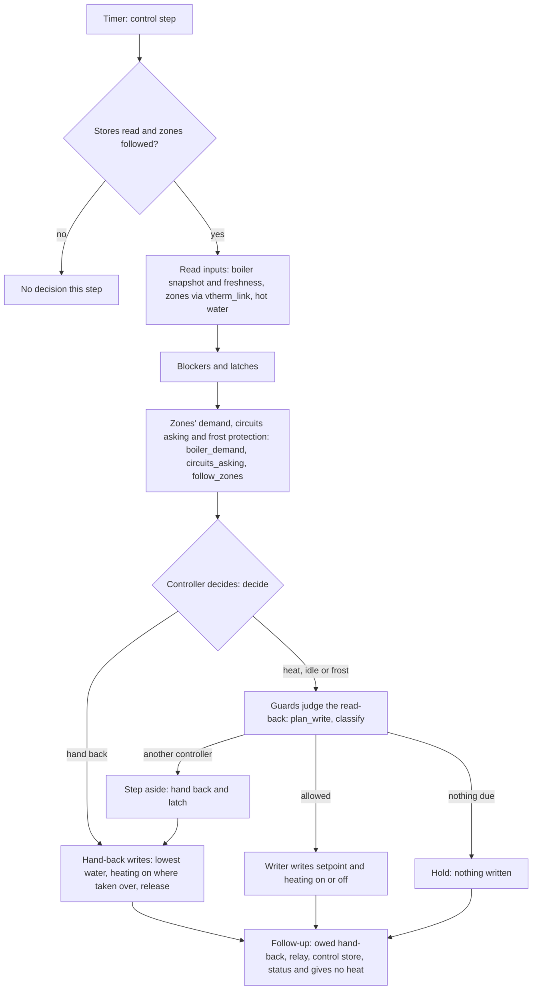

[Polska wersja](../../pl/technical/technical.md)

# Smart Boiler for Versatile Thermostat — technical documentation

Status: current.

> **In development, not released.** The integration has not yet run on a real boiler.

This document describes how the integration is built: its parts, one control step, its
lifecycle, what it stores and how it is tested. What it does for the user is in the
[user guide](../user-guide/user-guide.md); every rule and decision is in [`docs/en/specification/scope.md`](../specification/scope.md).
Abbreviations: Home Assistant (HA), Versatile Thermostat (VT), OpenTherm Gateway (OTGW), Message
Queuing Telemetry Transport (MQTT).

## Contents

1. [Overview](#1-overview)
2. [Repository structure](#2-repository-structure)
3. [Component responsibilities](#3-component-responsibilities)
4. [One control step](#4-one-control-step)
5. [Lifecycle](#5-lifecycle)
6. [Persistent state](#6-persistent-state)
7. [Testing](#7-testing)

## 1. Overview

The integration (domain `vtherm_smart_boiler`) is a plugin of VT. It replaces VT's on/off
central boiler: it reads VT's zones, decides when the boiler heats and how warm its water is,
writes that to the boiler and hands the boiler back on every exit.

- **Pure logic in `core/`.** Every control and learning law, the monitor's analysis and the
  verdict are pure Python with no HA imports — a test parses the imports of `core/` to enforce
  it. The same core runs in the unit tests, in the simulator and in HA.
- **The HA side** around it gathers inputs from the entities the user picked, runs the core on
  timers and state changes, carries out its writes, and publishes sensors, binary sensors,
  switches, buttons and repair issues.
- **`vtherm_link.py` is the only door to zone data.** It reads each zone only through
  `vtherm_api` (the user's rule, 2026-11-24/25; I12.7). A zone is the thermostat VT handed to
  the plugin's feature manager whose declared `entity_id` matches. From the thermostat: the room
  temperature and when VT measured it, the target, the mode, whether the zone heats and its
  device is on, and why VT keeps it off (the window only). From its `entry_infos`: its type,
  cycle and devices, whether VT's central boiler counts it, the room's thermometer and window
  sensor, and VT's central boiler settings. From VT's calls on the manager: the zone counts as
  started from VT's first `refresh_state`, and its duty and valve opening are what VT's power
  hook last said VT applied. A zone whose thermostat VT has not handed over is not known; nothing
  of VT's climate entity stands in for it. The rooms' history is what it read, kept by the
  plugin itself (see [Persistent state](#6-persistent-state)); nothing of VT's climates goes into
  it. Still read from VT's climate entities for now: the zone picker, the zones' names, the
  reload repair and VT's central mode (until the rooms come from VT, step I12.11). It
  detects what is installed (VT and its version, `vtherm_api`) instead of assuming it; it reads
  nothing of SmartPI. No other module looks up a zone's state by entity name.
- **A feature manager registered with VT** (`feature_manager.py`, through `vtherm_api`'s
  `register_feature_manager`) is the channel VT hands each thermostat through. It keeps what VT
  tells it — its `refresh_state` and its power hook `async_on_underlying_power` — and publishes
  nothing on VT's thermostats: the water data it showed until I12.9 went, as nothing read it
  (the user's decision of 2026-11-25). It is registered only once VT is loaded; a thermostat
  already running is handed over only after VT's next reload, which the plugin never triggers
  itself — a repair issue names such zones, and until then they are not known.
- **"Gives no heat"** (`binary_sensor`, key `no_heat`; `core/boiler_call.py`): one house-wide
  signal, on while the boiler gives the rooms no heat now, with its reason — VT's central boiler
  not calling, its activation delay, hot water, a boiler fault, or the plugin unable to vouch for
  heat. Mapped from control's decision at each step; unavailable while control is off. The user
  picks it in SmartPI 1.0's "heating unavailable" setting, or uses it in an automation: the
  plugin pauses no zone's learning itself (I12.9).

Details: [`docs/en/specification/scope.md`, §2](../specification/scope.md#2-why-a-plugin) and
[§5](../specification/scope.md#5-hardware-circuits-and-zone-algorithms).

## 2. Repository structure

```text
custom_components/vtherm_smart_boiler/   the integration (HA side)
├── core/                                 pure logic, no HA imports
├── transport/                            reading the boiler's entities, and the writers
├── translations/                         en.json (the source) and other languages
└── frontend/                             the Boiler page and its cards as built, licenses, texts
frontend/                                 the Boiler page's source (TypeScript, Lit, Vite)
tests/                                    tests: core/, integration/, sim/, tools/, and the rest
sim/                                      the physics simulator and its test-only HA components
tools/                                    recorder history importer for offline analysis
devenv/                                   the test HA (Docker compose) for acceptance scenarios
scripts/                                  env.sh (runs every command inside the project), deploy
docs/                                     the documentation, one folder per language
├── en/                                   English, the default
│   ├── specification/                    what the plugin does (scope) and its interfaces
│   ├── user-guide/                       how to use it
│   ├── technical/                        how it is built (this document)
│   ├── development/                      the development plan; the plans and reviews (history)
│   └── testing/                          the test environment and the test reports
├── pl/                                   Polish: every current document, the same layout
└── images/                               pictures shared by every language
```

- `sim/custom_components/` holds `boiler_sim` (the simulated boiler, rooms and weather) and a
  stand-in `opentherm_gw`, both for tests only.
- `tools/import_history.py` turns a copy of an HA recorder database into the core's history,
  so the monitor's analysis can be checked on recorded data: the boiler's signals, the weather
  and the helper VT's central boiler switches — never VT's climates.
- The Boiler page ([`plan-0.2-i10.md`](../development/plans/plan-0.2-i10.md)):
  `frontend/` is its source; `npm run build` there writes the module the plugin serves into
  `custom_components/vtherm_smart_boiler/frontend/`, with the licenses of the packages bundled
  into it. Those files are committed, so HACS installs them; CI builds them again and fails where
  they differ. The page's texts live there too (`frontend/translations/`, English the source):
  the page reads them, and `panel.py` takes the sidebar title from them. What the plugin's
  entities already say — the alarms' and the signals' names, the verdict's reasons, where a
  building value comes from — the page takes from the plugin's own translations
  (`translations/`), which Home Assistant hands it in the user's language
  (`hass.loadBackendTranslation("entity", …)`), so each is written once. `panel.py` serves the
  files and puts the page in the sidebar through Home Assistant's `panel_custom`; the switch
  "Page in the sidebar" takes it away and puts it back. The page stays through a reload — taken
  away, it would throw a user on it off with an error; the start registers it again in one step
  — and goes with the entry disabled or removed, or that switch disabled (J4's F17). While the
  entry runs, `panel.py` also
  has Home Assistant load the same module on every page (`frontend.add_extra_js_url`, taken
  back at unload, an older address replaced after an update), so the overview's parts are in the
  card picker as four cards — status and tiles, schematic and rooms, the curve, the last 24 h —
  each the page's own part (`frontend/src/cards.ts`), with no settings: each finds the running
  entry through `vtherm_smart_boiler/installation`. Without Home Assistant's frontend running
  nothing is registered. Node.js comes from `scripts/bootstrap_node.sh` into `.tools/node/`.
  `websocket_api.py` holds what the page reads, five read-only WebSocket commands for any
  signed-in user, each answering from the running entry (else the error `not_running`):
  `vtherm_smart_boiler/installation` — the boiler, the circuits with their zones and emitters,
  the picked entity of every signal, the plugin's entities by key and the curve's settings;
  `vtherm_smart_boiler/curve` — the curve's points for the settings in use or for draft values,
  nothing saved, from `core/curve_view.py` (the curve at the room temperature in use, then the
  limits, as control decides it before the comfort correction, a circuit's need and the ramp),
  with the settings' own checks by their translation keys; `vtherm_smart_boiler/days` — the
  daily summaries in their stored form, with the last 12 weeks' gas per degree-day reckoned by
  `core/weekly.py` (a week whose gas is not known for every day has none, the monitor's rule),
  the energy signature fitted by `core/signature.py` — each day's heating gas per 24 h against
  its mean outdoor temperature, the days only watched and the days under control apart, each
  group's line through its heating days (colder than the heating threshold in use, with heating
  gas) by the building fit's rules (`core/building.py`: days, outdoor spread, more gas on colder
  days, R²), or why there is none, and the two compared in the middle of the temperatures both
  cover — and the gas meter's unit (none without a meter: the gas is then estimated in the unit
  of the boiler's gas figures); each day kept since I10.7 holds its heating starts hour by hour
  from its start (`hourly_starts`, 23 or 25 hours at a clock change), which the page places at
  their clock hours; days kept before have none and still read;
  `vtherm_smart_boiler/burns` — the burns of the monitor's
  last analysis as it classified them (heating, hot water, unknown), so the page draws the
  monitor's own; `vtherm_smart_boiler/journal` — the journal (see
  [Persistent state](#6-persistent-state)), from a moment on where one is given; and one write,
  for an administrator only:
  `vtherm_smart_boiler/curve/save` saves the curve's design point and, at the advanced level, its
  offset **through the plugin's own options flow** — its "Heating curve" form filled with the
  stored values and the changes, then "Save and finish" — so every check and the save with its
  reload are the settings' own; a refusal comes back by its field and translation key, and a save
  the settings would stop for (a confirmation, another section) is not made. Their schemas use
  `probatio`, as Home Assistant's own commands do since 2026.10. The tab "Status and alarms"
  forgets a measured building value with the plugin's own buttons (`button.press`), offered to an
  administrator only, after confirming.

## 3. Component responsibilities

**Setup (`__init__.py`).** Reads the entry's options into an `EntryConfig`, builds the
coordinator and the control unit, attaches the coordinator to the feature manager, and on
unload stops the control unit first (it hands back) and the coordinator last. HA is imported
inside functions only.

**Coordinator (`coordinator.py`, `SmartBoilerCoordinator`).** Follows the mapped entities,
keeps a rolling history and computes what the entities publish. A quick path runs on state
changes and every 30 seconds (readings, signal check, hot water, current alarms); the analysis
(`core/analysis.py`) runs every few minutes on a copy of the history, off the event loop. It
also owns the stores (see [Persistent state](#6-persistent-state)).

The history (`core/history.py`, `History`) has three sources. The boiler's signals, the weather,
the plugin's control state and the helper VT's central boiler switches come live from their
states and, after a start, from the recorder: the last 8 days (`HISTORY_DAYS`), and older days,
up to a year, only to build day summaries. The rooms come from the plugin's own reads through
`vtherm_api`, at every refresh (30 s) and every control step (10 s), changes only
(`ZoneSeries.record`), and from the rooms' store after a start — never from the recorder's
records of VT's climates (I12.7b). "Was the boiler called for heat" (`History.zone_demand`,
`zone_calling`) is the helper's state wherever it is known — VT's own decision, with its
thresholds — and the rooms only where it is not, or where no helper is set (monitoring only).
It tells heating burns from hot water (every day summary, the verdict, the building fit), the
pauses the hysteresis drift may judge, the short burns unstable ignition counts and the burns the
lowest water temperature's evidence takes. The rooms' own details — the mean target of the
report, the valve openings of that evidence — come from the rooms' store alone, so they start
from the installation.

**Monitor and analysis (`core/monitor.py`, `core/analysis.py`, `core/verdict.py`).** From the
history to burns, metrics, trend warnings, a report and the control verdict, always with its
reasons. `core/alarms.py` holds the monitor's alarms, with hysteresis so they do not flap.

**Control unit (`control.py`, `ControlUnit`).** The HA side of control: a control step every
few seconds, its writes through the writer, the hand-back on every exit, and the status the
entities show — "gives no heat" among them. It turns guard events and failures into
alarms. The writer exists only while control is switched on. An internal error hands back and
latches control.

**Control step (`core/loop.py`, `loop_step`).** One step: the controller's decision through the
write guards to what is written now. The same step drives the simulator and HA. A relay has a
step of its own (`core/relay.py`).

**Controller (`core/controller.py`, `decide`).** A state machine that turns what the plugin
knows into a boiler command, in a fixed order of precedence: control switched off; a latch or
an alarm set to hand back; a missing precondition (a blocker); the boiler link lost or stale; the
boiler's own fault; otherwise heating on or off from frost protection and the zones' demand, and
the water temperature from the curve (`core/curve.py`), limits and ramp.

**Demand (`core/demand.py`, `boiler_demand`).** What VT's central boiler decided, now the
plugin's job: devices or zones calling (VT's devices by default, as its central boiler counts
them), total power or valve opening, each zone counted only while VT reports it clearly; where
VT gives no device state, VT's own rule — a valve open at all, else a duty cycle above 0.

**Circuits run by other automation (`core/circuit_requests.py`, `circuits_asking`).** A circuit
whose mixer or pump something else drives asks for heat through its own entity or its zones; an
entity that cannot be read asks nothing and is named. While it asks, its need — an entity's
reading first, else the value entered — is a lower bound of the water, nothing added
(`core/limits.py`, `limit_flow`). A fixed valve sets none: the boiler follows its curve, the
valve standing open while the water is at or below its setting.

**Zone watch (`core/zone_watch.py`, `follow_zones`).** The recognition period after a start
(at most 10 minutes), each zone's grace period, and the case where every zone is unknown.

**Guards (`core/guards.py`, `plan_write`, `classify`).** What may actually be written, whatever
the controller asks for: nothing to the boiler's persistent memory, a write-rate guard, repeats
where a value expires. They judge the read-back and sort a change the plugin did not make into a
lost command, a value ignored from the start, a clipped value or another controller.

**Relay (`core/relay.py`).** An on/off boiler switched by a relay: what is written to it, what
its reported state means, and whether the boiler shows that it heats.

**Hand-back (`core/hand_back.py`).** The evidence of a hand-back: what shows a release, when a
steady third value means another controller holds a target, and when a two-valued target's
change is a lost command. The control unit writes the three parts and retries until confirmed.

**Writers (`transport/writers.py`).** The only code that changes the boiler: a writable entity,
the OTGW through HA's `opentherm_gw`, the OTGW firmware over MQTT, or a relay. Each writer knows
the services it may call (a test checks the list); a failed write raises `WriteError` and is
never assumed applied. Reading the boiler is in `transport/entities.py`, which writes nothing.

**Configuration (`config_flow.py`, `config.py`, `control_config.py`).** The setup and options
forms, and the control options as core objects with the blockers that keep control from
starting. Both flows are one menu of sections; control is five of its items, each one form —
the control device, the heating curve, the control behaviour, frost protection, the alarm
reactions (`CONTROL_ITEMS`) —, each shown where it applies and opened with the write path's
own checks (`_control_path`). A form shows itself again with the fields an answer reveals
(`entity_form_fields`, `relay_form_fields`); a value whose field is hidden is kept. Control reads its section with the connection's MQTT topics and the signals'
read-backs put in (`with_boiler_inputs`): each value is stored once. The zones are the
circuits': each circuit lists the VT zones it feeds and, of them, those with underfloor and
with convectors, and, of a zone it feeds only in part, its devices (`devices`, by zone — the
form resolves each device to its zone through `vtherm_link.zone_devices`); a zone may be in
two circuits only so. The zones' own section keeps only whether a zone's valves close when it
is off (`config._circuit_zones`). `repairs.py` holds the repair flows (for example confirming a hand-back done by hand).

## 4. One control step

A timer runs the control unit's step (`ControlUnit._async_step` in `control.py`). The pure part
is `loop_step` in `core/loop.py`, which calls `decide` in `core/controller.py` and then the
guards in `core/guards.py`.



- **Freshness:** nothing is written without fresh boiler data — on a relay, the relay's own
  state; the user's age limits belong to mapped signals and go with them. The link is judged
  over a window (lost once stale steps cover 5 minutes within 10; back after 60 seconds fresh).
- **Blockers and latches** come before demand: a latch, or an alarm set to hand back, hands
  back whatever the zones ask.
- **Decide:** heating on or off is decided at every step — the zones' demand, or a circuit run
  by other automation asking; the water temperature every decision interval (5 minutes by
  default), and at once after a blocker or fault ends or when a circuit's need changes: the
  curve, never below an asking circuit's need, capped by
  the circuits fed straight from the boiler and the boiler's maximum. With several circuits the
  curve's room and the comfort correction read the zones of the circuit fed straight.
- **Guards** see the read-back of every write; a hand-back is never held back by a guard.
- **Follow-up:** an owed hand-back is retried every minute until confirmed; the control state is
  saved at once when it moves (see [Persistent state](#6-persistent-state)).

Details: [`docs/en/specification/scope.md`, §7](../specification/scope.md#7-features-by-stage).

## 5. Lifecycle

**Setup.** `async_setup_entry` reads the options; a control section that cannot be used leaves
control out, not the whole entry, so the monitor keeps running and a hand-back still owed goes
out. The coordinator reads its stores; the control unit reads the control state cautiously (see
below) and, before anything else can fail, makes one attempt at a hand-back the last run left
owed (a failure stays owed and is retried by the clock). Then the coordinator and the control
unit start, the control unit registers its shutdown job, and the coordinator is attached to the
feature manager.

**Recognition period.** After HA starts or VT reloads, the zones report one by one. The
controller takes no new decision until every zone has reported, for at most 10 minutes. A
command held before the restart is kept or restored at once if nothing forbids it; otherwise the
boiler is handed back first. VT may show a thermostat it has not started as "off"; that is never
read as "no demand".

**Reload.** Saving the options reloads the integration: while control holds the boiler, it is
handed back and taken again (a relay goes to its rest state and back).

**HA stop.** The hand-back runs in a shutdown job (`hass.async_add_shutdown_job`), which HA runs
before its stop event. All shutdown jobs share one 20-second limit, after which HA cancels those
still running; the hand-back is built to end within it. A hand-back not confirmed by then stays
owed in the control store and is retried at the next start.

**Unload.** `async_unload_entry` stops the control unit first (it hands back), detaches the
feature manager, unloads the platforms and stops the coordinator last.

**Removal.** If a hand-back is still owed when the entry is removed, it can no longer be retried:
a repair issue that outlives the entry tells the user to hand back by hand.

## 6. Persistent state

Control has a store of its own (`ControlStore` in `coordinator.py`), apart from the entry's main
store, which holds the monitor's small data and day summaries.

- **What it holds:** whether control is enabled, the last command and whether the plugin is
  controlling, latches and their causes, a hand-back owed and its release evidence, the
  baselines the guards compare against, the relay's observations, and the active
  control alarms.
- **Written at once:** every change that a crash must not lose — the controlling marker, a
  latch, an owed hand-back — is saved immediately and atomically. The outcome of each write is
  noted; a write that failed raises a repair issue (full disk or read-only storage).
- **Read cautiously** (`async_read_control_state`): when the store cannot be read (missing,
  damaged or of another shape) and the options hold a control section, a hand-back counts as
  owed and the boiler as held, so the plugin hands back to be safe.

**The journal** (`journal.py`, its rules in `core/journal.py`) has a store of its own too,
`<domain>.<entry_id>.journal`, so the entry's main store and its version stay as they are. It
keeps what the plugin decided and why, for the Boiler page: the plugin's starts and stops,
control taking the boiler and handing it back, the heat call on and off, the water setpoint
written — its first value, then each change of at least 1 K from the value last journaled — a
circuit's need holding the water, an alarm raised (or its level raised) and cleared, and each
settings save, from the page (naming what it changed) or from the settings (naming the sections
that changed); each with the reasons control gave. It only watches — it listens to control's
state and the monitor's updates and changes nothing; a failure in it is logged once. The first
look after a start journals control taking the boiler again — a restart's or a reload's
takeover, with the heat call, the water and a circuit's need — and the stop journals the stop's
own hand-back, made by control just before, unless it is still owed (J4's F18); the alarms
already raised are the start's baseline; an alarm that cannot be judged stays as it was. Kept 14 days and 2,000 entries at most, the oldest dropped
first (provisional, K4); written a minute after a change, at once when the entry unloads, and by
Home Assistant at its stop; a store that cannot be read starts an empty journal. It goes with
the entry's other stores when the entry is removed.

**The rooms' history** (`rooms_store` in `coordinator.py`, its format in `core/history.py`) has
a store of its own too, `<domain>.<entry_id>.rooms`: each room's temperature, target, mode,
call, duty and valve opening as the plugin read them through `vtherm_api` over the last 8 days.
Each series is one line of text — moments in whole seconds, each after the first as the seconds
since the one before; values to three decimals — as Home Assistant writes its stores indented.
It keeps the newest 10,000 samples of a series at most, so a value that flaps cannot grow the
file without end. Written half an hour after a change (about 48 writes a day at most) and at a
clean stop; read back at the start, for the rooms configured now, unknown from its last write
until the rooms are read again — a crash loses what came since. A series that cannot be read is
left out; a store without the moment of its write is ignored. Nothing is written to it before
it was read. It goes with the entry's other stores when the entry is removed.

## 7. Testing

Three layers ([`docs/en/development/plan.md`, "Test environment"](../development/plan.md#test-environment)):

1. **Core tests** (`tests/core/`) — plain pytest, no HA, no network.
2. **Integration tests** — `pytest-homeassistant-custom-component`: HA runs inside the test
   process; no instance, no network. Continuous integration (CI) also fetches VT 10.6.5 from its
   tag, so the tests with a real VT run on every change. It fetches SmartPI 0.4.0 too, only for
   the test HA's deploy: the plugin reads nothing of SmartPI.
3. **Test HA** — a dedicated container (`devenv/`) running the plugin, VT, SmartPI and the
   simulator, where the acceptance scenarios run before anything reaches a real boiler.

**The simulator** (`sim/simulator.py`, with `sim/custom_components/boiler_sim`) models the
boiler, rooms and weather. A scenario sets the plant, the weather, hot-water draws and the zone
valves, and can call a controller every control period; commands reach the simulated boiler as
through a gateway. Control is tested only against the simulator.

**Running the checks**, as [`CONTRIBUTING.md`](../../../CONTRIBUTING.md) says, each through
`scripts/env.sh`:

```sh
scripts/env.sh python -m pytest -q -p no:homeassistant --disable-socket --allow-unix-socket \
    tests/core
scripts/env.sh python -m pytest -q --ignore=tests/core
scripts/env.sh ruff check .
scripts/env.sh ruff format --check .
scripts/env.sh mypy
```

The Boiler page, in `frontend/`: `../scripts/env.sh npm test` and `../scripts/env.sh npm run build`
(types checked first); commit the built files. `../scripts/env.sh npm run screenshots` draws the
built page on sample data (`frontend/preview/index.html`) in a headless Chromium — light and
dark, a desktop and a phone, an administrator and a user who is not — into `.tmp/screenshots/`,
and fails on any error in the page; `scripts/bootstrap_browser.sh` puts that Chromium, and the
system libraries it needs, into `.tools/`.

