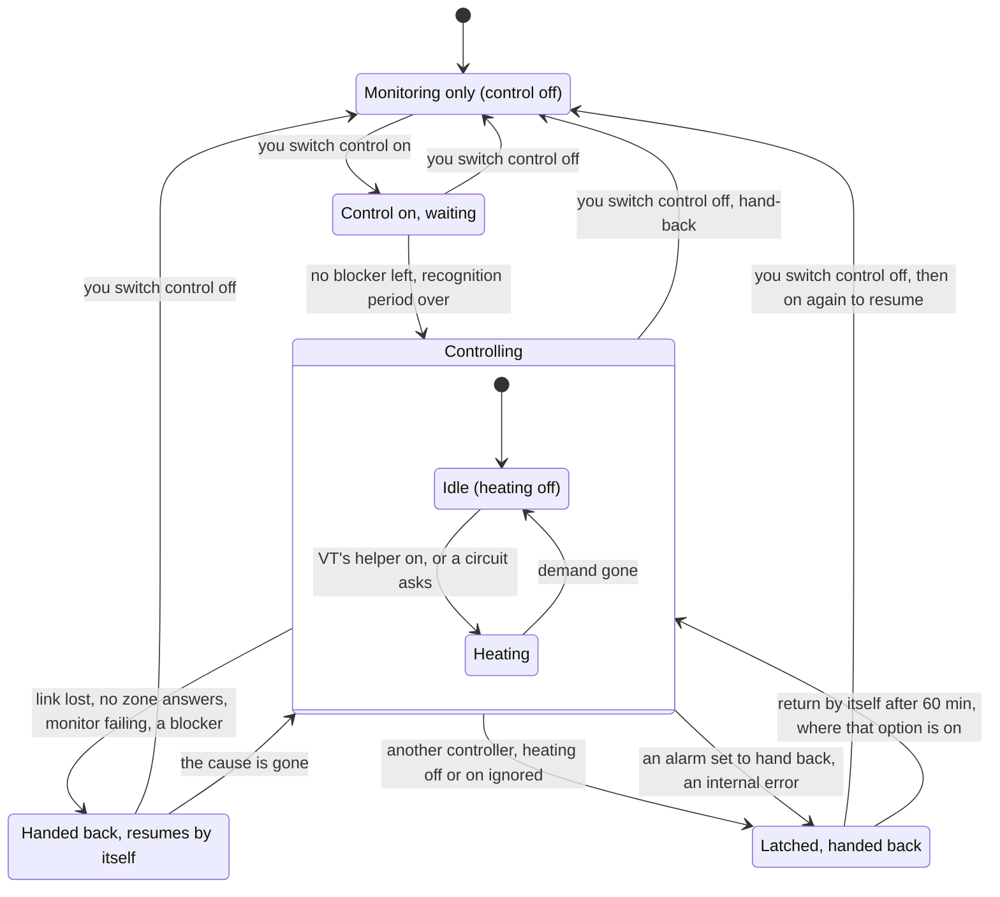

[Polska wersja](../../pl/user-guide/user-guide.md)

# Smart Boiler for Versatile Thermostat — user guide

Status: current.

> **In development, not released.** The integration has not yet run on a real boiler. There is
> no release and no entry in the Home Assistant Community Store (HACS). Do not install it on a
> heating system you rely on.

Smart Boiler for Versatile Thermostat is a plugin (not part of VT and not made by its authors) for
Versatile Thermostat (VT), a Home Assistant integration that runs the rooms of a house. VT decides
how much heat each room needs. This plugin watches a central heating boiler (gas, oil, electric or
another fuel; not a heat pump) and, once you switch control on, decides when the boiler heats and
how warm its water is. It does not control rooms or valves.

This guide is a summary. The specification, with every rule and decision, is
[`docs/en/specification/scope.md`](../specification/scope.md). Where the two differ, `docs/en/specification/scope.md` and the texts in the
integration's own forms are the reference. Some values in the specification are still marked
"provisional": they may change before the first release. How the plugin is built is described in
the [technical documentation](../technical/technical.md).

## Contents

1. [Prerequisites](#1-prerequisites)
2. [Installation](#2-installation)
3. [Quick start](#3-quick-start)
4. [How it works](#4-how-it-works)
5. [Connecting the boiler](#5-connecting-the-boiler)
6. [Safety and hand-back](#6-safety-and-hand-back)
7. [Alarms and repair issues](#7-alarms-and-repair-issues)
8. [State diagram of control](#8-state-diagram-of-control)
9. [Entities](#9-entities)
10. [How often data updates](#10-how-often-data-updates)
11. [What stays local](#11-what-stays-local)
12. [Options and risks](#12-options-and-risks)
13. [Automation examples](#13-automation-examples)
14. [Troubleshooting](#14-troubleshooting)
15. [Known limitations](#15-known-limitations)
16. [Removal](#16-removal)

## 1. Prerequisites

- **Home Assistant 2026.10.4 or later** — the newest Versatile Thermostat (10.6.5) needs it, and
  the plugin is tested on it.
- **Versatile Thermostat 10.6.5 or later**, with its thermostats (the plugin calls them zones)
  set up for the rooms this boiler heats. With an older VT the plugin does not control the
  boiler and asks you to update VT. VT 10.6.5 shows itself as 10.6.4 in Home Assistant, which
  the plugin accepts. VT 10.6.5 itself needs Home Assistant 2026.10.4 and `vtherm_api` 0.9.0.
- The `vtherm_api` library, 0.9.0 or later. Home Assistant installs it with VT and the plugin.
- **A boiler that Home Assistant can read**, through any integration that shows its signals as
  entities: for example the OpenTherm Gateway (OTGW), EMS-ESP or an ESPHome OpenTherm controller.
  A boiler with only on/off room-thermostat terminals can be monitored and switched by a relay.
- **The signals mapped.** You pick the entity that provides each signal; none is required for
  monitoring. Flame and flow temperature enable the burner's metrics and the boiler link, and
  control of the water temperature needs both. Every other signal (return temperature, water
  pressure, modulation, outdoor temperature, a gas meter and others) enables more of the monitor.
- **For control:** a way to write to the boiler and to hand it back (see
  [Connecting the boiler](#5-connecting-the-boiler)), and VT's central boiler set up to switch a
  helper the plugin follows (see [When heating goes on and off](#43-when-heating-goes-on-and-off)).

SmartPI and VT's Auto-TPI (VT's self-learning time-proportional algorithm) are optional; the
plugin works with any VT zone algorithm.

**What VT's thermostats show.** Nothing from the plugin. To keep a zone algorithm from learning
while the boiler gives no heat, the plugin has one sensor, **Gives no heat** (see
[Beside VT's zone algorithms](#411-beside-vts-zone-algorithms)).

## 2. Installation

There is **no release yet**, so the integration cannot be installed through HACS today.

Once there is a release, it will install through HACS as a custom repository:

1. In HACS, open the menu → **Custom repositories**, add
   `https://github.com/Shadow-230/vtherm-smart-boiler` with the type **Integration**.
2. Find **Smart Boiler for Versatile Thermostat** in HACS and download it.
3. Restart Home Assistant.

**Manual installation** (once there is a release): copy the folder
`custom_components/vtherm_smart_boiler/` from the release into the `custom_components/` folder
of your Home Assistant configuration, then restart Home Assistant.

Only one entry of the integration can exist: it runs one boiler.

## 3. Quick start

1. **Prepare VT.** Set up VT's thermostats for the rooms. For control, create an on/off helper
   (Settings → Devices & services → Helpers → Toggle) and set up VT's central boiler in VT's
   central configuration: its thresholds and activation delay, and its two commands on the helper
   (`input_boolean.your_helper/input_boolean.turn_on` and `…/input_boolean.turn_off`). Never point
   VT's commands at the boiler itself: two controllers must never drive the same boiler.
   Monitoring works without this; control waits for it.
2. **Create the entry.** Settings → Devices & services → Add integration → **Smart Boiler for
   Versatile Thermostat**. The first panels ask how the boiler is connected, its heat source and
   type, and the control mode — full control, on/off or monitoring only. Nothing is chosen for
   you and nothing is switched on. Then pick a name and the level of detail; the level changes
   only what you see.
3. **Go through the menu.** Each section is one form; confirming it brings you back to the menu,
   and nothing is created yet. A section that does not apply is not shown. **Configuration
   incomplete** opens the next section to confirm, or one with a problem; **Create** appears once
   every section shown is confirmed. Closing the window discards the setup.
   - **Boiler interface** — only where your connection needs it: the MQTT topics, the gateway,
     how the gateway sits between thermostat and boiler, the restart indicator.
   - **Boiler signals** — the entity for each signal you have; at least flame and flow for
     control. With control of the water temperature, also the read-backs: the heating setpoint
     the boiler received (required) and the heating on/off read-back.
   - **Boiler** — what you know about it; leave unknown values empty.
   - **Circuit: <name>** — one item per heating circuit (up to four at the advanced level): its
     type, the VT zones it feeds and which of them have underfloor heating or convectors, its
     highest water temperature. A zone in no circuit is neither watched nor asked for heat.
   - **VT zones** — whose valves close while VT has the zone off.
   - **Building** and **Monitor thresholds** — at the advanced level, for the monitor only;
     **Days of data for the verdict** is there (7 by default).
   - **Control items** — with full control or on/off: the control device, the heating curve, the
     control behaviour and the alarm reactions (see
     [Control is opt-in](#42-control-is-opt-in)).
4. **Read the verdict.** Once it has the days of data, the sensor **Control verdict** says whether
   control is worth enabling ([4.1](#41-monitoring-and-the-verdict)). You decide.
5. **Switch control on** in the integration's options: **Control mode**, tick **Control on**,
   then **Save and finish** — on the first day or later. Only an administrator opens the options.
   If something is missing, a window says what, nothing changes, and the monitor keeps running.
   Untick it to switch control off: the boiler is handed back at once. Until you switch it on, the
   plugin writes nothing to the boiler. An automation switches control with the action
   `vtherm_smart_boiler.set_control` (`enabled`: on or off), with the same checks; called by a
   person — from a dashboard, a script you start, the developer tools — it is refused. An
   automation started by hand ("Run") carries no person either, so anyone who may run such an
   automation switches control with it: give one only to people who may switch control. The
   entity **Control (experimental)** of the integration's device shows whether control is on; it
   switches nothing.

**Changing settings later.** The integration's options open the same menu, with **Save and
finish** in place of **Create**. Nothing is saved until you choose it: it checks everything,
saves, and reloads the integration once — while control holds the boiler, it is handed back and
taken again. Changing only the level reloads nothing. The menu names the sections you changed;
closing the window discards them. A problem found at the save opens its section with the reason.
A change that would stop control asks first.

## 4. How it works

The details of every rule are in the specification:
[`docs/en/specification/scope.md`, §7](../specification/scope.md#7-features-by-stage) and
[§10](../specification/scope.md#10-assess-alongside-control).

### 4.1 Monitoring and the verdict

After you add the integration, it only watches the boiler. It writes nothing, and the boiler runs
as it did before — under Versatile Thermostat's central boiler, a wall thermostat or its own
regulation — until you switch control on, which you may do from the first day. It records, for
example:

- burns and how long they last, and how often the boiler starts;
- how much of the time the boiler condenses (if you map the signals it needs);
- hot-water draws, and gas per degree-day (measured with a gas meter you map, else estimated);
- problems with the signals it reads.

The verdict needs **7 days of data** by default. You may ask for more (up to 60 days), but not
fewer. They count calendar days from the day you created the entry.

**Where the past comes from.** The boiler's signals are read back from Home Assistant's recorder:
the last 8 days, and older days as far back as the recorder reaches, up to a year. Whether the boiler was called for heat — which tells a heating burn from a hot
water draw — comes from the helper VT's central boiler switches: on means VT called for heat. Its
recorder history counts too, so this works for the days before you installed the plugin. The
rooms' details — temperatures, targets, which rooms call, valve openings — are the plugin's own:
it notes them every time it reads the rooms and keeps the last 8 days in its own storage. It does
not read them back from VT's thermostats in the recorder, so analyses that need room details
start from the installation. Without a helper (monitoring only), whether the boiler was called
also comes from the rooms the plugin noted.

Then the sensor **Control verdict** shows one of:

| Verdict | Meaning |
|---|---|
| Worth enabling | the plugin saw problems that its control changes, for example short burns |
| Not worth enabling | enough was measured, and control would change little |
| Not enough data yet | too little was measured to judge |

The verdict is advice. You decide. Before it comes, and outside the heating season when the days
pass without enough data, **Control (experimental)** says that control starts without a verdict.

What the verdict and the building values mean:

- **Short burns** most often come from a boiler too big for the house: its lowest output is more
  than the house needs, so it starts and stops. The verdict says so when the building's load is
  often below the boiler's minimum power.
- **The building's heat loss**, measured from the boiler's use and the weather, counts only after
  about **3 weeks of heating** (21 heating days); before that it is shown, never used. It is
  shown with a likely range of about ±20 % — the accuracy published methods reach. A measured
  loss below the design load is common: it means the boiler is oversized, not that the
  measurement is wrong.
- **Use against yesterday** compares two days; a day's use moves a lot on its own (the building
  still warm or cold from yesterday, sun, people). When the part no cause explains stays within
  15 % of the day before, it is marked as normal variation.

### 4.2 Control is opt-in

Control is **off by default**. You switch it on in the integration's options (**Control mode**,
**Control on**, then **Save and finish**); the entity **Control (experimental)** shows whether it
is on. You can switch it on from the first day, once every required setting is filled in, for
example:

- the control mode "full control" or "on/off" (monitoring only keeps control off, and
  **Control (experimental)** says so);
- a way to write to the boiler and a way to hand it back (see
  [Connecting the boiler](#5-connecting-the-boiler)), fitting the boiler's connection;
- the heating curve's design flow temperature (it has no default);
- at most one heating circuit fed straight from the boiler; beside it, circuits behind a fixed
  thermostatic mixing valve or controlled by other automation. A circuit the boiler mixes itself
  (a second heating circuit of the boiler) is not controlled yet;
- VT's central boiler set up with its two commands on an on/off helper, and that helper picked in
  **Control behaviour** (see [When heating goes on and off](#43-when-heating-goes-on-and-off)).

When something is missing, **Control (experimental)** says what. The monitor keeps running, and the
boiler stays with its own control or its thermostat.

### 4.3 When heating goes on and off

Versatile Thermostat's central boiler decides whether the boiler heats. Set it up in VT's central
configuration, as VT's documentation describes: its thresholds (how many devices call, or how much
power), its activation delay, and its two commands on an on/off helper (`input_boolean`) you
create — never on the boiler itself. Then pick that helper in the plugin's **Control behaviour**.
The plugin follows the helper: on, the boiler heats; off, it does not. It adds the water
temperature and its safety rules.

- The plugin checks every 10 seconds, and at once when the helper changes, in both directions.
- Control is blocked without the helper, while VT's central boiler is not set up (ticked, with
  both commands), and while its commands switch anything but the helper; a repair issue then names
  what they switch. If VT switches your boiler's relay today, pick that relay in the plugin (the
  relay path) and point VT's commands at the helper.
- VT counts only the rooms marked "used by the central boiler" in VT: mark every room that should
  call the boiler.
- If the helper is neither on nor off, nothing can ask for heat (see
  [After a restart](#47-after-a-restart)).
- The plugin counts the rooms that call, for display. Where VT gives no device state, a room calls
  with its valve open at all, or, without a valve, with its duty cycle above 0 — VT's own rule.
- A zone counts only once VT has handed its thermostat to the plugin and started it. The plugin
  reads the room only from VT's thermostat, never from what VT's climate entity shows. A room
  whose thermostat was already running when the plugin was installed is handed over only when VT
  reloads; until then it is "unknown", as is a room VT has not started yet — never "no demand".
- VT's central mode (Auto, Stopped, Heat only, Cool only, Frost protection) acts through the
  zones. With every zone stopped, nothing calls for heat, so the boiler stays off. "Stopped" in
  VT does not hand the boiler back, and it means nobody heats: frost protection is VT's (see
  [Frost protection](#45-frost-protection)).
- There is no summer switch in the plugin. If VT's zones are off, the boiler does not heat.
- **VT's cycle for rooms that call the boiler: 10 to 15 minutes.** VT switches a room's heating
  on and off in cycles (5 minutes by default). The plugin follows the rooms at once, so each gap
  between their pulses stops the burner. Gas boilers are usually given 6 cycles an hour at most;
  in the simulation a 10–15 minute cycle cut the boiler's starts by a third to a half in mild
  weather, with the rooms as warm. While control is set up, the plugin names the rooms VT
  switches in cycles under 10 minutes ("Short cycles in VT").
- A circuit controlled by other automation asks for heat while its **Circuit asks for heat**
  entity is on, or one of its zones calls: heating goes on for it, whatever VT's central boiler
  says — its mixer needs the water. If that entity is unavailable or unknown, the
  circuit asks nothing (its zones still can), and the
  control state shows the reason `circuit_request_unknown`.
- **What the plugin shows** (with control set up):
  - **Heat call** — on while the plugin calls the boiler for heat (VT's frost protection
    included, as VT calls for it); off while it controls the boiler and does not call it, with the reason: nothing
    calls, rooms call but VT's central boiler does not, VT's central boiler waits its activation
    delay, the boiler reports a fault; unknown while it does not control the boiler (control off,
    blocked, handed back) or cannot tell yet. Its attributes show the rooms calling and when VT's
    activation delay ends.
  - **Calling for heat** — the rooms calling now, and which.
  - The event `vtherm_smart_boiler_boiler_call`, fired when the call changes and when VT's
    central boiler begins to wait its activation delay, for your automations (`boiler_called`,
    `call_reason`, `activation_at`).

### 4.4 The water temperature

While heating is on, the plugin sets the boiler's water (flow) temperature:

1. **The heating curve** — you enter it: its point at the hardest frost — the outdoor
   temperature (default −15 °C) and the flow temperature needed there (required, no default) —
   and an optional offset. The curve gives a water temperature for each outdoor temperature.
   The outdoor temperature at the hardest frost is the one your heating was designed for: it is
   in the heating design, if there is one; otherwise the design outdoor temperature the national
   heating standard gives for your place, or the frost of the few coldest days of a year there.
   **The curve's room temperature** (advanced level): **Auto** (default) follows the highest
   setpoint among the zones that heat now — the warmest room you keep — at most 23 °C, and with
   VT's presets (eco at night lowers it); you can leave rooms out (a bathroom kept warmer).
   **Manual** keeps the value you enter: the setpoint of your warmest room. Too low leaves rooms
   cold in mild weather. An entry set up before this version runs Manual with its value. The
   control state shows the room temperature in use (`curve_room`).
   With a curve, the building's design load is read at this same temperature. The **Heating
   curve** item also shows the highest water temperature of the circuits fed straight from the
   boiler and the boiler's maximum heating setpoint — the lower applies. With several circuits,
   the curve serves the one fed straight from the boiler, and its room temperature (Auto) and
   the comfort correction read that circuit's zones.
2. **Lowest water temperature** — the curve never goes below it. Default 20 °C (provisional).
   Too low, and the boiler may stop by itself again and again in mild weather; a boiler that does
   not condense may condense in its flue. Take the value from the boiler's manual. The monitor
   may suggest a higher value if it sees many short burns; nothing changes by itself.
3. **What other circuits need** — while it asks, the water never goes below the need of a
   circuit controlled by other automation; nothing is added to it. A fixed valve sets no lower
   bound: the boiler follows its curve, and the valve stands open while the water is at or below
   its setting. The control state shows the reason `limit_circuit_need` when a need holds the
   water.
4. **Highest water temperature** — the circuit's, in its form (**Circuit: <name>**): never
   above it, whatever the curve, the comfort correction or another circuit asks; 70 °C where it
   is empty. Only the circuits fed straight from the boiler cap the water; one behind a mixer or
   a fixed valve is guarded by them, and its own too-hot alarm tells. Needed for underfloor
   heating on an unmixed loop. Above the curve only the comfort correction raises
   the water, up to its own limit (default 3 K). The boiler itself may overshoot it a little; an
   alarm tells you when the measured flow stays too high — on a circuit fed straight from the
   boiler, not while hot water is heated: the circuit gets none of that water. (Before, the curve had a highest water
   temperature of its own; an update keeps the lower of it and the circuit's.)

The water temperature changes slowly (the ramp, default 1 K per minute). It is re-decided every
5 minutes by default (the decision interval).

If the outdoor temperature is lost, the plugin uses the weather entity, then keeps the last
known value for 3 hours, then uses your fallback setpoint or the curve's design point. A failed
outdoor sensor never means zero heat.

**Comfort correction** — **off by default** (an entry keeps what it stored). Switched on: when a
room stays short of its setpoint with its valve fully
open, the water rises slowly above the curve, up to its limit: 3 K by default, up to 10 K, set
in **Heating curve** beside the correction; never more than 3 K a day. "Short" means 0.3 K or
more below VT's setpoint, whatever the zone's algorithm. It does not rise while the boiler starts
more often than before. One room short counts like
any other — the water never goes higher for one room's sake. After three hours as high as it may
go — at its limit, or once it has risen 3 K within a day — with a room still short, the correction
holds there, and a repair issue names the room and the
possible causes: the curve too low, the room's radiator too small, or the room losing heat. What
it costs: more gas, and more burner starts — with VT's TPI zones it often sits at its limit and
raises the starts several times over for almost no warmth. That is why it is off: where a room
stays cold, raise the curve first. A "Reset comfort correction" button sets it back to zero.

**Which rooms judge the curve.** A room's temperature counts for the comfort correction, its
warning "curve too low", the long burn's "water too cool" and the critical zone only while the
plugin can trust it. It is left out while VT runs that thermostat in its safety mode, while the
room's thermometer (the sensor set in VT) is unavailable or unknown, and after the plugin starts
until VT has measured the room again. The room still counts when it calls for heat. **Control
state** lists such rooms in its attribute `room_sensor_lost_zones`; no alarm rises for them.

### 4.5 Frost protection

Frost protection is VT's job; the plugin has none of its own. Use VT's frost preset on a
thermostat, or VT's central mode "Frost protection": VT then makes a cold room call, its central
boiler turns the helper on, and the plugin heats as for any other call. So keep VT's central
boiler on the helper. "Stopped" in VT means nobody heats, a cold room included. While control
does not hold the boiler and nothing else heats, the alarm "handed back while a room is near
freezing" tells you of a room below 5 °C ([Safety and hand-back](#6-safety-and-hand-back)).

### 4.6 VT's activation delay

VT's activation delay is set in VT's central boiler (0 to 600 seconds). It is for slow valves
(for example thermoelectric heads on underfloor heating), so they open before the boiler and its
pump start. The plugin has no delay of its own.

- While VT waits it out, the plugin shows "off" with the reason `activation_delay` and when the
  delay ends. The boiler starts when VT turns the helper on.

### 4.7 After a restart

**Recognition period.** After Home Assistant starts or VT reloads, the plugin waits until every
zone has reported, for at most 10 minutes. It takes no new decision meanwhile. If it was
controlling the boiler before the restart, and nothing has changed that forbids it, it keeps or
restores its last command at once. If something has changed, it hands
the boiler back first.

**Grace period.** If a zone becomes unknown while VT runs, its last answer is kept for 10
minutes. After that it drops out and the other zones decide. **Control state** lists the zones
it cannot see in its attribute `unknown_zones`.

**No zone answers.** If every zone is unknown after these periods, or VT's helper is neither on nor
off, nothing can ask for heat:

| Your installation | What happens |
|---|---|
| A working thermostat or room controller (see below) | the boiler is handed back to it |
| No working thermostat | the plugin keeps heating off; it does **not** hand back |

In both cases an alarm ("Control: no zone answers", or "Control: VT's decision unknown") and a
repair issue appear. Control resumes by itself when a zone, or the helper, answers again.

A **working thermostat** is one of:

- an OpenTherm thermostat wired to the gateway's thermostat terminals;
- on an entity path, the tick "The boiler has its own room controller";
- on a relay, that tick together with the relay's state after hand-back set to "on".

**A thermostat VT has not started** counts as unknown, even after the recognition period. VT may
show such a thermostat as "off" until it starts. The plugin does not read that "off" as "no
demand".

### 4.8 Hot water

The boiler type says whether the boiler heats hot water: single-function without hot water,
single-function with a tank, combi (instantaneous hot water) or combi with a built-in tank. For
every boiler that heats hot water the panels ask whether **hot water has priority**:

- **With priority** (default) — while the boiler heats hot water, the rooms get no heat. This is
  usual for a combi and for a tank charged through a three-way valve. **Gives no heat** is then
  on during the draw, with the reason "hot water".
- **Without priority** — hot water and heating run together (a tank charged in parallel, a
  buffer, a combi that shares its heat). Hot water then does not count as heat the rooms miss.

With the wrong answer, **Gives no heat** is wrong during hot water: a zone algorithm that reads it
pauses its learning for nothing, or learns from draws that took the rooms' heat. How burns are
told apart as heating or hot water does not depend on it.

### 4.9 Open windows

Open windows are VT's to handle. VT's own window detection — a window sensor, or its automatic
detection by the temperature's slope — turns the zone off or lowers its setpoint; such a zone no
longer asks for heat. The plugin has no window handling of its own; it only keeps a room with an
open window out of its critical zone ([Entities](#9-entities)).

### 4.10 Circuits and zones

A circuit is the part of the heating fed one way, picked as its **Circuit type**:

- **Straight from the boiler** — the curve's circuit; at most one is controlled.
- **Thermostatic mixing valve (fixed)** — its setting is asked: it tells the zones what water
  they get. The boiler follows its curve; the valve stands open while the water is at or below
  its setting.
- **Controlled by other automation** — a mixer or a pump that something else runs; the plugin
  never drives it. It may name an entity that is on while it wants heat (**Circuit asks for
  heat**) and the water it needs (a value, or an entity whose reading comes first); while it
  asks, the water stays at that need at least, nothing added. A need is for a load that wants
  water hotter than the curve whatever the weather — a fan heater, a ventilation coil, a tank.
  Leave it empty for underfloor heating behind a mixer: the curve is enough, and a need there
  raises the boiler at every call of its zones (the form warns once).
- **Mixed through the boiler** (a second heating circuit of the boiler) — not controlled yet.

Each circuit lists the VT zones it feeds, and of them those with underfloor heating or
convectors; the rest are radiators. A room fed by two circuits — a radiator on one, a floor loop
on the other — goes into each by its own devices (**Single devices of a zone**, advanced level);
it stays one zone, watched and counted once. A zone in no circuit is neither watched nor asked
for heat.

### 4.11 Beside VT's zone algorithms

The plugin reads VT's zones and never changes their settings or algorithms, nor pauses their
learning.

The heating curve already raises the water temperature as it gets colder outside. Some zone
algorithms count the outdoor temperature as well, so the weather then acts twice:

- **TPI** (VT's time-proportional algorithm) adds `tpi_coef_ext` × (target − outdoor) to each
  zone's heating time. With the plugin's curve, colder weather brings both warmer water and longer
  heating times. The term is VT's setting, per zone; the plugin does not change it.
- **SmartPI** (0.4.0) learns an outdoor term of its own (`u_ff1`, a learned factor ×
  (target − outdoor)). It cannot be set or switched off; it learns with the water the plugin
  sends.

How a zone behaves with both depends on its room and its algorithm; the plugin describes this and
gives no advice on these settings.

#### Gives no heat

With control set up, the binary sensor **Gives no heat** (`binary_sensor.boiler_gives_no_heat`
for an entry named "Boiler") is on while the boiler gives the rooms no heat now, and off while it
does, as far as the plugin drives it. Its attribute `reason` says why it is on:

- **VT's central boiler does not call for heat** (`vt_not_calling`) — control works, but VT's
  helper is off: no room calls, or VT's thresholds are not reached;
- **VT's activation delay runs** (`activation_delay`);
- **The boiler heats hot water** (`hot_water`) — only with hot water priority;
- **The boiler reports a fault** (`boiler_fault`);
- **The plugin cannot vouch for heat** (`handed_back`) — it handed the boiler back (an alarm, a
  lost boiler link), control is blocked, another controller has the boiler, or VT's decision is
  unknown.

It is unavailable while control is off: the plugin then does not drive the boiler and cannot
tell. While the plugin waits for data (a boiler link stale for a moment), it keeps its last
value. The plugin pauses no zone's learning itself; use the sensor as follows.

- **SmartPI 1.0:** pick the sensor in SmartPI's per-thermostat setting **Heating unavailable
  entity (optional)**, for each SmartPI thermostat. Nothing else to do: while it is on, SmartPI
  stops learning and holds its integral; only "on" counts, so "unavailable" lets it learn.
- **SmartPI 0.6.x** has no such setting. An automation can switch its learning off while the
  sensor is on, and back on otherwise, with SmartPI's own action
  `vtherm_smartpi.set_smartpi_learning` (field `learning_enabled`; checked in SmartPI 0.6.7). Put
  your SmartPI thermostats in `entity_id`. `to: null` reacts to on and off, not to a change of
  reason. It also switches learning back on that you switched off yourself.

  ```yaml
  automation:
    - alias: "SmartPI learns only while the boiler gives heat"
      triggers:
        - trigger: state
          entity_id: binary_sensor.boiler_gives_no_heat
          to: null
        - trigger: homeassistant
          event: start
      actions:
        - action: vtherm_smartpi.set_smartpi_learning
          target:
            entity_id:
              - climate.your_smartpi_thermostat
          data:
            learning_enabled: "{{ not is_state('binary_sensor.boiler_gives_no_heat', 'on') }}"
  ```

- **Auto-TPI** (VT 10.6.5): VT already skips Auto-TPI's learning while its central boiler is off,
  in thermostats marked "used by the central boiler" — so "VT not calling" and its activation
  delay need nothing. For hot water, a boiler fault or a hand-back VT offers no clean pause: its
  action `set_auto_tpi_mode` wipes what Auto-TPI learned by default and rewrites the thermostat's
  settings, so it is not a pause to automate.

**When a sensor goes quiet.** VT puts a zone into its safety mode when it gets no new value from
the room or outdoor sensor for its safety delay, 60 minutes by default, while the zone wants at
least half of the heating time. The zone then heats for only 10% of the time until a new value
arrives (VT's defaults). A healthy sensor that sends only changes can stay quiet that long when
the temperature is steady. If a zone keeps going into safety mode for this reason, set a longer
safety delay in that zone's advanced settings in VT, or give VT the sensor's `last_seen`
attribute, if it has one. With a longer delay, a sensor that really failed is noticed later. The
plugin does not change this setting. It keeps counting the zone's call for heat, does not rely on
its temperature, and lists it in the attribute `room_sensor_lost_zones` of **Control state**.

### 4.12 The Boiler page and cards

The plugin adds a page **Boiler** to Home Assistant's sidebar, for every user; the switch **Page
in the sidebar** on the plugin's device takes it away and puts it back. Everyone sees the page.
Only an administrator can change anything on it, and every change asks for confirmation first.

| Tab | What it shows |
|---|---|
| Overview | The status with its reasons and whether **Control** is on — an administrator gets **Change in settings**, which opens the plugin's page in Home Assistant's settings, where control is switched; its flame is filled while the burner burns, and outlined in the heating colour while the boiler is called for heat between burns. Tiles for the water the plugin asks, flow, return, outdoor, flame and the rooms calling. The installation drawn from the settings, with each circuit's rooms and whether they take heat. The heating curve with "where we are", the last 7 days' decisions and a preview of changes, drawn as boiler manuals draw it: warmer on the left, colder on the right. The last 24 h from the recorder: pick or play any moment, and the tiles, the schematic, the rooms and the curve show it |
| Burner | The burner's metrics; the monitor's burns of the last 24 h (heating, hot water, unknown); how long the heating burns lasted, the short ones marked |
| Use | Gas per degree-day and the degree-days; the last 12 weeks' gas per degree-day; the change against yesterday, cause by cause. A value not known says why |
| Analyses | The energy signature: each day's heating gas against its mean outdoor temperature, the days the plugin only watched and the days under control apart, each with its fitted line, and the two compared at the same temperature. The burner's heating starts by hour over the last 4 weeks |
| Journal | What the plugin decided and why, over the last 14 days. It shows its starts and stops, control taking the boiler and handing it back, the heat call, the water setpoint written (changes of 1 K or more), a circuit's need, the alarms and the settings saved. You see it as lanes that zoom by dragging across them, and as a list you can filter |
| Status and alarms | The control verdict with its reasons; every alarm, the active ones first, each opening its history; the signals' health; the building values with where they come from; the suggested lowest water temperature with its evidence |

**Changes from the page.** An administrator, after confirming:

- saves the heating curve's point at the hardest frost (and its offset, at the advanced level of
  the settings) **through the plugin's own settings**: every check they make applies, the plugin
  reloads as after any settings save, and the journal notes it. A save the settings would stop
  for (a confirmation, another section) is not made from the page: finish it in the settings;
- forgets a measured building value with the plugin's own reset buttons.

Control is not switched from the page: it is switched in the plugin's settings (**Control mode**,
**Control on**), where the page leads an administrator.

**What it shows, and what not.** The page shows only what the plugin and Home Assistant already
know. The curve's points, the burns, the weeks, the signature and the journal come from the
plugin, not from a second copy of its rules. A value whose entity is not picked in the settings
is not shown. An unknown value is a gap, never the last one carried on. The last 24 h and the
last 7 days come from Home Assistant's recorder (10 days by default). The page follows your
profile's language (English and Polish; other languages show English) and the light or dark
theme, and it works on a phone. Times follow your profile's time zone setting. The days the plugin
counts, and the starts by hour, are days in Home Assistant's time zone; where your profile's zone
differs, **Analyses** says so.

**Cards.** The overview's parts are also cards for your own dashboards: **Boiler: status**,
**Boiler: schematic**, **Boiler: heating curve** and **Boiler: last 24 h**. Add one as any card
(edit the dashboard, add a card, search for "Boiler"). They have no settings: each finds the
plugin by itself, and the same rules apply to changes. They are there while the plugin runs,
whether the page is in the sidebar or not. After an update, reload the browser page if a card
still shows the old version.

## 5. Connecting the boiler

The plugin reads the boiler through entities you pick in its forms. To control the boiler it
also needs a way to **write** to it — a "write path" — and a way to give the boiler back to its
own control — the **hand-back**.

Details: [`docs/en/specification/scope.md`, §5](../specification/scope.md#5-hardware-circuits-and-zone-algorithms) and
[Gateway topology](../specification/scope.md#gateway-topology). Each connection, field by field:
[Boiler connections](../specification/device-connections.md).

The first panel asks **how the boiler is connected**. The answer decides what the plugin can
write, how it hands the boiler back, and what the control device offers:

| Connection | What the plugin writes | "Heating off" | Hand-back | If Home Assistant stops |
|---|---|---|---|---|
| OpenTherm Gateway (integration) | the control setpoint, repeated every 30 s | the gateway's heating enable off | the safe hand-back | the gateway drops the setpoint within a minute: a thermostat on it takes over; without one, heating stops |
| OTGW firmware over MQTT | the same, as the firmware's MQTT commands | as above | as above | as above |
| ESPHome OpenTherm | the setpoint number and the heating switch, both held by the ESP | the heating switch off | a value you declare (offered) | the ESP keeps the last setpoint and heating until it restarts, then takes its start values ([5.7](#57-esphome-opentherm)) |
| EMS-ESP | its flow setpoint, which lapses, repeated every 30 s | setpoint 0 ([5.8](#58-ems-esp)) | the device's timeout, 1 minute (offered) | the setpoint lapses within about a minute: the boiler returns to its own setting |
| Relay (on/off boiler) | the relay | relay off | its rest state | the relay stays as it was |
| The boiler's Wi-Fi module or the manufacturer's integration | nothing by default: monitoring | — | — | — |
| Another writable entity (advanced) | what you pick, with the write type you declare | a heating switch | your choice | up to the device |
| Another integration, read only | nothing | — | — | — |

The values in this table are provisional until the user review before release (K4). A control
set up for another connection is blocked ("The control set up does not fit the boiler's
connection"). ESPHome and EMS-ESP are controllers on Home Assistant's side: their topology is
"virtual". The Wi-Fi module and manufacturer integrations usually write to the boiler's memory
or through a cloud, so control is offered only with a write type that is known and not
persistent.

**Control never writes through a cloud service.** Without internet the plugin could not hand the
boiler back, and cloud services limit how often they may be called. An entity whose integration
says it works through a cloud is refused as a write target and blocks control; it can still be
monitored. Wi-Fi alone is fine: a device Home Assistant reaches locally is not a cloud. A helper
or an MQTT bridge in front of a cloud cannot be seen by the plugin, so do not use one for control.

### 5.1 The write paths

The boiler's connection decides it; an installation set up before the connection question
still picks it in the item **Control device** ("Write path"). Monitoring only is a control mode.

- **Writable entity** — a boiler interface that offers writable entities, for example EMS-ESP
  or an ESPHome OpenTherm controller. The plugin writes the flow setpoint, and heating on and off
  through a switch.
- **OpenTherm Gateway (OTGW)**, through Home Assistant's `opentherm_gw` integration. The plugin
  writes the control setpoint and heating on and off through the gateway.
- **OTGW firmware over MQTT** (Message Queuing Telemetry Transport) — the same, sent as the
  firmware's MQTT commands.
- **Relay (on/off boiler)** — for a boiler with only room-thermostat terminals. Heating on and
  off only.

A heating on/off switch is **required** for water-temperature control in this version, except on
EMS-ESP, whose own setpoint 0 keeps heating off ([5.8](#58-ems-esp)). Without it, control stays
blocked and the monitor runs.

#### A writable entity

You pick the setpoint entity and the heating on/off switch, and declare how each keeps its
value ("Write type"):

| Write type | Meaning | What the plugin does |
|---|---|---|
| Expiring | the device drops the value unless it is repeated | repeats it every 30 seconds |
| Held by the device | the device keeps the last value | sends it on a change and every 5 minutes |
| Persistent | the value is stored in the boiler's memory | not written: control stays off |
| Unknown (default) | — | not written: control stays off |

You also pick the **hand-back method**:

- **Write a value** — a setpoint written on hand-back. You declare what it does: "Its own control
  resumes" or "Heating stops". The same number means different things on different devices, so
  there is no default.
- **Device timeout** — the device returns to its own control when the plugin stops writing. You
  enter the device's timeout (default 1 minute, 1 to 60).
- **Turn off a switch** — an "external control" switch that hands control back to the device.

The form shows a method's own fields once the method is picked, and the heating switch's write
type once a heating switch is picked; a write type the connection fixes (ESPHome's, EMS-ESP's
setpoint) is not asked. A value no longer shown is kept as it was.

#### The OpenTherm Gateway

The plugin sends the control setpoint and repeats it every 30 seconds, as the gateway drops it
otherwise. "Heating off" is the gateway's heating-enable switched off, held, and sent again with
every repeat. The plugin never changes the gateway's mode.

### 5.2 What hand-back means

On every exit — control switched off, an alarm set to hand back, Home Assistant stopping, a lost
boiler link, an error — the plugin hands the boiler back (see
[Safety and hand-back](#6-safety-and-hand-back)). What happens next depends on your
installation:

| Installation | After hand-back |
|---|---|
| Gateway with an OpenTherm thermostat | the thermostat takes over; heating continues |
| Gateway without a thermostat (stand-alone) | heating **stops** until control resumes or you act |
| Writable entity, value "Its own control resumes" | the boiler's own control heats |
| Writable entity, value "Heating stops" | heating **stops** until control resumes |
| Relay, "Relay after hand-back" = off (default) | no heat, unless a thermostat wired to the boiler calls |
| Relay, "Relay after hand-back" = on | the boiler heats on its own dial or thermostat |

After a hand-back, or while Home Assistant is down, the boiler's (or the wall thermostat's) own
maximum water temperature applies, not the plugin's: an unmixed underfloor circuit then rests on
that limit.

**Control (experimental)** shows what a hand-back does in your installation ("On hand-back").

### 5.3 The gateway topology

You declare how the gateway is wired ("Gateway connection", in **Boiler interface**); Home
Assistant cannot read it. Only the connections that fit the write path are offered; ESPHome and
EMS-ESP are virtual without asking.

| Gateway connection | What the plugin may do |
|---|---|
| Gateway with a thermostat | control; hand-back returns the boiler to the thermostat |
| Gateway without a thermostat (stand-alone) | control; hand-back stops heating |
| Virtual: a controller on the Home Assistant side | control through that controller's entities |

With a gateway connection the item shows itself again and asks **what is wired to the gateway's
thermostat terminals**:

| Answer | Control |
|---|---|
| OpenTherm thermostat | allowed (with "Gateway with a thermostat") |
| Nothing | allowed (with stand-alone) |
| On/off contact (two wires) | **blocked**: monitor only |
| I don't know | **blocked** until you check |

Why an on/off contact blocks control: the gateway keeps the plugin's "heating off" even after the
override ends. If Home Assistant crashed while heating was off, an on/off thermostat on the
gateway could then not heat the house. An OpenTherm thermostat is not affected.

Things to know with a gateway:

- **Stand-alone:** if Home Assistant stops for more than about a minute, the setpoint lapses and
  the boiler stops heating. After a stand-alone hand-back, frost protection rests on the boiler's
  own, if it has one.
- **With a thermostat:** while the plugin controls, the wall thermostat's heating setting and its
  off switch do nothing (its hot-water settings still work). After a hand-back it heats by its own
  setting and program. The plugin warns when the wall thermostat's setpoint is unknown or below
  15 °C (if you map that signal).
- A VT zone built on the gateway's own thermostat entity is refused.

### 5.4 The relay (on/off boiler)

The relay is a switch, or a boiler thermostat entity switched between heat and off. An
`input_boolean` (a Home Assistant helper) is refused, because it confirms nothing. The plugin
switches heating on and off only; it does not set a water temperature.

The plugin cannot read the relay's own settings, so the form asks you:

- the tick "this is a separate relay contact, not a setting stored in the boiler's memory" —
  control does not start without it;
- its state after a power cut, its own switch-off timer, and whether it reports its real state
  (each defaults to "I don't know", treated cautiously):
  - **reports its real state** — yes: the plugin writes only on a difference and checks the
    relay; no or "I don't know": it repeats its command, unconfirmed;
  - **state after a power cut** — off: the boiler waits for Home Assistant; on, last or "I don't
    know": after a power cut the boiler may heat without control until Home Assistant is back;
  - **own switch-off timer** — none, a length (10 to 120 minutes; "on" is repeated at half of
    it), or "I don't know". Whether a Shelly relay restarts its auto-off timer on a repeated "on"
    is not documented;
- the repeat interval (10 to 300 seconds, default 300) — asked only where something is repeated:
  the relay does not report its state, or it may have its own timer; a declared timer's length
  is asked with the timer, and "boiler heats above" with the boiler's power mapped (advanced);
- "Relay after hand-back": off (default) or on.

If Home Assistant stops, the relay stays as it was; you can switch it by hand in its own app or
web page. A relay with its own switch-off timer switches heating off by itself. A relay in the
boiler's power supply also cuts the boiler's pump overrun and its own frost protection, and the
room-thermostat terminals may carry mains voltage.

A relay out of reach raises an alarm after 5 minutes. There is no hand-back then, since nothing
could reach the relay; the command is sent again when it returns.

### 5.5 The tick "The boiler has its own room controller"

Tick it only if the boiler has a room controller of its own that asks for heat by itself once the
plugin lets go — for example a room unit on the boiler's bus. It is off by default.

- On a writable entity: when VT gives no answer at all, the boiler is handed back to that
  controller, and every other hand-back goes to it too.
- On a relay: it counts only with "Relay after hand-back" = on.
- On a gateway it is not offered: the thermostat terminals answer decides.

Without the tick, when VT gives no answer the boiler does not heat, and an alarm and a repair
issue tell you why.

### 5.6 Nothing goes to the boiler's permanent memory

The plugin writes only values that expire or that the device holds in working memory. A target
declared persistent, or of unknown type, is never written: control stays off and says why. Curve
parameters stored in the boiler are never written. The plugin also leaves the boiler's hot-water
enable as it was.

### 5.7 ESPHome OpenTherm

An ESP running ESPHome's OpenTherm component is the boiler's master: it keeps sending the last
setpoint and heating on/off it was given. If Home Assistant stops, the ESP goes on with them until
it restarts — by default 15 minutes after its last Home Assistant connection (its API
`reboot_timeout`) — and then takes the start values of its own configuration. So control on
ESPHome needs the tick **"On the ESP: safe start values and a short API reboot_timeout"**, never
ticked for you. Without it, control does not start ("The ESP's safe start not confirmed").

The tick confirms three settings in the ESP's own configuration (ESPHome's
[OpenTherm documentation](https://esphome.io/components/opentherm/) names them for your version):

- the setpoint number and the heating switch start at values that are safe with nobody
  controlling them — heating off, or a moderate water temperature;
- neither restores its last value after a restart (`restore_value` off);
- the API `reboot_timeout` is a few minutes, so the ESP falls back to those values soon after
  Home Assistant is gone.

In the plugin: the setpoint number is the setpoint entity, the heating switch the heating switch;
both are held by the device, as ESPHome holds them — the form does not ask their write types —,
with the hand-back "Write a value", whose value and effect you declare.

With heating off at start, a house whose Home Assistant stays down after the ESP restarts is **not
heated** until Home Assistant returns. With a moderate start — heating on and a moderate water
temperature, for example 45 °C — the boiler heats without any room control until Home Assistant
is back: rooms may overheat, and underfloor heating needs its own limit.

`force_update: true` matters for the data's freshness: Home Assistant writes an ESPHome sensor's
value only when it changes, unless the ESP sends it with `force_update`. Without it the plugin
cannot tell a steady value from a frozen one. If a numeric sensor has not repeated an unchanged
value in the first six hours, the repair issue "ESPHome sensors do not repeat unchanged values"
names it. Binary sensors (the flame) cannot repeat; they are judged by availability.

### 5.8 EMS-ESP

EMS-ESP's flow setpoint (`selflowtemp`) lapses within about a minute, and EMS-ESP does not repeat
it, so the plugin writes it every 30 seconds. Pick it as the setpoint entity and as its
read-back. It is expiring, as EMS-ESP's setpoint is — the form does not ask its write type —,
with the hand-back "Device timeout" of 1 minute offered: the plugin stops writing and the boiler
returns to its own setting within about a minute.

- **"Heating off" is setpoint 0**, EMS-ESP's own documented way to keep heating off ("Force
  Heating Off"), written every 30 seconds like any setpoint — only with the setpoint kept
  "Expiring", so that a stopped Home Assistant leaves the boiler on its own control within about
  a minute. No heating switch is needed on this connection; never use EMS-ESP's "heating
  activated" for it — the boiler stores it in its memory. What the boiler's pump does at
  setpoint 0 is not known.
- If the boiler ignores the 0 from the start, control stops and hands back ("The boiler did not
  take "heating off": switch control off and on").
- The boiler takes a setpoint from the bus only below its own panel setting (EMS-ESP's
  documentation): with that setting below the plugin's highest water temperature, higher
  setpoints are not taken, and the plugin reports it.
- For fresh data the plugin listens to EMS-ESP's own repeats on its MQTT base topic (see
  [Fresh data](#68-fresh-data)).

## 6. Safety and hand-back

This section explains how the plugin hands the boiler back, how it reacts when something else
changes the boiler, and how control resumes after it stopped.

Details: [`docs/en/specification/scope.md`, §5](../specification/scope.md#5-hardware-circuits-and-zone-algorithms) (the safe
hand-back) and [§7](../specification/scope.md#7-features-by-stage) (control base).

### 6.1 The safe hand-back

The plugin hands the boiler back on **every exit**, for example:

- you switch control off, or remove or reload the integration;
- an alarm set to hand back;
- Home Assistant stopping;
- the boiler link lost for 5 minutes;
- the plugin's own monitor failing for 5 minutes;
- an internal error;
- the plugin stepping aside from another controller.

The hand-back has three parts, sent one after another at once, each tried whatever the others do:

1. the water set to the lowest water temperature;
2. heating switched on where a thermostat or the boiler's own control takes over;
3. the release: on a gateway the override is cleared; on an entity, the hand-back value, the
   external-control switch off, or the device's timeout.

A relay goes to its "Relay after hand-back" state instead.

A hand-back is **retried every minute until it is confirmed**, and the plugin remembers it
through restarts. While it is owed, a repair issue says so. If you return the boiler to its own
control by hand, you can confirm that in the repair issue and the plugin stops retrying.

A steady other value on the setpoint's read-back after the hand-back counts as another
controller's ("After the hand-back another controller holds the boiler") only once the hand-back
value reached the setpoint. If the device restarted, or its entities were away, since then, the
value is its own start value: the hand-back stays owed, shown as failed, and is sent again.

What the boiler does after a hand-back depends on your installation: see
[What hand-back means](#52-what-hand-back-means).

### 6.2 Changes seen from outside

Every write is read back — from the entities mapped in **Boiler signals** as **Heating setpoint
the boiler received** and, if mapped, **Heating on/off read-back**. The plugin shows the value
the boiler confirmed, or "unknown" — never
the value it asked for. When the read-back shows something the plugin did not write, it sorts it
into one of four kinds:

- **Lost command** — the boiler is back at its value from before, after an outage or a restart.
  The plugin sends the command again. After 3 within 24 hours, an information alarm.
- **Ignored from the start** — the boiler never takes the value in the first 3 tries of a
  session. The plugin stops sending that value for this session and tells you (see below).
- **Clipped** — always the same lower value, whatever is sent. The plugin accepts it as the
  boiler's own limit; information only.
- **Another controller** — a steady value the plugin did not write. The plugin writes its value
  back once; a second change within 24 hours makes it step aside.

**The plugin never fights another controller.** When it steps aside, it makes the full safe
hand-back and stays off (a "latch") until you switch control off and on — in the options:
untick **Control on** and save, then tick it and save again. An optional "return
by itself" (off by default, not for relays) takes the boiler back after 60 minutes without a
foreign value.

If the boiler ignores the plugin's **"heating off" or "heating on"** from the start of a session,
control is blocked and the boiler handed back, with an alarm. It stays blocked until you fix the
cause and switch control off and on.

If the read-back shows another setpoint for 5 minutes, the alarm "the boiler's confirmation is
missing" and a repair issue appear. This alone never hands the boiler back.

### 6.3 A lost boiler link

The plugin writes nothing without fresh data. When the flame or flow reading is not fresh for 5
minutes within the last 10, the link is lost:

- the alarm "Control: boiler link lost" appears and the plugin hands back;
- with a thermostat, the thermostat takes over; stand-alone, heating stops;
- control resumes by itself once the data has been fresh for 60 seconds without a break.

A failed outdoor sensor is not a lost link: the plugin uses a fallback setpoint, never zero heat.

### 6.4 The boiler's own fault

You may map the boiler's own fault signals: its low-water-pressure fault, and another fault that
stops it. On an OTGW a fault counts only while the boiler's "Fault indication" is on as well, and
that signal must be mapped too. With the OTGW firmware over MQTT, the gateway's entities are those
on the same Home Assistant device as its setpoint. Entities written by hand in YAML have no device:
they count as the gateway's when the setpoint has none either.

While such a fault reads "on" for 5 minutes, the plugin keeps heating off — with no hand-back
and no latch. It heats again by itself as soon as every mapped fault
reads off (or unknown). Read the fault on the boiler and follow its manual.

Low, high or falling water pressure and hot flue gas only inform, with a notification that says
what to do. A broken pressure sensor never stops heating.

### 6.5 No sign the boiler heats

A lockout, a panel set to summer or a gas fault may leave every read-back looking right. If
heating is on while a room calls, and for 30 minutes the flame stays off (or, without a flame
signal, the flow temperature does not rise by 5 K) while the water stays below the plugin's
setpoint, the plugin raises the alarm "Control: no sign the boiler heats" and a repair issue.
This never hands back: control goes on. Both clear at the first sign of heat, or when you switch
control off.

### 6.6 A relay that stops taking commands

- **Out of reach** (unavailable for 5 minutes): an alarm and a repair issue; no hand-back; the
  command is sent again when the relay returns.
- **Never takes the command** in the first 3 tries: a repair issue. If it is the "off" or "on"
  that is not taken, control is blocked and the relay handed back.
- **Stops taking commands** during a session (about 15 minutes, three checks): a repair issue.
  If "off" is not taken, control is blocked — the boiler may keep heating — and the relay is
  handed back. If "on" is not taken, the house is not heated and the plugin keeps sending "on".
- **Switched by something else** (an automation, its button, a person): written back once; a
  second change within 24 hours makes the plugin step aside.

### 6.7 How control resumes

| Why control stopped | Control resumes |
|---|---|
| An alarm set to hand back | when you switch control off and on (a latch) |
| Another controller (stepped aside) | off and on, or by itself where "return by itself" is on |
| "Heating off" or "on" ignored; a relay stops taking "off" | off and on, after fixing it |
| An internal error | when you switch control off and on |
| Any other value ignored from the start | at the next session |
| Boiler link lost | by itself, after 60 seconds of fresh data |
| Relay out of reach | by itself, when the relay returns |
| The boiler's own fault | by itself, when the fault clears |
| No zone answers | by itself, when a zone answers |
| The plugin's own monitor failing | by itself, when it works again |
| A blocker: a missing setting, Home Assistant starting | by itself, once it is gone |

VT's central boiler not set up, or its commands switching anything but the helper, is a blocker
too: control waits until you set it right in VT. After a start, control also waits until VT has
handed its thermostats to the plugin.

A latch survives a restart and is named in one repair issue. An alarm with a hand-back reaction
that is already active when you switch control on blocks control at once.

### 6.8 Fresh data

A signal is fresh while its entity is available and, where it has an age limit, while its last
report is within that limit. Without a fresh flame and flow, control writes nothing and hands
back after five minutes ([A lost boiler link](#63-a-lost-boiler-link)); on a relay the limits
judge the monitor only, as control switches the relay by the relay's own state. The limits are
set in the options under **Freshness limits**, in minutes, one per mapped signal and one for the
weather entity; a signal removed from **Boiler signals** takes its limit with it:

- **Empty (default): automatic.** No limit until the source is seen repeating an unchanged value
  at least twice in the run; then five times its own rhythm, 10 to 30 minutes for the boiler's
  signals and 3 to 12 hours for the weather entity. A source that reports only changes never gets
  one: a steady value is not a stale one, and a limit would stop control in steady weather.
- **0: no limit** — only whether the entity is available counts.
- **A number: that limit.** Shorter than the source's reporting interval, it makes a steady value
  stale.

Home Assistant writes an MQTT or ESPHome entity's value only when it changes, so its own report
time says nothing about a steady value. The interfaces repeat their values themselves — the OTGW
firmware at least every 60 seconds, EMS-ESP every 10 seconds by default — and on these two the
plugin listens to the device's MQTT messages (reading only) and takes them as the signals'
reports. The topics are asked with the connection: the OTGW firmware's top topic and node, or
EMS-ESP's base topic. With EMS-ESP's boiler publish time at 0 (changes only), nothing repeats.
On ESPHome the repeats come from `force_update: true` on its sensors ([5.7](#57-esphome-opentherm)).
The OpenTherm Gateway integration rewrites its entities on every report by itself.

## 7. Alarms and repair issues

The plugin tells you about problems in two ways:

- **Alarms** are binary sensors of the integration's device. Most only inform. Only the few named
  in [Safety and hand-back](#6-safety-and-hand-back) change control.
- **Repair issues** appear in Home Assistant under Settings → System → Repairs. Each says what
  happened and what to do, and closes by itself when its cause is gone.

An alarm whose input is unknown keeps its last state for 60 minutes, then shows "unknown". An
unknown value never raises an alarm. Some alarms exist only when the signals they need are
mapped. The names below are the ones shown in Home Assistant in English.

### 7.1 Boiler and water

Alarms from the monitor. They inform; the plugin keeps heating.

| Alarm | Meaning | What to do |
|---|---|---|
| Water pressure low | below the "add water" level you set | add water as the manual says |
| Water pressure high | above the limit you set | see the repair issue below |
| Water pressure falling | falling over days, water temperature allowed for | look for a leak |
| Flue gas too hot | above the limit you set | book a boiler service |
| Flue gas rising above return | flue gas hotter above the return than before | book a service |
| Frequent starts | the alarm: more starts in the last hour than the limit (12); a warning: more than 6 an hour over the last 3 hours | check VT's cycle (10–15 min), the curve and the limits |
| Unstable ignition | many burns lost soon after ignition in a day | have it checked |
| Heating hysteresis drifting | the boiler's on/off band drifts over time | have it checked |
| Low flow: all valves closed while the pump runs | no path for the water | check valves or bypass |
| Circuit water too hot | flow above the circuit's alarm temperature for its time (a circuit fed straight from the boiler: not while hot water is heated) | check its maximum |
| Long burn without warming | the burner on for 3 h — gaps of up to 30 min included, so a boiler that keeps stopping and starting counts too — and the rooms not warming: its reason says the water too cool for the rooms short (the flow reached its setpoint at least once in the last half hour, or stays above it with the boiler at its minimum), the boiler at its power limit (the flame on throughout, below its setpoint at high modulation), or the water too hot | water too cool: raise the curve (the correction, where on, raises it); too hot: lower it — the curve, or on an on/off boiler its own water setting |

Repair issues:

| Repair issue | Meaning and what to do |
|---|---|
| Heating water pressure is low — add water | add water with the filling tap, watching the gauge |
| Heating water pressure is high | check the filling tap is closed; let water out only when cold |
| Heating water pressure keeps falling | risk of a leak: look for drips, or have it checked |
| Flue gas too hot | book a service: heat exchanger, flue, condensate pipe |
| The boiler reports a fault that stops it | heating is kept off until it clears; see the manual |
| The boiler keeps stopping at the lowest water temperature | names a higher value for that limit; nothing changes by itself |
| The boiler keeps stopping at its lowest water temperature | the same, on the device's own curve |
| The boiler is at its power limit | 3 h at high modulation below its setpoint with rooms short: check its heating power setting |

For pressure, your alarm limit must be below the safety valve's rating, printed on the valve.

### 7.2 Control

Control alarms are named "Control: …".

| Alarm | Meaning |
|---|---|
| Control: write failed | a write did not go through; it is sent again every step |
| Control: the boiler does not accept a command — check the settings | a value was never taken |
| Control: changed by another controller | something else wrote to the boiler |
| Control: hand-back failed | the hand-back has not been confirmed |
| Control: internal error | an error in the plugin stopped control |
| Control: comfort correction at its limit | at its limit (3 K by default), or at the 3 K it may rise in a day, for 3 hours: see its repair issue |
| Control: the boiler's confirmation is missing | a setpoint not shown back for 5 minutes |
| Control: commands often lost | 3 lost commands within 24 hours (information) |
| Control: no sign the boiler heats | heating on for 30 minutes with no flame or rise |
| Control: the monitor keeps failing | the plugin's monitor failed for 5 minutes; handed back |

Repair issues about control:

| Repair issue | Meaning and what to do |
|---|---|
| Handing the boiler back has not got through | retried every minute; confirm by hand once done |
| After the hand-back another controller holds the boiler | counted as handed back |
| Control stepped aside: another controller writes to the boiler | switch control off and on |
| Control stepped aside: another controller switches the boiler | switch control off and on |
| Control stopped: the boiler does not take "heating off" | fix it, then switch off and on |
| Control stopped: the boiler does not take "heating on" | fix it, then switch off and on |
| Control handed back: the boiler ignores a value the plugin writes | your reaction setting |
| Control stays handed back after an earlier alarm | switch control off and on |
| Control stopped after an internal error | see the log; switch control off and on |
| Control stopped and the boiler does not heat | a blocker stopped control; heating is off |
| The boiler does not accept the command: the house is not heated | check the setpoint entity |
| The boiler does not show the plugin's water temperature | check the boiler's limits |
| No sign the boiler heats | check for a lockout, summer mode or gas |
| Control waits for the gateway's confirmation | the setpoint read-back has no value |
| The control options cannot be used | open the options and set control up again |
| Alarm reactions no longer offered | those alarms now only inform |
| The heating curve looks too low for … | the correction as high as it may go for 3 h, most rooms short: raise the curve first, then check radiators and heat loss |
| … stays short of its setpoint | the correction as high as it may go for 3 h, one room short: check its radiator, valve and window first, then the curve |

**Control (experimental)** also names the setup answers that keep control off: monitoring only, a
control or a topology that does not fit the boiler's connection, and on ESPHome the safe start
not confirmed.

### 7.3 Zones

| Alarm | Meaning |
|---|---|
| Control: handed back while a room is near freezing | a room below 5 °C while nothing heats: frost protection rests on the boiler's own |
| Control: no zone answers | no zone known: nothing can ask for heat |
| Control: VT's decision unknown | VT's helper is neither on nor off: nothing can ask for heat |

| Repair issue | Meaning and what to do |
|---|---|
| Versatile Thermostat gives no answer (3 variants) | check that VT runs, thermostats on |
| VT's decision is unknown (2 variants) | check the helper, and that VT's central boiler switches it |
| VT's central boiler switches something other than the helper | point VT's commands at the helper |
| Set the heat-call thresholds in VT's central boiler | after an update: set your old values in VT |
| A heating circuit has no rooms | add its rooms, or remove the circuit |
| Underfloor heating without a water limit | enter the circuit's highest water temperature |
| Short cycles in VT: more boiler starts | set those rooms' cycle in VT to 10–15 minutes |
| Versatile Thermostat is too old for the plugin | update VT; control is blocked meanwhile |
| Some VT thermostats need a reload to be handed to the plugin | reload VT; until then those rooms are unknown |

"3 variants": the boiler is not heating, or it is back on its thermostat, or the plugin only
monitors.

### 7.4 Connection

When "Signals" is off, its attributes name the signal with the problem.

| Alarm | Meaning |
|---|---|
| Signals | on (connected) while flame and flow, or the relay, are known and fresh |
| Control: boiler link lost | flame or flow not fresh for 5 minutes within 10; handed back |
| Control: relay out of reach | the relay unavailable for 5 minutes; no hand-back |
| Outdoor sensor problem | the outdoor sensor is stuck or far from the weather entity |
| Control: outdoor sensor left out | control uses the weather entity or a fallback instead |

| Repair issue | Meaning and what to do |
|---|---|
| Control handed the boiler back: its data is lost | check the boiler interface |
| The relay cannot be reached | check the relay and its connection |
| The relay does not accept the command — check it | check the relay and the entity |
| The relay has stopped taking commands (two variants) | check it; "off" not taken blocks control |
| Control stepped aside: something else switches the relay | find what switches it |
| Control stepped aside: the relay switches itself off every few minutes | lengthen its timer |
| Control stopped: the relay does not take "off" / "on" | check it, then switch off and on |
| Control stopped: the relay stopped taking "off" | check it, then switch off and on |
| The relay keeps switching off a fixed time after "on" | declare its timer |
| The boiler does not heat while control is off | the relay rests off while rooms call |
| Say what is wired to the gateway's thermostat terminals | answer it under Boiler interface |
| The wall thermostat would keep the house cool after a hand-back | raise its setting |
| The wall thermostat reports no setpoint | check its setting and the signal |
| An entity the plugin uses is gone | pick another one in the options |
| Versatile Thermostat's central configuration is not running | fix VT's central configuration |
| ESPHome sensors do not repeat unchanged values | add `force_update: true` to them on the ESP |

### 7.5 Monitor and the plugin itself

| Repair issue | Meaning and what to do |
|---|---|
| Control handed the boiler back: the plugin's monitor keeps failing | resumes by itself |
| The plugin's monitor failed for a while; control has resumed | report it if it recurs |
| The plugin did not start: the house is not heated | see the log; heat by other means |
| The plugin did not start: the house may not be heated | see the log; check the boiler |
| The plugin's memory of the boiler could not be read | it handed back to be safe |
| The plugin cannot save its memory of the boiler | full disk or read-only storage |
| The boiler may still hold a value from Smart Boiler for Versatile Thermostat | hand back by hand |

The last one appears after the integration was removed before it could finish its cleanup.

## 8. State diagram of control

The diagram shows the states control goes through and what moves it from one to the next. It
follows the table "How control resumes" in
[`docs/en/specification/scope.md`, §7](../specification/scope.md#7-features-by-stage) and
[How control resumes](#67-how-control-resumes) above.



Notes on the diagram:

- **Waiting** covers every blocker (a missing setting, VT's central boiler not set up or switching
  the boiler itself, Home Assistant starting) and the recognition period after a start. A command the plugin held
  before a restart is kept or restored at once, without waiting.
- **No zone answers** hands the boiler back only where a working thermostat or room controller
  takes over; without one, the plugin keeps heating off instead (see
  [After a restart](#47-after-a-restart)).
- **The boiler's own fault** is not drawn: control stays in "Controlling" with heating kept off,
  with no hand-back and no latch, until the fault clears.
- **A relay out of reach** is not drawn either: there is no hand-back, and the command is sent
  again when the relay returns.
- **"Return by itself"** applies only to stepping aside from another controller, and never to
  a relay.
- A value the boiler ignores from the start (other than heating off or on) is left out for the
  session and written again at the next one.

## 9. Entities

All belong to one device, named as you named the entry ("Boiler" by default). A monitor entity
exists only while the signals it needs are mapped; the sensor **Features** says which are
inactive and why. Some are hidden by default (marked *hidden*); **Forecast snapshots** is
disabled by default.

**Monitor**

| Entity | What it shows |
|---|---|
| Heating starts per hour | burner starts for heating, per hour over the last 24 h; burns that may have been hot water apart |
| Median heating burn | the typical length of a heating burn |
| Heating burner hours (24 h) *hidden* | burner hours for heating in the last 24 h |
| Short heating burns *hidden* | the share of heating burns shorter than the short-burn length (10 min by default) |
| Condensing share | the share of heating burn time with the return below 55 °C |
| Degree-days (7 days) *hidden* | the week's degree-days, from the heating threshold |
| Gas per degree-day | gas per degree-day, measured with a gas meter you map, else estimated |
| Use against yesterday *hidden* | the change in use against the day before, split into weather, hot water, settings and the rest — the rest marked when it is normal day-to-day variation |
| Control verdict | worth enabling, not worth enabling, or not enough data yet — with its reasons |
| Signal problems | how many mapped signals have a problem; each one's health in the attributes |
| Features | how many features are inactive now, and why |
| Building loss coefficient, Building heating threshold *hidden* | the building values in use — yours, measured or the default — with their source; a measured loss with its likely range |
| Suggested lowest water temperature | a suggestion only, never applied |
| Forecast snapshots *disabled* | how many recorded forecasts are kept, for later releases |
| Critical zone, circuit … | per circuit, the zone whose own controller works hardest now; never a room whose temperature is not trusted, nor one with its window open — by its sensor, VT's automatic detection or VT holding it off — nor one still warming back after the window closes, until it is within 0.3 K of its target or has risen less than 0.2 K in 30 minutes |
| Signals | on while flame and flow (and a relay) are known and fresh |
| Outdoor sensor problem | the boiler's outdoor sensor is stuck or disagrees with the weather entity |
| Long burn without warming | the burner on for 3 h (short gaps included) without the rooms warming, with the likely reason |
| Alarms (binary sensors, on = problem) | one per check: water pressure, flue gas, starts, ignition, low flow, a circuit's water too hot and the others — the [alarm table](#7-alarms-and-repair-issues) |

**Control**

| Entity | What it shows or does |
|---|---|
| Control (experimental) | switches control on and off; its attributes say what blocks it and what a hand-back does in your installation |
| Control state | off, not allowed, handed back, waiting for data, heating, idle, fallback setpoint or boiler fault — with its reasons; the curve's room and outdoor temperatures the water was decided with |
| Control flow setpoint | the setpoint as the boiler confirms it; unknown otherwise, never the value asked for |
| Heat call | on while the plugin calls the boiler for heat, off with the reason while it does not; an event fires when it changes |
| Gives no heat | on while the boiler gives the rooms no heat, with the reason; unavailable while control is off — for zone algorithms ([Gives no heat](#gives-no-heat)) |
| Calling for heat | the rooms calling now, and which |
| Control: … (binary sensors) | the control alarms: write failed or ignored, another controller, hand-back failed, boiler link lost, handed back while a room is near freezing and the others |
| Reset comfort correction | sets the comfort correction back to 0 |
| Reset measured heat loss, Reset measured heating threshold | forget the measured building values |

**The page**

| Entity | What it does |
|---|---|
| Page in the sidebar | puts the page "Boiler" in Home Assistant's sidebar, for every user, and takes it away; on by default. What the page and its cards show: [The Boiler page and cards](#412-the-boiler-page-and-cards) |

Problems that need you also show as repair issues under Settings → Repairs.

## 10. How often data updates

- Boiler signals and zones are read when they change, and at least every **30 s**.
- Control takes a step every **10 s**; an expiring setpoint is repeated every **30 s**, a held one
  on a change and every 5 minutes.
- The monitor's metrics and verdict are computed every **5 minutes**.
- With a weather entity, forecasts are recorded every **30 minutes** (kept for later releases;
  nothing uses them for control yet).
- A signal counts as stale past its age limit: automatic by default, settable per signal
  ([Fresh data](#68-fresh-data)).

## 11. What stays local

Everything. The plugin talks to no cloud service and sends nothing outside Home Assistant. It
reads entities, writes only to the targets you pick, keeps its state, the rooms' last 8 days and
recorded forecasts in Home Assistant's own storage (`.storage`), and its sensors go to Home
Assistant's recorder like any other. A diagnostics download (the integration's device → Download diagnostics) replaces
entity IDs and the gateway's identifiers before you share it.

## 12. Options and risks

Every option has a cautious default, and its text in the form says what it does and what it
risks. The main ones — described, not advised:

| Option | Default | What it does, and what it risks |
|---|---|---|
| Control (switch) | off | on, the plugin writes to the boiler; off, the boiler runs as before |
| Heating curve | the design flow has no default — you enter it | too high wastes gas and makes the burner cycle; too low leaves rooms cold |
| Lowest water temperature | 20 °C (provisional) | too low: in mild weather the boiler stops by itself again and again, and a non-condensing boiler condenses in its flue (its manual gives the value) |
| A circuit's highest water temperature | 70 °C where empty | caps every setpoint on circuits fed straight from the boiler; the boiler may overshoot it by its own hysteresis |
| Its too-hot alarm | the maximum + 5 K, for 10 min | information only; too high lets a real overshoot pass unreported |
| Comfort correction | off; switched on, up to 3 K (at most 10 K), rising at most 3 K a day | raises the water for a room that stays short of its target; with TPI zones it can hold the water higher and multiply the burner's starts |
| Helper switched by VT's central boiler | none — you pick it | VT's central boiler decides through it; pointed at the boiler instead, two controllers would fight |
| Write type of a picked target | unknown — not written | expiring or held must be declared; a wrong declaration wears the boiler's memory or lets a value lapse |
| Hand-back value | none — entered with its effect | the same number means "own control" on one device and "no heat" on another |
| Alarm reactions | information — a few alarms always hand back | an alarm set to hand back stops control until you switch it off and on |
| Return by itself after another controller | off | on, control returns 60 minutes after the last foreign value, while the other controller may still be there |

Every default and the reason for it: the defaults table in [`docs/en/specification/scope.md`, §7](../specification/scope.md#7-features-by-stage). Values marked
provisional are reviewed before the first release.

## 13. Automation examples

The entity IDs below are for an entry named "Boiler"; find yours on the integration's device.

Tell me when control hands the boiler back and cannot confirm it:

```yaml
automation:
  - alias: "Boiler hand-back failed"
    triggers:
      - trigger: state
        entity_id: binary_sensor.boiler_control_hand_back_failed
        to: "on"
    actions:
      - action: notify.notify
        data:
          message: "The boiler's hand-back has not got through — check Settings → Repairs."
```

Tell me when the verdict is ready:

```yaml
automation:
  - alias: "Boiler control verdict"
    triggers:
      - trigger: state
        entity_id: sensor.boiler_control_verdict
        to:
          - "worth_it"
          - "not_worth_it"
    actions:
      - action: notify.notify
        data:
          message: "Control verdict: {{ states('sensor.boiler_control_verdict') }}"
```

Hand the boiler back before a service visit — switching control off does it:

```yaml
action: switch.turn_off
target:
  entity_id: switch.boiler_control_experimental
```

## 14. Troubleshooting

- **Control does not switch on, or the control state says "Not allowed".** The attributes of
  **Control (experimental)** (`blockers_text`, `blocked_by_text`) say what is missing; a repair issue usually says
  what to do.
- **The control state stays "Handed back".** The plugin stepped aside — another controller, the
  boiler ignoring "heating off", an alarm set to hand back. Fix the cause, then switch control off
  and on.
- **The verdict says "Not enough data yet", or a sensor is missing.** The sensors **Features** and
  **Signal problems** name the missing or stale signals.
- **"Signals" is off.** Flame or flow is stale or unknown: check the boiler's integration, or the
  signal's age limit ([Fresh data](#68-fresh-data)).
- **An alarm is on.** The [alarm table](#7-alarms-and-repair-issues) says what each means and what to do.
- **Logs.** Debug logging:

  ```yaml
  logger:
    logs:
      custom_components.vtherm_smart_boiler: debug
  ```

  With a problem report, attach the diagnostics download.

## 15. Known limitations

- Not released, and not yet run on a real boiler: tested against a simulated boiler and on a
  test Home Assistant.
- **Changes no read-back can see:** heating switched off or summer mode on the boiler's panel, a
  lockout, the maker's app, another controller's modulation limit, the hot-water enable, a boiler
  that clamps the setpoint behind a gateway — the gateway still shows the plugin's value. They
  show only through their effects: no sign the boiler heats while VT calls (after 30 minutes),
  or the comfort correction at its limit (after about 4.5 h).
- **A boiler that clips a steady setpoint** looks like another controller: a lower value is
  recognised as the boiler's own limit only once the plugin has sent values at least 1 K apart.
  With one steady value it is written back once, and a second change within 24 h makes the plugin
  step aside.
- One boiler per Home Assistant (one entry). No heat pumps, no valves, no hot-water control.
- Water-temperature control needs a heating on/off switch (except EMS-ESP); a gateway with an
  on/off thermostat on its terminals is monitor only.
- VT's central boiler must be set up, its commands on a helper the plugin follows.
- Forecasts are recorded, not used for control yet.
- On a Home Assistant install outside its container or OS image, Home Assistant installs the
  client libraries of the MQTT and OpenTherm Gateway integrations with the plugin, even if you use
  neither; without network access then, the plugin does not set up.
- Many values are provisional until the review before the first release.

## 16. Removal

1. Optionally switch control off first (**Control mode**, untick **Control on**) and check the
   boiler is back under its own control.
2. Delete the entry: Settings → Devices & services → Smart Boiler for Versatile Thermostat →
   Delete. The plugin hands the boiler back and deletes its stored state, its journal, the rooms' history and its forecasts. If the hand-back could not be confirmed, a repair issue stays
   after removal: hand the boiler back by hand.
3. Remove it in HACS (or delete its folder) and restart Home Assistant.
4. To let VT's central boiler drive the boiler again, point its commands back at the boiler in VT's
   central configuration.
