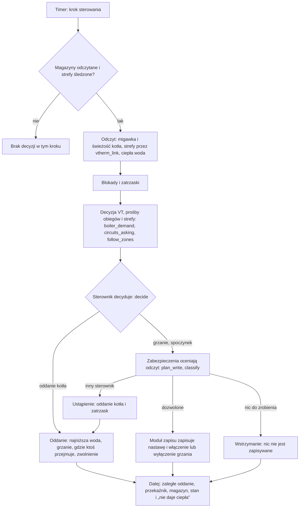

[English version](../../en/technical/technical.md)

# Smart Boiler for Versatile Thermostat — dokumentacja techniczna

Status: aktualny.

> **W trakcie budowy, bez wydania.** Integracja nie pracowała jeszcze z prawdziwym kotłem.

Ten dokument opisuje budowę integracji: jej części, jeden krok sterowania, cykl życia, to, co
zapisuje, i sposób testowania. Co integracja robi dla użytkownika, opisuje
[przewodnik użytkownika](../user-guide/user-guide.md); wszystkie zasady i decyzje są w
[`docs/pl/specification/scope.md`](../specification/scope.md). Skróty: Home Assistant (HA), Versatile Thermostat
(VT), OpenTherm Gateway (OTGW), Message Queuing Telemetry Transport (MQTT).

## Spis treści

1. [Przegląd](#1-przegląd)
2. [Struktura repozytorium](#2-struktura-repozytorium)
3. [Zadania komponentów](#3-zadania-komponentów)
4. [Jeden krok sterowania](#4-jeden-krok-sterowania)
5. [Cykl życia](#5-cykl-życia)
6. [Stan trwały](#6-stan-trwały)
7. [Testowanie](#7-testowanie)

## 1. Przegląd

Integracja (domena `vtherm_smart_boiler`) jest wtyczką VT. Kocioł centralny VT decyduje, kiedy
kocioł grzeje, przez pomocnika, za którym idzie wtyczka; wtyczka decyduje, jak ciepła jest woda,
zapisuje to do kotła i oddaje kocioł przy każdym wyjściu.

- **Czysta logika w `core/`.** Każde prawo sterowania i uczenia, analiza monitora i werdykt to
  czysty Python bez importów HA — test parsuje importy `core/`, żeby to wymusić. Ten sam rdzeń
  działa w testach jednostkowych, w symulatorze i w HA.
- **Strona HA** wokół niego zbiera dane wejściowe z encji wybranych przez użytkownika, uruchamia
  rdzeń na timerach i przy zmianach stanu, wykonuje jego zapisy i publikuje czujniki, czujniki
  binarne, przełączniki, przyciski i zgłoszenia w Naprawach.
- **`vtherm_link.py` to jedyne wejście do danych stref.** Czyta każdą strefę wyłącznie przez
  `vtherm_api` (zasada użytkownika, 2026-11-24/25; I12.7). Pokoje to termostaty przekazane przez
  VT modułowi funkcji wtyczki, których `entry_infos` mówią, że liczy je kocioł centralny VT
  (`used_by_controls_central_boiler`; I12.11); wtyczka nie prowadzi własnej listy. Termostat
  przekazany, a nieliczony, nie jest pokojem, i wymienia go jedno informacyjne zgłoszenie w
  Naprawach. Gdy VT nie trzyma termostatu pokoju, który wtyczka znała — VT go przeładowuje albo
  po ponownym starcie jeszcze go nie uruchomił (pokoje zapisane we własnym magazynie wtyczki) —
  pokój zostaje, jako nieznany, więc okres rozpoznania i okres karencji z decyzji 3 nadal
  działają; znika, gdy VT przekaże go jako nieliczony albo gdy rejestr Home Assistanta nie zna
  już jego encji. Strefę rozpoznaje się po zadeklarowanym `entity_id`, a nazywa zadeklarowanym
  `name`. Z termostatu:
  temperatura pokoju i czas jej pomiaru przez VT, nastawa, tryb, czy strefa grzeje i czy jej
  urządzenie pracuje oraz powód, dla którego VT trzyma ją wyłączoną (tylko okno). Z jego
  `entry_infos`: typ, cykl i urządzenia, czy liczy go centralny kocioł VT, termometr i czujnik
  okna pokoju oraz ustawienia centralnego kotła VT. Z wywołań VT na module funkcji: strefa liczy
  się jako uruchomiona od pierwszego `refresh_state` od VT, a jej wypełnienie i otwarcie zaworu to
  to, co ostatnio podał hak mocy VT jako zastosowane. Strefa, której termostatu VT nie przekazał,
  jest nieznana; nic z encji klimatu VT jej nie zastępuje. Historia pokoi to to, co odczytał,
  przechowywane przez samą wtyczkę (zobacz [Stan trwały](#6-stan-trwały)); nic z encji klimatu VT
  do niej nie trafia. Nic z encji klimatu VT nie jest czytane, ani tryb centralny VT. To, co
  bierze z Home Assistanta o VT, to informacja Home Assistanta, nie dane VT: czy VT jest wczytany
  i jego wersja (integracje i wpisy konfiguracji) oraz rejestr encji — czy VT ma encje klimatu
  (zgłoszenie o przeładowaniu niżej) i obszar encji (skrót obszaru w obiegu). Nie czyta niczego
  ze SmartPI. Żaden inny moduł nie odczytuje stanu strefy po nazwie encji, a test
  (`tests/test_vt_boundary.py`) wymienia każde miejsce integracji, które czyta stan, historię
  stanu albo wpis konfiguracji, i czyja to encja: żadna nie jest encją VT.
- **Moduł funkcji (feature manager) zarejestrowany w VT** (`feature_manager.py`, przez
  `register_feature_manager` z `vtherm_api`) to kanał, którym VT przekazuje każdy termostat.
  Zachowuje to, co mówi mu VT — jego `refresh_state` i hak mocy `async_on_underlying_power` — i
  nie publikuje niczego na termostatach VT: dane o wodzie, które pokazywał do I12.9, usunięto, bo
  nikt ich nie czytał (decyzja użytkownika z 2026-11-25). Jest rejestrowany dopiero po wczytaniu
  VT; termostat, który już działa, trafia do niego dopiero po następnym przeładowaniu VT, którego
  wtyczka nigdy sama nie wywołuje. Przy pierwszej instalacji, gdy VT działa, nie przychodzi
  żaden: zgłoszenie do naprawy „Przeładuj raz Versatile Thermostat” pojawia się, gdy VT jest
  wczytany, rejestr Home Assistanta zna encje klimatu VT, a w tym uruchomieniu żaden termostat
  nie został przekazany przez 15 minut od rejestracji; znika, gdy tylko pierwszy zostanie
  przekazany, a jego przepływ naprawy (`repairs.ReloadVtFlow`) sprawdza ponownie. Ostatni krok
  konfiguracji mówi to samo tam, gdzie to potrzebne.
- **„Nie daje ciepła”** (`binary_sensor`, klucz `no_heat`; `core/boiler_call.py`): jeden sygnał
  dla całego domu, włączony, gdy pokój liczony przez VT woła o ciepło, a kocioł go nie daje
  (wyłączony, gdy żaden pokój nie woła, I13.1), z powodem — kocioł
  centralny VT nie wzywa ciepła, trwa jego opóźnienie włączenia, ciepła woda, usterka kotła albo
  wtyczka nie może ręczyć za ciepło. Wyliczany z decyzji sterowania w każdym kroku; niedostępny,
  gdy sterowanie jest wyłączone. Użytkownik wybiera go w ustawieniu „heating unavailable” w
  SmartPI 1.0 albo używa w automatyzacji: wtyczka sama nie wstrzymuje nauki żadnej strefy
  (I12.9).

Szczegóły: [`docs/pl/specification/scope.md`, §2](../specification/scope.md#2-dlaczego-wtyczka) i
[§5](../specification/scope.md#5-sprzęt-obiegi-i-algorytmy-stref).

## 2. Struktura repozytorium

```text
custom_components/vtherm_smart_boiler/   integracja (strona HA)
├── core/                                 czysta logika, bez importów HA
├── transport/                            odczyt encji kotła i moduły zapisu
├── translations/                         en.json (źródło) i inne języki
└── frontend/                             zbudowana strona „Kocioł” i karty, licencje, teksty
frontend/                                 źródło strony „Kocioł” (TypeScript, Lit, Vite)
tests/                                    testy: core/, integration/, sim/, tools/ i reszta
sim/                                      symulator fizyki i jego komponenty HA tylko do testów
tools/                                    import historii z recordera do analizy offline
devenv/                                   testowy HA (Docker compose) do scenariuszy odbiorczych
scripts/                                  env.sh (uruchamia każde polecenie w projekcie), deploy
docs/                                     dokumentacja, osobny katalog na każdy język
├── en/                                   angielski, wersja podstawowa
│   ├── specification/                    co wtyczka robi (zakres) i jej interfejsy
│   ├── user-guide/                       jak jej używać
│   ├── technical/                        jak jest zbudowana
│   ├── development/                      plan rozwoju; plany i przeglądy (historia)
│   └── testing/                          środowisko testowe i raporty z testów
├── pl/                                   polski: każdy aktualny dokument, ten sam układ
└── images/                               obrazy wspólne dla wszystkich języków
```

- `sim/custom_components/` zawiera `boiler_sim` (symulowany kocioł, pomieszczenia i pogodę) oraz
  zastępczy `opentherm_gw`, oba tylko do testów.
- `tools/import_history.py` zamienia kopię bazy recordera HA na historię rdzenia, żeby analizę
  monitora można było sprawdzić na zapisanych danych: sygnały kotła, pogodę i pomocnika
  przełączanego przez kocioł centralny VT — nigdy encje klimatu VT.
- Strona „Kocioł” ([`plan-0.2-i10.md`](../../en/development/plans/plan-0.2-i10.md)):
  `frontend/` to jej źródło; `npm run build` w tym katalogu zapisuje moduł, który wtyczka
  udostępnia, do `custom_components/vtherm_smart_boiler/frontend/`, razem z licencjami pakietów w
  nim zawartych. Te pliki są w repozytorium, więc HACS je instaluje; CI buduje je ponownie i
  zgłasza błąd, gdy się różnią. Są tam też teksty strony (`frontend/translations/`, angielski to
  źródło): czyta je strona, a `panel.py` bierze z nich nazwę w menu bocznym. To, co mówią już
  encje wtyczki — nazwy alarmów i sygnałów, powody werdyktu, skąd pochodzi wartość budynku —
  strona bierze z własnych tłumaczeń wtyczki (`translations/`), które Home Assistant podaje jej
  w języku użytkownika (`hass.loadBackendTranslation("entity", …)`), więc każde jest zapisane
  raz. `panel.py`
  udostępnia pliki i dodaje stronę do menu bocznego przez `panel_custom` Home Assistanta;
  przełącznik „Strona w menu bocznym” ją zabiera i przywraca. Strona zostaje na czas
  przeładowania — zabrana, wyrzuciłaby oglądającego ją użytkownika z błędem; start rejestruje ją
  ponownie w jednym kroku — i znika z wyłączonym albo usuniętym wpisem albo z wyłączonym tym
  przełącznikiem (F17 z J4). Póki wpis działa, `panel.py` każe
  też Home Assistantowi wczytywać ten sam moduł na każdej stronie (`frontend.add_extra_js_url`,
  zabierane przy wyładowaniu, starszy adres zastępowany po aktualizacji), więc części przeglądu
  są w wyborze kart jako cztery karty — stan i kafelki, schemat, krzywa, ostatnie 24 h —
  każda to własna część strony (`frontend/src/cards.ts`), bez ustawień: każda sama znajduje
  działający wpis przez `vtherm_smart_boiler/installation`. Gdy frontend Home Assistanta nie
  działa, nic nie jest rejestrowane. Strona nie czyta niczego z VT i nie pokazuje pokoi
  ([`plan-0.2-i12.md`](../../en/development/plans/plan-0.2-i12.md), decyzja 6): kafelek pokoi
  pokazuje własną liczbę wtyczki, **Wołające o ciepło** (`demand_count`), z odnośnikiem do strony
  VT w ustawieniach dla administratora; schemat rysuje płynącą wodę, gdy **Wezwanie do grzania**
  (`boiler_called`) jest włączone albo płomień pali na grzanie, do obiegów, które wymienia atrybut
  tego czujnika `calling_circuits` — obiegi wołających pokoi, zapisywane w recorderze, w
  przeciwieństwie do samych pokoi (`calling_zones`), więc ostatnie 24 h je odtwarzają. Ostatnie
  24 h czytają z recordera historię tylko sygnałów kotła, własnych encji wtyczki i pogody.
  Node.js instaluje `scripts/bootstrap_node.sh` do `.tools/node/`. `websocket_api.py` to to, co strona czyta: pięć poleceń WebSocket tylko do
  odczytu, dla każdego zalogowanego użytkownika, każde odpowiada z działającego wpisu (inaczej
  błąd `not_running`): `vtherm_smart_boiler/installation` — kocioł, obiegi z ich pokojami i
  grzejnikami (strona rysuje grzejniki; identyfikatory pokoi służą sprawdzeniu J4), encja wybrana dla każdego sygnału, encje wtyczki według klucza i ustawienia
  krzywej; `vtherm_smart_boiler/curve` — punkty krzywej dla ustawień w użyciu albo dla wartości
  roboczych, bez zapisu, z `core/curve_view.py` (krzywa przy temperaturze pokojowej w użyciu,
  potem limity, tak jak decyduje sterowanie przed korektą komfortu, potrzebą obiegu i rampą), ze
  sprawdzeniami z ustawień według ich kluczy tłumaczeń; `vtherm_smart_boiler/days` — podsumowania
  dni w zapisanej postaci, razem z gazem na stopniodzień z ostatnich 12 tygodni liczonym przez
  `core/weekly.py` (tydzień bez gazu w którymś dniu nie ma wyniku, zasada monitora), sygnaturą
  energetyczną dopasowaną przez `core/signature.py` — gaz na grzanie każdego dnia na 24 h wobec
  jego średniej temperatury zewnętrznej, osobno dni tylko obserwowane i dni pod sterowaniem, linia
  każdej grupy przez jej dni grzania (zimniejsze niż próg grzania w użyciu, z gazem na grzanie)
  według zasad dopasowania budynku (`core/building.py`: liczba dni, rozrzut temperatur, więcej
  gazu w zimniejsze dni, R²) albo powód jej braku, i obie porównane w środku temperatur, które
  obie obejmują — oraz z jednostką licznika gazu (bez licznika żadną: gaz jest wtedy szacowany w
  jednostce danych gazu kotła); każdy dzień zapisany od I10.7 trzyma swoje starty grzania
  godzina po godzinie od swojego początku (`hourly_starts`, 23 albo 25 godzin przy zmianie
  czasu), które strona umieszcza na ich godzinach zegarowych; dni zapisane wcześniej ich nie mają
  i nadal są czytane;
  `vtherm_smart_boiler/burns` — palenia z ostatniej analizy monitora tak,
  jak je sklasyfikował (ogrzewanie, ciepła woda, nieznane), więc strona rysuje palenia samego
  monitora; `vtherm_smart_boiler/journal` — dziennik (zob. [Stan trwały](#6-stan-trwały)), od
  podanej chwili, jeśli ją podano; oraz jeden zapis, tylko dla administratora:
  `vtherm_smart_boiler/curve/save` zapisuje punkt krzywej przy największym mrozie i, na poziomie
  zaawansowanym, jej przesunięcie **przez własne ustawienia wtyczki** — ich formularz „Krzywa
  grzewcza” wypełniony zapisanymi wartościami i zmianami, potem „Zapisz i zakończ” — więc każde
  sprawdzenie i sam zapis z przeładowaniem są tych ustawień; odmowa wraca z polem i kluczem
  tłumaczenia, a zapisu, przy którym ustawienia by się zatrzymały (potwierdzenie, inna sekcja),
  się nie robi. Ich schematy używają `probatio`, jak własne polecenia Home Assistanta od 2026.10.
  Zakładka „Stan i alarmy” zapomina zmierzoną wartość budynku własnymi przyciskami wtyczki
  (`button.press`), dostępnymi tylko dla administratora, po potwierdzeniu.

## 3. Zadania komponentów

**Konfiguracja wpisu (`__init__.py`).** Czyta opcje wpisu do `EntryConfig`, buduje koordynator
i jednostkę sterowania, dołącza koordynator do modułu funkcji, a przy wyładowaniu najpierw
zatrzymuje jednostkę sterowania (oddaje ona kocioł), a koordynator na końcu. HA jest
importowany tylko wewnątrz funkcji.

**Koordynator (`coordinator.py`, `SmartBoilerCoordinator`).** Śledzi wskazane encje, trzyma
historię kroczącą i wylicza to, co publikują encje. Szybka ścieżka działa przy zmianach stanu i
co 30 sekund (odczyty, sprawdzenie sygnałów, ciepła woda, bieżące alarmy); analiza
(`core/analysis.py`) działa co kilka minut na kopii historii, poza pętlą zdarzeń. Koordynator
zarządza też magazynami (zobacz [Stan trwały](#6-stan-trwały)).

Historia (`core/history.py`, `History`) ma trzy źródła. Sygnały kotła, pogoda, stan sterowania
wtyczki i pomocnik przełączany przez kocioł centralny VT przychodzą na żywo z ich stanów, a po
starcie z rejestratora: ostatnie 8 dni (`HISTORY_DAYS`) i starsze dni, do roku wstecz, tylko do
budowy podsumowań dni. Pokoje pochodzą z własnych odczytów wtyczki przez `vtherm_api`, przy każdym
odświeżeniu (30 s) i każdym kroku sterowania (10 s), tylko zmiany (`ZoneSeries.record`), a po
starcie z magazynu pokoi — nigdy z zapisów encji klimatu VT w rejestratorze (I12.7b). „Czy kocioł
był wezwany do grzania” (`History.zone_demand`, `zone_calling`) to stan pomocnika wszędzie, gdzie
jest znany — własna decyzja VT, z jego progami — a pokoje tylko tam, gdzie nie jest, albo gdy
pomocnik nie jest ustawiony (samo monitorowanie); obieg sterowany inną automatyką, który prosi
przez swoją encję żądania (`History.circuits_asking`, encja użytkownika, z rejestratora i na
bieżąco), liczy się jako wezwanie bez względu na VT (I12.18).
Odróżnia palenia na grzanie od ciepłej wody
(każde podsumowanie dnia, werdykt, dopasowanie budynku), przerwy, które może ocenić dryf
histerezy, krótkie palenia liczone przez niestabilny zapłon i palenia brane przez dowody
najniższej temperatury wody. Własne szczegóły pokoi — średnia nastawa w raporcie, otwarcia
zaworów w tych dowodach — pochodzą tylko z magazynu pokoi, więc zaczynają się od instalacji.

**Monitor i analiza (`core/monitor.py`, `core/analysis.py`, `core/verdict.py`).** Od historii do
cykli pracy palnika, metryk, ostrzeżeń o trendach, raportu i werdyktu sterowania, zawsze z
powodami. `core/alarms.py` zawiera alarmy monitora, z histerezą, żeby nie migotały.

**Jednostka sterowania (`control.py`, `ControlUnit`).** Strona HA sterowania: krok sterowania co
kilka sekund, jego zapisy przez moduł zapisu, oddanie kotła przy każdym wyjściu i stan
pokazywany przez encje — w tym „Nie daje ciepła”. Zamienia zdarzenia zabezpieczeń i awarie
na alarmy. Moduł zapisu istnieje tylko wtedy, gdy sterowanie jest włączone. Błąd wewnętrzny
oddaje kocioł i blokuje sterowanie zatrzaskiem.

**Krok sterowania (`core/loop.py`, `loop_step`).** Jeden krok: od decyzji sterownika, przez
zabezpieczenia zapisu, do tego, co zostaje zapisane teraz. Ten sam krok napędza symulator i HA.
Przekaźnik ma własny krok (`core/relay.py`).

**Sterownik (`core/controller.py`, `decide`).** Maszyna stanów, która zamienia to, co wtyczka
wie, na polecenie dla kotła, w stałej kolejności pierwszeństwa: sterowanie wyłączone; zatrzask
albo alarm ustawiony na oddanie kotła; brakujący warunek wstępny (blokada); utracona albo
nieświeża łączność z kotłem; usterka samego kotła; w pozostałych przypadkach włączenie lub
wyłączenie grzania z decyzji VT (pomocnik), a temperatura wody z krzywej (`core/curve.py`),
limitów i rampy.

**Zapotrzebowanie (`core/demand.py`, `boiler_demand`).** Decyzja VT — pomocnik włączony,
wyłączony albo nieznany — i policzone pokoje: ile woła (do pokazania), które są nieznane i czy
cokolwiek w ogóle może prosić (decyzja 3). Pokój woła, gdy VT mówi, że jedno z jego urządzeń
działa; gdy VT nie podaje stanu urządzenia, według zasady VT — zawór choć trochę otwarty, inaczej
cykl pracy powyżej 0.

**Obiegi sterowane przez inną automatykę (`core/circuit_requests.py`, `circuits_asking`).**
Obieg, którego mieszaczem albo pompą steruje coś innego, prosi o ciepło przez własną encję albo
przez swoje strefy; encja, której nie da się odczytać, o nic nie prosi i jest wskazana. Gdy obieg
prosi, jego potrzeba — najpierw odczyt encji, inaczej wpisana wartość — jest dolną granicą wody,
bez żadnego dodatku (`core/limits.py`, `limit_flow`). Stały zawór żadnej granicy nie wyznacza:
kocioł idzie po krzywej, a zawór stoi otwarty, gdy woda jest na poziomie nastawy lub niżej.

**Pilnowanie stref (`core/zone_watch.py`, `follow_zones`).** Okres rozpoznania po starcie
(najwyżej 10 minut), okres przejściowy każdej strefy i przypadek, gdy wszystkie strefy są
nieznane.

**Zabezpieczenia (`core/guards.py`, `plan_write`, `classify`).** Co naprawdę może zostać
zapisane, o cokolwiek prosi sterownik: nic do trwałej pamięci kotła, ogranicznik częstości
zapisów, powtórzenia tam, gdzie wartość wygasa. Oceniają odczyt zwrotny i przypisują zmianę,
której wtyczka nie zrobiła, do utraconego polecenia, wartości ignorowanej od początku, wartości
przyciętej albo innego sterownika.

**Przekaźnik (`core/relay.py`).** Kocioł wł./wył. przełączany przekaźnikiem: co jest do niego
zapisywane, co znaczy zgłaszany przez niego stan i czy kocioł pokazuje, że grzeje.

**Oddanie sterowania (`core/hand_back.py`).** Dowody oddania sterowania: co świadczy o
zwolnieniu, kiedy stała trzecia wartość oznacza, że cel trzyma inny sterownik, i kiedy zmiana
celu dwuwartościowego jest utraconym poleceniem. Jednostka sterowania zapisuje trzy części i
ponawia, aż zostaną potwierdzone.

**Moduły zapisu (`transport/writers.py`).** Jedyny kod, który zmienia kocioł: encja do zapisu,
OTGW przez `opentherm_gw` z HA, firmware OTGW przez MQTT albo przekaźnik. Każdy moduł zapisu zna
usługi, które może wywołać (test sprawdza listę); nieudany zapis zgłasza `WriteError` i nigdy
nie jest uznawany za wykonany. Odczyt kotła jest w `transport/entities.py`, który niczego nie
zapisuje.

**Konfiguracja (`config_flow.py`, `config.py`, `control_config.py`).** Formularze konfiguracji
i opcji oraz opcje sterowania jako obiekty rdzenia, z blokadami, które nie pozwalają ruszyć
sterowaniu. Oba przepływy to jedno menu sekcji; sterowanie to cztery jego pozycje, każda jako
jeden formularz — urządzenie sterujące, krzywa grzewcza, zachowanie sterowania, reakcje na alarmy
(`CONTROL_ITEMS`) —, każda pokazana tam, gdzie ma zastosowanie, i otwierana
po sprawdzeniu ścieżki zapisu (`_control_path`). Formularz pokazuje się ponownie z polami, które
odsłoniła odpowiedź (`entity_form_fields`, `relay_form_fields`); wartość ukrytego pola zostaje. Sterowanie czyta swoją sekcję z dołożonymi tematami MQTT połączenia i odczytami
zwrotnymi z sygnałów (`with_boiler_inputs`): każda wartość jest zapisana raz. Pokoje są z VT
(I12.11): opcje trzymają tylko to, jak należą do obiegów. Przy jednym obiegu wszystkie pokoje są
jego, a zapisuje on tylko, które pokoje mają podłogówkę i konwektory. Przy kilku każdy obieg
wymienia zasilane pokoje, a z nich te z podłogówką i z konwektorami, a z pokoju zasilanego tylko
w części — jego urządzenia (`devices`, według pokoju; formularz przypisuje każde urządzenie do
pokoju przez `vtherm_link.room_devices`); tylko tak pokój może być w dwóch obiegach.
`config._zones` czyta to przypisanie, a `Installation.with_rooms` łączy je z pokojami, które VT
przekazuje, przy każdym odświeżeniu i kroku sterowania. `repairs.py` zawiera przepływy napraw (na przykład potwierdzenie oddania kotła
zrobionego ręcznie).

## 4. Jeden krok sterowania

Timer uruchamia krok jednostki sterowania (`ControlUnit._async_step` w `control.py`). Czystą
częścią jest `loop_step` w `core/loop.py`, który wywołuje `decide` w `core/controller.py`, a
potem zabezpieczenia w `core/guards.py`.



- **Świeżość:** nic nie jest zapisywane bez świeżych danych kotła — przy przekaźniku bez
  świeżego stanu samego przekaźnika; limity wieku ustawione przez użytkownika należą do
  wskazanych sygnałów i odchodzą razem z nimi. Łączność jest oceniana w oknie (utracona, gdy
  nieświeże kroki pokryją 5 minut w ciągu 10; wraca po 60 sekundach świeżych danych).
- **Blokady i zatrzaski** idą przed zapotrzebowaniem: zatrzask albo alarm ustawiony na oddanie
  kotła oddaje kocioł, o cokolwiek proszą strefy.
- **Decyzja:** włączenie lub wyłączenie grzania jest ustalane w każdym kroku — decyzja VT
  (pomocnik) albo prośba obiegu sterowanego przez inną automatykę; temperatura wody co odstęp decyzji
  (domyślnie 5 minut) i od razu po końcu blokady albo usterki lub gdy zmienia się potrzeba
  obiegu: krzywa, nigdy poniżej potrzeby proszącego obiegu,
  ograniczona przez obiegi zasilane prosto z kotła i maksimum kotła. Przy kilku obiegach
  temperatura pokojowa krzywej i korekta komfortu biorą pod uwagę strefy obiegu zasilanego
  prosto z kotła.
- **Zabezpieczenia** widzą odczyt zwrotny każdego zapisu; oddania kotła żadne zabezpieczenie
  nigdy nie wstrzymuje.
- **Dalsze kroki:** zaległe oddanie kotła jest ponawiane co minutę, aż zostanie potwierdzone;
  stan sterowania jest zapisywany od razu, gdy się zmieni (zobacz
  [Stan trwały](#6-stan-trwały)).

Szczegóły: [`docs/pl/specification/scope.md`, §7](../specification/scope.md#7-funkcje-według-etapów).

## 5. Cykl życia

**Konfiguracja wpisu.** `async_setup_entry` czyta opcje; część sterowania, której nie da się
użyć, wyłącza tylko sterowanie, a nie cały wpis, więc monitor dalej działa, a zaległe oddanie
kotła i tak zostaje wysłane. Koordynator czyta swoje magazyny; jednostka sterowania ostrożnie
czyta stan sterowania (zobacz niżej) i, zanim cokolwiek innego może zawieść, raz próbuje oddać
kocioł, jeśli poprzednie uruchomienie zostawiło to jako zaległe (niepowodzenie zostaje zaległe i
jest ponawiane przez zegar). Potem startują koordynator i jednostka sterowania, jednostka
sterowania rejestruje swoje zadanie zamknięcia, a koordynator zostaje dołączony do modułu
funkcji.

**Okres rozpoznania.** Po starcie HA albo przeładowaniu VT strefy zgłaszają się jedna po
drugiej. Sterownik nie podejmuje nowych decyzji, dopóki każda strefa się nie zgłosi, najwyżej
przez 10 minut. Polecenie trzymane przed ponownym uruchomieniem jest zachowywane albo od razu
przywracane, jeśli nic tego nie zabrania; w przeciwnym razie najpierw kocioł jest oddawany. VT
może pokazywać termostat, którego nie uruchomił, jako „wyłączony”; nigdy nie jest to czytane
jako „brak zapotrzebowania”.

**Przeładowanie.** Zapisanie opcji przeładowuje integrację: jeśli sterowanie trzyma kocioł, jest
on oddawany i przejmowany ponownie (przekaźnik przechodzi w stan spoczynkowy i z powrotem).

**Zatrzymanie HA.** Oddanie kotła działa w zadaniu zamknięcia (`hass.async_add_shutdown_job`),
które HA uruchamia przed swoim zdarzeniem zatrzymania. Wszystkie zadania zamknięcia mają wspólny
limit 20 sekund, po którym HA anuluje te, które wciąż trwają; oddanie kotła jest zbudowane tak,
żeby się w nim zmieścić. Oddanie niepotwierdzone do tego czasu zostaje zaległe w magazynie
sterowania i jest ponawiane przy następnym starcie.

**Wyładowanie.** `async_unload_entry` najpierw zatrzymuje jednostkę sterowania (oddaje ona
kocioł), odłącza moduł funkcji, wyładowuje platformy, a na końcu zatrzymuje koordynator.

**Usunięcie.** Jeśli przy usuwaniu wpisu oddanie kotła wciąż jest zaległe, nie da się go już
ponowić: zgłoszenie w Naprawach, które przetrwa wpis, mówi użytkownikowi, żeby oddał kocioł
ręcznie.

## 6. Stan trwały

Sterowanie ma własny magazyn (`ControlStore` w `coordinator.py`), oddzielny od głównego magazynu
wpisu, który trzyma drobne dane monitora i podsumowania dni.

- **Co trzyma:** czy sterowanie jest włączone, ostatnie polecenie i to, czy wtyczka steruje,
  zatrzaski i ich przyczyny, zaległe oddanie kotła i dowody zwolnienia, wartości bazowe, z którymi porównują zabezpieczenia, obserwacje przekaźnika i aktywne alarmy
  sterowania.
- **Zapisywane od razu:** każda zmiana, której awaria nie może zgubić — znacznik sterowania,
  zatrzask, zaległe oddanie kotła — jest zapisywana natychmiast i atomowo. Wynik każdego zapisu
  jest odnotowywany; nieudany zapis tworzy zgłoszenie w Naprawach (pełny dysk albo pamięć tylko
  do odczytu).
- **Czytane ostrożnie** (`async_read_control_state`): gdy magazynu nie da się odczytać (brak go,
  jest uszkodzony albo ma inny kształt), a opcje zawierają część sterowania, oddanie kotła liczy
  się jako zaległe, a kocioł jako trzymany, więc wtyczka dla bezpieczeństwa oddaje kocioł.

**Dziennik** (`journal.py`, jego zasady w `core/journal.py`) też ma własny magazyn,
`<domain>.<entry_id>.journal`, więc główny magazyn wpisu i jego wersja zostają bez zmian. Trzyma
to, co wtyczka zdecydowała i dlaczego, dla strony „Kocioł”: starty i zatrzymania wtyczki,
przejęcie kotła przez sterowanie i jego oddanie, włączenie i wyłączenie wezwania ciepła,
zapisaną nastawę wody — jej pierwszą wartość, potem każdą zmianę o co najmniej 1 K od wartości
ostatnio zapisanej w dzienniku — potrzebę obiegu, która trzyma wodę, alarm podniesiony (albo z
podniesionym poziomem) i ustąpiony oraz każdy zapis ustawień, ze strony (z tym, co zmienił) albo
z ustawień (z sekcjami, które się zmieniły); każde z powodami, które podało sterowanie. Tylko
obserwuje — słucha stanu sterowania i odświeżeń monitora i niczego nie zmienia; jego błąd jest
logowany raz. Pierwsze spojrzenie po starcie zapisuje ponowne przejęcie kotła przez sterowanie
— po restarcie albo przeładowaniu, z wezwaniem ciepła, wodą i potrzebą obiegu — a zatrzymanie
zapisuje oddanie kotła, które sterowanie zrobiło tuż przed nim, chyba że oddanie jest jeszcze
należne (F18 z J4); alarmy już podniesione są punktem wyjścia startu; alarm, którego nie da się
teraz ocenić, zostaje taki, jaki był. Trzyma 14
dni i najwyżej 2000 wpisów, najstarsze wypadają pierwsze (tymczasowo, K4); zapisywany minutę po
zmianie, od razu przy wyładowaniu wpisu i przez Home Assistanta przy jego zatrzymaniu; magazyn,
którego nie da się odczytać, zaczyna pusty dziennik. Znika razem z innymi magazynami wpisu, gdy
wpis jest usuwany.

**Historia pokoi** (`rooms_store` w `coordinator.py`, jej format w `core/history.py`) też ma
własny magazyn, `<domain>.<entry_id>.rooms`: temperatura, nastawa, tryb, wezwanie, wypełnienie i
otwarcie zaworu każdego pokoju, tak jak wtyczka odczytała je przez `vtherm_api` w ostatnich 8
dniach. Każda seria to jeden wiersz tekstu — chwile w pełnych sekundach, każda po pierwszej jako
sekundy od poprzedniej; wartości do trzech miejsc po przecinku — bo Home Assistant zapisuje swoje
magazyny z wcięciami. Trzyma najwyżej 10 000 najnowszych próbek serii, więc migocząca wartość nie
powiększa pliku bez końca. Zapisywany pół godziny po zmianie (najwyżej około 48 zapisów na dobę)
i przy czystym zatrzymaniu; odczytywany przy starcie, każdy zapisany pokój, nieznany od
ostatniego zapisu do następnego odczytu pokoi — awaria gubi to, co przyszło od zapisu. Zapisane
pokoje to pokoje, których wtyczka oczekuje, aż VT przekaże ich termostaty (I12.11, decyzja 3). Serii,
której nie da się odczytać, nie bierze; magazyn bez chwili zapisu pomija. Nic do niego nie jest
zapisywane, zanim go odczytano. Znika razem z innymi magazynami wpisu, gdy wpis jest usuwany.

## 7. Testowanie

Trzy warstwy ([`docs/pl/development/plan.md`, „Test environment”](../development/plan.md#środowisko-testowe)):

1. **Testy rdzenia** (`tests/core/`) — zwykły pytest, bez HA, bez sieci.
2. **Testy integracyjne** — `pytest-homeassistant-custom-component`: HA działa wewnątrz procesu
   testów; bez instancji, bez sieci. Ciągła integracja (CI) pobiera też VT 10.6.5 z jego tagu,
   więc testy z prawdziwym VT działają przy każdej zmianie. Pobiera też SmartPI 0.4.0, tylko do
   wdrożenia na testowy HA: wtyczka nie czyta niczego ze SmartPI.
3. **Testowy HA** — osobny kontener (`devenv/`) z wtyczką, VT, SmartPI i symulatorem, w którym
   scenariusze odbiorcze są uruchamiane, zanim cokolwiek trafi do prawdziwego kotła.

**Symulator** (`sim/simulator.py`, z `sim/custom_components/boiler_sim`) modeluje kocioł,
pomieszczenia i pogodę. Scenariusz ustala instalację, pogodę, pobory ciepłej wody i zawory
stref, a w każdym okresie sterowania może wywołać sterownik; polecenia docierają do
symulowanego kotła tak jak przez bramkę. Sterowanie jest testowane tylko na symulatorze.

**Uruchamianie sprawdzeń**, tak jak opisuje [`CONTRIBUTING.md`](../../../CONTRIBUTING.md), każde
przez `scripts/env.sh`:

```sh
scripts/env.sh python -m pytest -q -p no:homeassistant --disable-socket --allow-unix-socket \
    tests/core
scripts/env.sh python -m pytest -q --ignore=tests/core
scripts/env.sh ruff check .
scripts/env.sh ruff format --check .
scripts/env.sh mypy
```

Strona „Kocioł”, w `frontend/`: `../scripts/env.sh npm test` i `../scripts/env.sh npm run build`
(najpierw sprawdzenie typów); zbudowane pliki trafiają do repozytorium.
`../scripts/env.sh npm run screenshots` rysuje zbudowaną stronę na przykładowych danych
(`frontend/preview/index.html`) w Chromium bez okna — jasny i ciemny motyw, komputer i telefon,
administrator i zwykły użytkownik — do `.tmp/screenshots/` i zgłasza błąd przy każdym błędzie na
stronie; `scripts/bootstrap_browser.sh` umieszcza to Chromium i potrzebne mu biblioteki systemowe
w `.tools/`.

