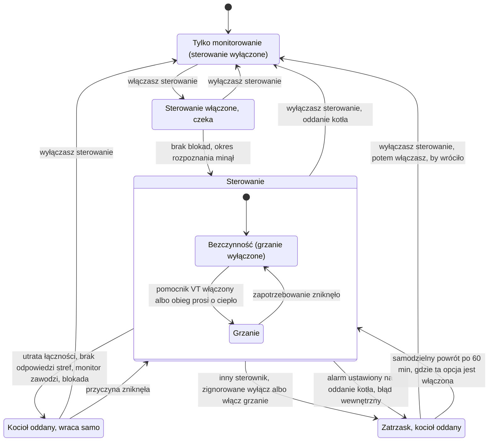

[English version](../../en/user-guide/user-guide.md)

# Smart Boiler for Versatile Thermostat — przewodnik użytkownika

Status: aktualny.

> **W trakcie budowy, bez wydania.** Integracja nie pracowała jeszcze z prawdziwym kotłem. Nie ma
> wydania ani wpisu w Home Assistant Community Store (HACS). Nie instaluj jej w ogrzewaniu, na
> którym polegasz.

Smart Boiler for Versatile Thermostat to wtyczka (nie jest częścią VT ani dziełem jego autorów) do
Versatile Thermostat (VT), integracji Home Assistant, która steruje pomieszczeniami w domu. VT
decyduje, ile ciepła potrzebuje każde pomieszczenie. Ta wtyczka obserwuje kocioł centralnego
ogrzewania (gazowy, olejowy, elektryczny lub na inne paliwo; nie pompę ciepła), a gdy włączysz
sterowanie, decyduje, kiedy kocioł grzeje i jak ciepła jest jego woda. Nie steruje pomieszczeniami
ani zaworami.

Ten przewodnik jest streszczeniem. Specyfikacja, ze wszystkimi zasadami i decyzjami, to
[`docs/pl/specification/scope.md`](../specification/scope.md). Gdy oba teksty się różnią, rozstrzygają `docs/pl/specification/scope.md`
i teksty w formularzach samej integracji. Niektóre wartości w specyfikacji są wciąż oznaczone
jako „tymczasowe” (provisional): mogą się zmienić przed pierwszym wydaniem. Budowę wtyczki
opisuje [dokumentacja techniczna](../technical/technical.md).

## Spis treści

1. [Wymagania](#1-wymagania)
2. [Instalacja](#2-instalacja)
3. [Szybki start](#3-szybki-start)
4. [Jak to działa](#4-jak-to-działa)
5. [Podłączenie kotła](#5-podłączenie-kotła)
6. [Bezpieczeństwo i oddanie sterowania](#6-bezpieczeństwo-i-oddanie-sterowania)
7. [Alarmy i zgłoszenia w Naprawach](#7-alarmy-i-zgłoszenia-w-naprawach)
8. [Diagram stanów sterowania](#8-diagram-stanów-sterowania)
9. [Encje](#9-encje)
10. [Jak często odświeżają się dane](#10-jak-często-odświeżają-się-dane)
11. [Co zostaje lokalnie](#11-co-zostaje-lokalnie)
12. [Opcje i ryzyko](#12-opcje-i-ryzyko)
13. [Przykłady automatyzacji](#13-przykłady-automatyzacji)
14. [Rozwiązywanie problemów](#14-rozwiązywanie-problemów)
15. [Znane ograniczenia](#15-znane-ograniczenia)
16. [Usuwanie](#16-usuwanie)

## 1. Wymagania

- **Home Assistant 2026.10.4 lub nowszy** — wymaga go najnowszy Versatile Thermostat (10.6.5), a
  wtyczka jest na nim testowana.
- **Versatile Thermostat 10.6.5 lub nowszy**, z termostatami (wtyczka nazywa je strefami albo
  pokojami) ustawionymi dla pomieszczeń ogrzewanych przez ten kocioł i z zaznaczonym w każdym
  **Używane przez kocioł centralny**: pokoje wtyczki to termostaty, które liczy kocioł centralny
  VT. Ze starszym VT wtyczka nie steruje
  kotłem i prosi o aktualizację VT. VT 10.6.5 przedstawia się w Home Assistancie jako 10.6.4, co
  wtyczka przyjmuje. Sam VT 10.6.5 wymaga Home Assistanta 2026.10.4 i `vtherm_api` 0.9.0.
- Biblioteka `vtherm_api` w wersji 0.9.0 lub nowszej. Home Assistant instaluje ją razem z VT i
  wtyczką.
- **Kocioł, który Home Assistant potrafi odczytać**, przez dowolną integrację pokazującą jego
  sygnały jako encje: na przykład OpenTherm Gateway (OTGW), EMS-ESP albo sterownik OpenTherm na
  ESPHome. Kocioł, który ma tylko zaciski termostatu pokojowego wł./wył., można monitorować i
  przełączać przekaźnikiem.
- **Wskazane sygnały.** Dla każdego sygnału wybierasz encję, która go dostarcza; do
  monitorowania żaden nie jest wymagany. Płomień i temperatura zasilania włączają metryki
  palnika i łączność z kotłem, a sterowanie temperaturą wody wymaga obu. Każdy inny sygnał
  (temperatura powrotu, ciśnienie wody, modulacja, temperatura zewnętrzna, gazomierz i inne)
  włącza kolejne funkcje monitora.
- **Do sterowania:** sposób zapisu do kotła i sposób jego oddania (zobacz
  [Podłączenie kotła](#5-podłączenie-kotła)) oraz kocioł centralny VT ustawiony tak, by
  przełączał pomocnika, za którym idzie wtyczka (zobacz
  [Kiedy grzanie się włącza i wyłącza](#43-kiedy-grzanie-się-włącza-i-wyłącza)).

SmartPI i Auto-TPI z VT (samouczący się algorytm VT, sterujący proporcjonalnie do czasu) są
opcjonalne; wtyczka działa z każdym algorytmem stref VT.

**Co pokazują termostaty VT.** Nic od wtyczki. Żeby algorytm strefy nie uczył się, gdy kocioł
nie daje ciepła, wtyczka ma jeden czujnik, **Nie daje ciepła** (zobacz
[Obok algorytmów stref VT](#411-obok-algorytmów-stref-vt)).

## 2. Instalacja

**Nie ma jeszcze wydania**, więc dziś nie da się zainstalować integracji przez HACS.

Gdy wydanie się pojawi, będzie się instalować przez HACS jako niestandardowe repozytorium:

1. W HACS otwórz menu → **Niestandardowe repozytoria**, dodaj
   `https://github.com/Shadow-230/vtherm-smart-boiler` z typem **Integracja**.
2. Znajdź **Smart Boiler for Versatile Thermostat** w HACS i pobierz.
3. Uruchom ponownie Home Assistant.

**Instalacja ręczna** (gdy pojawi się wydanie): skopiuj folder
`custom_components/vtherm_smart_boiler/` z wydania do folderu `custom_components/` w konfiguracji
Home Assistant, a potem uruchom ponownie Home Assistant.

Może istnieć tylko jeden wpis integracji: obsługuje jeden kocioł.

## 3. Szybki start

1. **Przygotuj VT.** Ustaw termostaty VT dla pomieszczeń i zaznacz **Używane przez kocioł
   centralny** w każdym termostacie, którego pokój grzeje ten kocioł: to są pokoje wtyczki, i
   tylko je liczy kocioł centralny VT. We wtyczce nie ma listy pokoi do prowadzenia. Do
   sterowania utwórz pomocnika wł./wył.
   (Ustawienia → Urządzenia i usługi → Pomocnicy → Przełącznik) i ustaw kocioł centralny VT w
   konfiguracji centralnej VT: jego progi i opóźnienie włączenia oraz oba polecenia na pomocniku
   (`input_boolean.twoj_pomocnik/input_boolean.turn_on` i `…/input_boolean.turn_off`). Nigdy nie
   kieruj poleceń VT na sam kocioł: dwa sterowniki nigdy nie mogą sterować tym samym kotłem.
   Monitorowanie działa i bez tego; sterowanie na to czeka.
2. **Utwórz wpis.** Ustawienia → Urządzenia i usługi → Dodaj integrację → **Smart Boiler for
   Versatile Thermostat**. Pierwsze panele pytają, jak kocioł jest podłączony, o źródło ciepła i
   rodzaj kotła oraz o tryb sterowania — pełne sterowanie, wł./wył. albo tylko monitorowanie. Nic
   nie jest wybierane za ciebie i nic się nie włącza. Potem nazwa i poziom szczegółowości; poziom
   zmienia tylko to, co widzisz.
3. **Przejdź przez menu.** Każda sekcja to jeden formularz; po zatwierdzeniu wracasz do menu, a
   nic jeszcze nie jest tworzone. Sekcja, która nie ma zastosowania, nie jest pokazana.
   **Konfiguracja niepełna** otwiera następną sekcję do zatwierdzenia albo tę z problemem;
   **Utwórz** pojawia się, gdy każda pokazana sekcja jest zatwierdzona. Zamknięcie okna porzuca
   konfigurację.
   - **Interfejs kotła** — tylko tam, gdzie twoje połączenie go potrzebuje: tematy MQTT, bramka,
     jak bramka stoi między termostatem a kotłem, wskaźnik restartu.
   - **Sygnały kotła** — encja dla każdego sygnału, który masz; do sterowania co najmniej płomień
     i zasilanie. Przy sterowaniu temperaturą wody także odczyty zwrotne: nastawa c.o. odebrana
     przez kocioł (wymagana) i odczyt zwrotny włączenia ogrzewania.
   - **Kocioł** — co o nim wiesz; nieznane wartości zostaw puste.
   - **Obieg: <nazwa>** — jedna pozycja na obieg grzewczy (do czterech na poziomie
     zaawansowanym): jego typ, jego najwyższa temperatura wody i które pokoje mają podłogówkę
     albo konwektory. Przy jednym obiegu wszystkie pokoje są w nim. Przy kilku każdy wymienia
     swoje pokoje; pokój poza obiegami liczy się do tego, ile pokoi woła o ciepło, ale nie do
     wody żadnego obiegu.
   - **Budynek** i **Progi monitora** — na poziomie zaawansowanym, tylko dla monitora; tam jest
     **Dni danych do werdyktu** (domyślnie 7).
   - **Pozycje sterowania** — przy pełnym sterowaniu albo wł./wył.: urządzenie sterujące, krzywa
     grzewcza, zachowanie sterowania i reakcje na alarmy (zobacz
     [Sterowanie włączasz sam](#42-sterowanie-włączasz-sam)).
   - **Przeładuj raz VT.** VT przekazuje wtyczce swoje termostaty tylko wtedy, gdy je
     uruchamia. Jeśli VT już działa, gdy konfigurujesz wtyczkę, po **Utwórz** uruchom raz
     ponownie Home Assistant albo przeładuj wpisy Versatile Thermostat w Ustawienia → Urządzenia
     oraz usługi. Ostatni krok konfiguracji mówi o tym tam, gdzie to potrzebne, a zgłoszenie
     „Przeładuj raz Versatile Thermostat” przypomina; znika samo, gdy VT przekaże pierwszy
     termostat. Do tego czasu wtyczka nie zna żadnego pokoju.
4. **Przeczytaj werdykt.** Gdy zbierze tyle dni danych, czujnik **Werdykt sterowania** mówi, czy
   warto włączyć sterowanie ([4.1](#41-monitorowanie-i-werdykt)). Decyzja należy do ciebie.
5. **Włącz sterowanie** w opcjach integracji: **Tryb sterowania**, zaznacz **Sterowanie
   włączone**, potem **Zapisz i zakończ** — od pierwszego dnia albo później. Opcje otwiera tylko
   administrator. Jeśli czegoś brakuje, okno mówi czego, nic się nie zmienia, a monitor dalej
   działa. Odznacz, żeby wyłączyć sterowanie: kocioł zostaje od razu oddany. Dopóki go nie
   włączysz, wtyczka nic nie zapisuje do kotła. Automatyzacja przełącza sterowanie akcją
   `vtherm_smart_boiler.set_control` (`enabled`: włączone albo wyłączone), z tymi samymi
   sprawdzeniami; wywołana przez osobę — z pulpitu, uruchomionego przez nią skryptu, narzędzi
   deweloperskich — jest odrzucana. Automatyzacja uruchomiona ręcznie („Uruchom”) też nie niesie
   osoby, więc każdy, kto może ją uruchomić, przełącza nią sterowanie: dawaj taką automatyzację
   tylko tym, którzy mogą przełączać sterowanie. Encja **Sterowanie (eksperymentalne)** na urządzeniu
   integracji pokazuje, czy sterowanie jest włączone; niczego nie przełącza.

**Późniejsze zmiany ustawień.** Opcje integracji otwierają to samo menu, z **Zapisz i zakończ**
zamiast **Utwórz**. Nic nie jest zapisywane, dopóki tego nie wybierzesz: sprawdza wszystko,
zapisuje i raz przeładowuje integrację — gdy sterowanie trzyma kocioł, oddaje go i przejmuje
ponownie. Sama zmiana poziomu niczego nie przeładowuje. Menu wymienia zmienione sekcje; zamknięcie
okna je porzuca. Problem znaleziony przy zapisie otwiera swoją sekcję z powodem. Zmiana, która
zatrzymałaby sterowanie, najpierw pyta.

## 4. Jak to działa

Szczegóły każdej zasady są w specyfikacji:
[`docs/pl/specification/scope.md`, §7](../specification/scope.md#7-funkcje-według-etapów) i
[§10](../specification/scope.md#10-ocena-obok-sterowania).

### 4.1 Monitorowanie i werdykt

Po dodaniu integracji wtyczka tylko obserwuje kocioł. Niczego nie zapisuje, a kocioł pracuje jak
dotąd — pod kotłem centralnym Versatile Thermostat, termostatem ściennym albo własną automatyką —
dopóki nie włączysz sterowania, co możesz zrobić od pierwszego dnia. Rejestruje na przykład:

- cykle pracy palnika i ich długość oraz to, jak często kocioł startuje;
- przez jaką część czasu kocioł kondensuje (jeśli wskażesz potrzebne do tego sygnały);
- pobory ciepłej wody i zużycie gazu na stopniodzień (mierzone gazomierzem, który wskażesz,
  w przeciwnym razie szacowane);
- problemy z sygnałami, które czyta.

Werdykt potrzebuje domyślnie **7 dni danych**. Możesz zażądać więcej (do 60 dni), ale nie mniej.
Liczą się dni kalendarzowe od dnia utworzenia wpisu.

**Skąd bierze się przeszłość.** Sygnały kotła są odczytywane z rejestratora Home Assistant:
ostatnie 8 dni i starsze dni tak daleko, jak sięga rejestrator, do roku wstecz. To, czy kocioł był wezwany do grzania — co odróżnia palenie na grzanie od poboru
ciepłej wody — pochodzi z pomocnika przełączanego przez kocioł centralny VT: włączony oznacza, że
VT wezwał ciepło. Liczy się też jego historia w rejestratorze, więc działa to także dla dni sprzed
instalacji wtyczki. Szczegóły pokoi — temperatury, nastawy, które pokoje wzywają ciepła, otwarcia
zaworów — są własne wtyczki: zapisuje je przy każdym odczycie pokoi i trzyma ostatnie 8 dni we
własnym magazynie. Nie odczytuje ich z termostatów VT w rejestratorze, więc analizy, które
potrzebują szczegółów pokoi, zaczynają się od instalacji. Bez pomocnika (samo monitorowanie) także
to, czy kocioł był wezwany, pochodzi z pokoi zapisanych przez wtyczkę. Obieg sterowany inną
automatyką, który prosi o ciepło przez wybraną dla niego encję, też liczy się jako wezwanie,
cokolwiek pokazuje pomocnik.

Potem czujnik **Werdykt sterowania** pokazuje jedną z wartości:

| Werdykt | Znaczenie |
|---|---|
| Warto włączyć | wtyczka zobaczyła problemy, które jej sterowanie zmienia, na przykład krótkie cykle pracy palnika |
| Nie warto włączać | zmierzono dość, a sterowanie niewiele by zmieniło |
| Jeszcze za mało danych | zmierzono za mało, żeby ocenić |

Werdykt jest radą. Decyzja należy do ciebie. Zanim się pojawi, a poza sezonem grzewczym także
wtedy, gdy dni miną bez wystarczających danych, **Sterowanie (eksperymentalne)** mówi, że sterowanie ruszy
bez werdyktu.

Co znaczą werdykt i wartości budynku:

- **Krótkie palenia** najczęściej biorą się z kotła za dużego dla domu: jego najmniejsza moc jest
  większa, niż dom potrzebuje, więc kocioł startuje i gaśnie. Werdykt mówi to, gdy obciążenie
  budynku często jest poniżej mocy minimalnej kotła.
- **Straty ciepła budynku**, mierzone ze zużycia kotła i pogody, liczą się dopiero po około
  **3 tygodniach grzania** (21 dni grzewczych); wcześniej są pokazywane, ale nieużywane. Są
  pokazywane z prawdopodobnym zakresem około ±20 % — tyle osiągają opublikowane metody. Zmierzone
  straty mniejsze od projektowych są częste: oznaczają przewymiarowany kocioł, a nie błąd pomiaru.
- **Zużycie wobec wczoraj** porównuje dwa dni; zużycie z dnia na dzień zmienia się samo sporo
  (budynek jeszcze ciepły albo zimny po wczoraj, słońce, ludzie). Gdy część, której żadna
  przyczyna nie wyjaśnia, mieści się w 15 % zużycia z dnia poprzedniego, jest oznaczona jako
  normalna zmienność.

### 4.2 Sterowanie włączasz sam

Sterowanie jest **domyślnie wyłączone**. Włączasz je w opcjach integracji (**Tryb sterowania**,
**Sterowanie włączone**, potem **Zapisz i zakończ**); encja **Sterowanie (eksperymentalne)**
pokazuje, czy jest włączone. Możesz je włączyć od pierwszego dnia, gdy wypełnione są wszystkie
wymagane ustawienia, na przykład:

- tryb sterowania „pełne sterowanie” albo „wł./wył.” (tylko monitorowanie i tylko temperatura
  pokoju zostawiają sterowanie wyłączone, a **Sterowanie (eksperymentalne)** mówi dlaczego);
- sposób zapisu do kotła i sposób jego oddania (zobacz
  [Podłączenie kotła](#5-podłączenie-kotła)), pasujące do połączenia kotła;
- projektowa temperatura zasilania krzywej grzewczej (nie ma wartości domyślnej);
- najwyżej jeden obieg grzewczy zasilany wprost z kotła; obok niego obiegi za stałym
  termostatycznym zaworem mieszającym albo sterowane przez inną automatykę. Obiegu mieszanego
  przez sam kocioł (drugiego obiegu grzewczego kotła) sterowanie jeszcze nie obsługuje;
- kocioł centralny VT ustawiony z oboma poleceniami na pomocniku wł./wył., a ten pomocnik wybrany
  w **Zachowaniu sterowania** (zobacz
  [Kiedy grzanie się włącza i wyłącza](#43-kiedy-grzanie-się-włącza-i-wyłącza)).

Gdy czegoś brakuje, **Sterowanie (eksperymentalne)** mówi czego. Monitor dalej działa, a kocioł zostaje
przy własnym sterowaniu albo przy swoim termostacie.

### 4.3 Kiedy grzanie się włącza i wyłącza

O tym, czy kocioł grzeje, decyduje kocioł centralny Versatile Thermostat. Ustaw go w konfiguracji
centralnej VT, tak jak opisuje dokumentacja VT: jego progi (ile urządzeń woła albo ile mocy),
opóźnienie włączenia i oba polecenia na pomocniku wł./wył. (`input_boolean`), którego tworzysz —
nigdy na samym kotle. Potem wybierz tego pomocnika w **Zachowaniu sterowania** wtyczki. Wtyczka
idzie za pomocnikiem: włączony — kocioł grzeje; wyłączony — nie. Dokłada temperaturę wody i swoje
zasady bezpieczeństwa.

- Wtyczka sprawdza co 10 sekund i od razu, gdy pomocnik się zmieni, w obie strony.
- Sterowanie jest zablokowane bez pomocnika, dopóki kocioł centralny VT nie jest ustawiony
  (zaznaczony, z oboma poleceniami), i dopóki jego polecenia przełączają coś innego niż pomocnika;
  zgłoszenie w Naprawach podaje wtedy, co przełączają. Jeśli dziś VT przełącza przekaźnik twojego
  kotła, wybierz ten przekaźnik we wtyczce (ścieżka przez przekaźnik) i skieruj polecenia VT na
  pomocnika.
- VT liczy tylko pokoje oznaczone w VT jako „używany przez kocioł centralny”: oznacz każdy pokój,
  który ma wołać kocioł.
- Jeśli pomocnik nie jest ani włączony, ani wyłączony, nic nie może poprosić o ciepło (zobacz
  [Po ponownym uruchomieniu](#47-po-ponownym-uruchomieniu)).
- Wtyczka liczy pokoje, które wołają, do pokazania. Gdy VT nie podaje stanu urządzenia, pokój
  woła, gdy jego zawór jest choć trochę otwarty, a bez zaworu — gdy jego cykl pracy jest powyżej 0
  — tak jak w VT.
- Strefa się liczy dopiero wtedy, gdy VT przekazał jej termostat wtyczce i go uruchomił. Wtyczka
  czyta pokój tylko z termostatu VT, nigdy z tego, co pokazuje encja klimatu VT. Pokój, którego
  termostat już działał, gdy instalowano wtyczkę, trafia do niej dopiero po przeładowaniu VT; do
  tego czasu ma stan „nieznany”, tak jak pokój, którego VT jeszcze nie uruchomił — nigdy „brak
  zapotrzebowania”.
- Tryb centralny VT (Auto, Zatrzymany, Tylko grzanie, Tylko chłodzenie, Ochrona przed mrozem)
  działa przez strefy. Gdy wszystkie strefy są zatrzymane, nic nie potrzebuje ciepła, więc
  kocioł zostaje wyłączony. „Zatrzymany” w VT nie oddaje kotła i znaczy, że nikt nie grzeje:
  ochrona przed mrozem należy do VT (zobacz [Ochrona przed mrozem](#45-ochrona-przed-mrozem)).
- Wtyczka nie ma przełącznika lato/zima. Jeśli strefy VT są wyłączone, kocioł nie grzeje.
- **Cykl w VT dla pokoi, które wołają kocioł: 10 do 15 minut.** VT włącza i wyłącza grzanie
  pokoju w cyklach (domyślnie co 5 minut). Wtyczka idzie za pokojami od razu, więc każda przerwa
  między ich impulsami zatrzymuje palnik. Dla kotłów gazowych przyjmuje się najwyżej 6 cykli na
  godzinę; w symulacji cykl 10–15 minut zmniejszył liczbę startów kotła o jedną trzecią do połowy
  w łagodną pogodę, przy równie ciepłych pokojach. Gdy sterowanie jest ustawione, wtyczka
  wymienia pokoje, które VT przełącza w cyklach krótszych niż 10 minut („Krótkie cykle w VT”).
- Obieg sterowany przez inną automatykę prosi o ciepło, gdy jego encja **Obieg prosi o ciepło**
  jest włączona albo gdy potrzebuje ciepła któraś z jego stref: grzanie włącza się wtedy dla
  niego, bez względu na kocioł centralny VT — jego mieszacz potrzebuje wody. Gdy tej
  encji nie da się odczytać (niedostępna, nieznana), obieg o nic nie prosi (jego strefy dalej
  mogą), a stan sterowania pokazuje powód
  `circuit_request_unknown`.
- **Co pokazuje wtyczka** (gdy sterowanie jest ustawione):
  - **Wezwanie do grzania** — włączone, gdy wtyczka wzywa kocioł do grzania (także dla ochrony
    przed mrozem VT, gdy VT o nią woła); wyłączone, gdy steruje kotłem i go nie wzywa, z powodem:
    nic nie woła, pokoje wołają, a kocioł centralny VT nie, kocioł centralny VT czeka na opóźnienie włączenia, kocioł zgłasza
    usterkę; nieznane, gdy nie steruje kotłem (sterowanie wyłączone, zablokowane, kocioł oddany)
    albo jeszcze nie wie. Jego atrybuty pokazują wołające pokoje i to, kiedy kończy się
    opóźnienie włączenia VT.
  - **Wołające o ciepło** — pokoje wołające teraz, które to są i na jakich obiegach.
  - Zdarzenie `vtherm_smart_boiler_boiler_call`, wysyłane przy zmianie wezwania i gdy kocioł
    centralny VT zaczyna czekać na opóźnienie włączenia, do twoich automatyzacji (`boiler_called`,
    `call_reason`, `activation_at`).

### 4.4 Temperatura wody

Gdy grzanie jest włączone, wtyczka ustawia temperaturę wody w kotle (temperaturę zasilania):

1. **Krzywa grzewcza** — wpisujesz ją sam: jej punkt przy najsilniejszym mrozie — temperaturę
   zewnętrzną (domyślnie −15 °C) i potrzebną wtedy temperaturę zasilania (wymagana, bez wartości
   domyślnej) — oraz opcjonalne przesunięcie. Krzywa podaje temperaturę wody dla każdej
   temperatury zewnętrznej. Temperatura przy najsilniejszym mrozie to ta, na którą
   zaprojektowano ogrzewanie: jest w projekcie instalacji, jeśli go masz; w przeciwnym razie
   projektowa temperatura zewnętrzna z normy grzewczej dla Twojej miejscowości albo mróz kilku
   najzimniejszych dni w roku.
   **Temperatura pokojowa krzywej** (poziom zaawansowany): **Auto** (domyślnie) idzie za
   najwyższą nastawą spośród stref, które teraz grzeją — najcieplejszym pokojem, jaki
   utrzymujesz — najwyżej 23 °C, i za presetami VT (eco w nocy ją obniża); możesz pominąć
   wybrane pokoje (łazienkę utrzymywaną cieplej). **Ręcznie** zostawia wpisaną wartość: nastawę
   najcieplejszego pokoju. Za niska zostawia pokoje zimne przy łagodnej pogodzie. Wpis ustawiony
   przed tą wersją działa ręcznie ze swoją wartością. Stan sterowania pokazuje używaną
   temperaturę (`curve_room`). Przy krzywej projektowe obciążenie budynku jest odczytywane przy
   tej samej temperaturze. Pozycja **Krzywa grzewcza** pokazuje też najwyższą temperaturę wody
   obiegów zasilanych prosto z kotła i maksymalną nastawę c.o. kotła — obowiązuje niższa. Przy
   kilku obiegach krzywa służy obiegowi zasilanemu prosto z kotła, a jej temperatura pokojowa
   (Auto) i korekta komfortu biorą pod uwagę strefy tego obiegu.
2. **Najniższa temperatura wody** — krzywa nigdy nie schodzi poniżej niej. Domyślnie 20 °C
   (wartość tymczasowa). Przy zbyt niskiej kocioł może w łagodną pogodę raz po raz sam się
   wyłączać; w kotle niekondensacyjnym może dojść do kondensacji w przewodzie spalinowym. Weź tę
   wartość z instrukcji kotła. Monitor może zaproponować wyższą wartość, jeśli widzi wiele
   krótkich cykli pracy palnika; nic nie zmienia się samo.
3. **Czego potrzebują inne obiegi** — gdy prosi, woda nigdy nie spada poniżej potrzeby obiegu
   sterowanego przez inną automatykę; nic nie jest do niej doliczane. Stały zawór żadnej dolnej
   granicy nie wyznacza: kocioł idzie po krzywej, a zawór stoi otwarty, gdy woda jest na poziomie
   nastawy lub niżej. Gdy potrzeba trzyma wodę, stan sterowania pokazuje powód
   `limit_circuit_need`.
4. **Najwyższa temperatura wody** — ta z obiegu, w jego formularzu (**Obieg: <nazwa>**):
   nigdy powyżej niej, cokolwiek wyliczy krzywa, korekta komfortu albo inny obieg; 70 °C, gdy
   pole jest puste. Wodę ograniczają tylko obiegi zasilane prosto z kotła; obieg za mieszaczem
   albo stałym zaworem chroni jego mieszacz lub zawór, a własny alarm za gorącej wody o tym
   informuje. Wymagana dla podłogówki bez mieszacza. Ponad krzywą wodę podnosi tylko korekta
   komfortu, do własnego limitu (domyślnie 3 K, czyli kelwiny — różnica temperatur). Sam kocioł
   może ją nieco przekroczyć; alarm informuje, gdy zmierzone zasilanie długo jest za wysokie —
   w obiegu zasilanym prosto z kotła nie wtedy, gdy grzeje się ciepła woda: ta woda do obiegu
   nie płynie.
   (Wcześniej krzywa miała własną najwyższą temperaturę wody; aktualizacja zachowuje niższą z
   niej i z tej obiegu.)

Temperatura wody zmienia się powoli (rampa, domyślnie 1 K na minutę). Domyślnie jest ustalana
na nowo co 5 minut (odstęp decyzji).

Temperatura zewnętrzna, którą czyta krzywa, to niższa z bieżącej i jej średniej z ostatnich
godzin: zimny poranek od razu podnosi wodę, łagodne popołudnie obniża ją tylko powoli. Średnia
obejmuje około 3 godzin. Gdy w obiegu, któremu służy krzywa, jest pokój z ogrzewaniem
podłogowym, obejmuje około 12 godzin (wartość tymczasowa): podłoga nagrzewa się i stygnie dobę
albo dłużej, więc jej woda nie powinna iść za krótkim ociepleniem; przy ociepleniu woda zostaje
wtedy dłużej nieco cieplejsza. Wtyczka nie wie, jak ciężki jest Twój dom: ciężki dom z
grzejnikami zostaje przy średniej z 3 godzin. Stan sterowania pokazuje używaną wartość
(`curve_outdoor`).

Gdy brakuje temperatury zewnętrznej, wtyczka używa encji pogody, potem przez 3 godziny trzyma
ostatnią znaną wartość, a następnie używa twojej nastawy awaryjnej albo punktu projektowego
krzywej. Awaria czujnika zewnętrznego nigdy nie oznacza zerowego grzania.

**Korekta komfortu** — **domyślnie wyłączona** (wpis zachowuje to, co zapisał). Po włączeniu: gdy
pomieszczenie nie dochodzi do swojej nastawy mimo w
pełni otwartego zaworu, woda powoli rośnie ponad krzywą, do swojego limitu: domyślnie 3 K,
najwyżej 10 K, ustawianego w **Krzywej grzewczej** obok korekty; nigdy więcej niż 3 K na dobę.
„Nie dochodzi” znaczy: co najmniej 0,3 K poniżej nastawy VT, bez względu na algorytm strefy.
Korekta czeka, aż pomieszczenie nie dochodzi do nastawy przez godzinę bez przerwy — i przez dwa
cykle VT tego pomieszczenia, gdy są dłuższe niż pół godziny. Potem rośnie o 1 K na cztery cykle
najwolniejszego pomieszczenia (ustawienie cyklu w VT; 15 minut, gdy nie jest znane), nigdy
szybciej niż 1 K na 30 minut. Dzięki temu jest dużo wolniejsza niż własna regulacja pomieszczeń i
obie się nie przepychają. Nie rośnie, gdy pomieszczenie wciąż się nagrzewa po podniesieniu nastawy
— na przykład po nocnym obniżeniu — dopóki nie jest w granicach 0,3 K od nowej nastawy albo nie
nagrzało się mniej niż o 0,2 K w pół godziny: ten sam test co po otwartym oknie. Nie rośnie, gdy
kocioł startuje częściej niż wcześniej.
Jedno niedogrzane pomieszczenie liczy się jak każde inne — woda nigdy nie idzie wyżej dla jednego
pokoju. Po trzech godzinach tak wysoko, jak może — na limicie albo po wzroście o 3 K w ciągu
doby — gdy pomieszczenie nadal nie dochodzi do nastawy, korekta tam stoi, a zgłoszenie w Naprawach podaje pomieszczenie i możliwe przyczyny: za niska krzywa, za
mały grzejnik albo pomieszczenie tracące ciepło.

**Pod krzywą.** Gdy płynie ciepło, a każde pomieszczenie, które korekta odczytuje, jest otwarte
mniej niż w 70 % i żadne nie jest niedogrzane, korekta obniża wodę pod krzywą: najwyżej 1 K na 2
godziny ciepła (i zawsze co najwyżej z połową szybkości wzrostu), najwyżej o 3 K (nigdy o więcej
niż jej limit) i najwyżej o 3 K na dobę. Wraca w stronę krzywej, 1 K na 15 minut, gdy tylko
któreś pomieszczenie nie dochodzi do nastawy albo jest otwarte w 70 %, albo kocioł startuje
częściej niż wcześniej. Nie schodzi niżej, gdy otwarcie albo temperatura któregoś pomieszczenia
nie są znane, przy skrajnej pogodzie, podczas ciepłej wody ani gdy najniższa temperatura wody lub
ograniczenie już trzyma wodę. Najniższa temperatura wody zawsze obowiązuje. Stan sterowania
pokazuje korektę ze znakiem: `comfort_correction` poniżej 0 znaczy pod krzywą.

Koszt: więcej gazu i więcej startów palnika — przy strefach TPI w VT może stać na limicie: w
symulacji do około 3,5 razy więcej startów przy stałym mrozie, prawie nie dodając ciepła. Pod
krzywą pomieszczenie może wolniej się nagrzewać. Dlatego jest wyłączona: gdy pokój zostaje zimny,
najpierw podnieś krzywą. Przycisk „Wyzeruj korektę komfortu” cofa ją do zera.

**Które pokoje oceniają krzywą.** Temperatura pokoju liczy się dla korekty komfortu, jej
ostrzeżenia „za niska krzywa”, „za chłodnej wody” przy długim spalaniu i strefy krytycznej tylko
wtedy, gdy wtyczka może jej ufać. Jest pomijana, gdy VT prowadzi ten termostat w trybie
bezpieczeństwa, gdy termometr pokoju (czujnik ustawiony w VT) jest niedostępny albo nieznany,
oraz po starcie wtyczki, dopóki VT znowu nie zmierzy pokoju. Pokój dalej się liczy, gdy woła o
ciepło. **Stan sterowania** podaje takie pokoje w atrybucie `room_sensor_lost_zones`; nie ma dla
nich alarmu.

### 4.5 Ochrona przed mrozem

Ochroną przed mrozem zajmuje się VT; wtyczka nie ma własnej. Użyj presetu przeciwmrozowego VT na
termostacie albo trybu centralnego VT „Ochrona przed mrozem”: VT każe wtedy zimnemu pokojowi
wołać o ciepło, jego kocioł centralny włącza pomocnika, a wtyczka grzeje jak przy każdym innym
wezwaniu. Dlatego kocioł centralny VT ma przełączać pomocnika. „Zatrzymany” w VT znaczy, że nikt
nie grzeje, także zimnego pokoju. Gdy sterowanie nie trzyma kotła i nic innego nie grzeje, alarm
„oddane, a w pomieszczeniu grozi mróz” mówi o pokoju poniżej 5 °C
([Bezpieczeństwo i oddanie sterowania](#6-bezpieczeństwo-i-oddanie-sterowania)).

### 4.6 Opóźnienie włączenia z VT

Opóźnienie włączenia ustawia się w kotle centralnym VT (od 0 do 600 sekund). Jest dla wolnych
zaworów (na przykład głowic termoelektrycznych w ogrzewaniu podłogowym), żeby otworzyły się
przed startem kotła i jego pompy. Wtyczka nie ma własnego opóźnienia.

- Gdy VT odlicza opóźnienie, wtyczka pokazuje „wyłączone” z powodem `activation_delay` i to, kiedy
  opóźnienie się kończy. Kocioł startuje, gdy VT włączy pomocnika.

### 4.7 Po ponownym uruchomieniu

**Okres rozpoznania.** Po starcie Home Assistant albo przeładowaniu VT wtyczka czeka, aż każda
strefa poda swój stan, najwyżej 10 minut. Strefy to pokoje, które wtyczka znała wcześniej — VT
przekazuje swoje termostaty dopiero wtedy, gdy je uruchamia. W tym czasie nie podejmuje nowych decyzji. Jeśli przed
ponownym uruchomieniem sterowała kotłem i nic się nie zmieniło, co by tego zabraniało,
zachowuje albo od razu przywraca swoje ostatnie polecenie. Jeśli coś
się zmieniło, najpierw oddaje kocioł.

**Okres przejściowy.** Jeśli strefa staje się nieznana, gdy VT działa, jej ostatnia odpowiedź
jest zachowywana przez 10 minut. Potem strefa wypada, a decydują pozostałe. **Stan sterowania**
podaje strefy, których nie widzi, w atrybucie `unknown_zones`.

**Żadna strefa nie odpowiada.** Jeśli po tych okresach wszystkie strefy są nieznane albo pomocnik
VT nie jest ani włączony, ani wyłączony, nic nie może poprosić o ciepło:

| Twoja instalacja | Co się dzieje |
|---|---|
| Działający termostat albo regulator pokojowy (zobacz niżej) | kocioł jest mu oddawany |
| Brak działającego termostatu | wtyczka trzyma grzanie wyłączone; **nie** oddaje kotła |

W obu przypadkach pojawiają się alarm („Sterowanie: żadna strefa nie odpowiada” albo
„Sterowanie: decyzja VT nieznana”) i zgłoszenie w Naprawach. Sterowanie wraca samo, gdy strefa
albo pomocnik znów odpowie.

**Działający termostat** to jedno z:

- termostat OpenTherm podłączony do zacisków termostatu bramki;
- na ścieżce przez encję zaznaczona opcja „Kocioł ma własny regulator pokojowy”;
- na przekaźniku ta opcja razem ze stanem przekaźnika po oddaniu sterowania ustawionym na
  „włączony”.

**Termostat, którego VT nie uruchomił**, liczy się jako nieznany, nawet po okresie rozpoznania.
VT może pokazywać taki termostat jako „wyłączony”, dopóki go nie uruchomi. Wtyczka nie czyta tego
„wyłączony” jako „brak zapotrzebowania”.

### 4.8 Ciepła woda

Rodzaj kotła mówi, czy kocioł grzeje ciepłą wodę: jednofunkcyjny bez ciepłej wody,
jednofunkcyjny z zasobnikiem, dwufunkcyjny (ciepła woda przepływowa) albo dwufunkcyjny
z wbudowanym zasobnikiem. Dla każdego kotła, który grzeje ciepłą wodę, ekrany pytają, czy
**ciepła woda ma priorytet**:

- **Z priorytetem** (domyślnie) — gdy kocioł grzeje ciepłą wodę, pomieszczenia nie dostają
  ciepła. Tak jest zwykle w kotle dwufunkcyjnym i przy zasobniku ładowanym przez zawór
  trójdrogowy. **Nie daje ciepła** jest wtedy włączony na czas poboru, z powodem „ciepła woda”.
- **Bez priorytetu** — ciepła woda i ogrzewanie działają razem (zasobnik ładowany równolegle,
  bufor, kocioł dwufunkcyjny, który dzieli ciepło). Ciepła woda nie liczy się wtedy jako ciepło,
  którego brakuje pomieszczeniom.

Przy złej odpowiedzi **Nie daje ciepła** myli się podczas ciepłej wody: algorytm strefy, który go
czyta, wstrzymuje naukę bez potrzeby albo uczy się z poborów, które zabrały pomieszczeniom ciepło.
Rozróżnianie, czy kocioł grzał dom, czy wodę, od niej nie zależy.

### 4.9 Otwarte okna

Otwartymi oknami zajmuje się VT. Jego własne wykrywanie okna — czujnik okna albo automatyczne
wykrywanie po szybkości zmian temperatury — wyłącza strefę albo obniża jej nastawę; taka strefa
przestaje wołać o ciepło. Wtyczka nie ma własnej obsługi okien; tylko nie uznaje pokoju z otwartym
oknem za strefę krytyczną ([Encje](#9-encje)).

### 4.10 Obiegi i strefy

Obieg to część instalacji zasilana w jeden sposób, wybrany jako jego **Typ obiegu**:

- **Prosto z kotła** — obieg krzywej; sterowany jest najwyżej jeden.
- **Termostatyczny zawór mieszający (stały)** — pytamy o jego nastawę: mówi strefom, jaką wodę
  dostają. Kocioł idzie po krzywej; zawór stoi otwarty, gdy woda jest na poziomie nastawy lub
  niżej.
- **Sterowany przez inną automatykę** — mieszacz albo pompa, którymi steruje coś innego; wtyczka
  nigdy nimi nie steruje. Może wskazać encję włączoną, gdy chce ciepła (**Obieg prosi o
  ciepło**), i potrzebną wodę (wartość albo encja, której odczyt ma pierwszeństwo); gdy prosi,
  woda trzyma co najmniej tę potrzebę, bez dodatku. Potrzeba jest dla odbiornika, który chce wody
  cieplejszej, niż daje krzywa, niezależnie od pogody — nagrzewnicy, wentylacji, zasobnika. Dla
  podłogówki za mieszaczem zostaw ją pustą: krzywa wystarcza, a potrzeba podnosi kocioł przy
  każdym wołaniu jej stref (formularz raz ostrzeże).
- **Mieszany przez kocioł** (drugi obieg grzewczy kotła) — jeszcze nie sterowany.

Pokoje są z VT: to termostaty, które VT przekazuje wtyczce i liczy dla kotła centralnego (w VT
zaznaczone **Używane przez kocioł centralny**). Wtyczka nie prowadzi listy pokoi. Przy jednym
obiegu wszystkie pokoje są w nim, a jego formularz pyta tylko, które pokoje mają podłogówkę albo
konwektory; pozostałe to grzejniki. Przy kilku obiegach każdy wymienia zasilane pokoje (obszar
dopisuje swoje pokoje przy zapisie), a z nich te z podłogówką albo konwektorami. Gdy dodasz
drugi obieg, pierwszy zatrzymuje wszystkie pokoje, których nie bierze nowy; gdy zostanie jeden
obieg, znów obejmuje wszystkie pokoje. Pokój zasilany przez dwa obiegi — grzejnik z jednego,
pętla podłogówki z drugiego — trafia do każdego przez swoje urządzenia (**Pojedyncze urządzenia
pokoju**, poziom zaawansowany); pozostaje jednym pokojem, liczonym raz. Pokój poza obiegami
liczy się do tego, ile pokoi woła o ciepło, ale nie do wody żadnego obiegu.

### 4.11 Obok algorytmów stref VT

Wtyczka czyta strefy VT i nigdy nie zmienia ich ustawień ani algorytmów, ani nie wstrzymuje ich
nauki.

Krzywa grzewcza już podnosi temperaturę wody, gdy na zewnątrz robi się zimniej. Niektóre algorytmy
stref też liczą temperaturę zewnętrzną, więc pogoda działa wtedy dwa razy:

- **TPI** (algorytm VT oparty na proporcji czasu grzania) dodaje `tpi_coef_ext` × (nastawa −
  temperatura zewnętrzna) do czasu grzania każdej strefy. Z krzywą wtyczki chłodniejsza pogoda
  daje i cieplejszą wodę, i dłuższe grzanie. To ustawienie VT, osobne w każdej strefie; wtyczka go
  nie zmienia.
- **SmartPI** (sprawdzone w 0.6.7 i 1.0) uczy się własnego członu zewnętrznego (`u_ff1`, wyuczony
  współczynnik × (nastawa − temperatura zewnętrzna)). Nie da się go ustawić ani wyłączyć; uczy się
  przy wodzie, którą ustawia wtyczka.

Jak strefa zachowuje się przy obu, zależy od pomieszczenia i algorytmu; wtyczka to opisuje i nie
doradza tych ustawień.

#### Nie daje ciepła

Przy ustawionym sterowaniu czujnik binarny **Nie daje ciepła** (`binary_sensor.boiler_gives_no_heat`
dla wpisu o nazwie „Boiler”) jest włączony, gdy pokój liczony przez VT woła o ciepło, a kocioł go
nie daje, i wyłączony, gdy daje — na tyle, na ile wtyczka nim steruje. Gdy żaden pokój nie woła,
jest wyłączony: żadnemu pokojowi nie brakuje ciepła, a algorytm strefy może uczyć się z postoju.
Jego atrybut `reason` mówi, dlaczego jest włączony:

- **Kocioł centralny VT nie wzywa ciepła** (`vt_not_calling`) — pokój woła, ale pomocnik VT jest
  wyłączony: progi VT nie są osiągnięte;
- **Trwa opóźnienie włączenia VT** (`activation_delay`);
- **Kocioł grzeje ciepłą wodę** (`hot_water`) — tylko przy priorytecie ciepłej wody;
- **Kocioł zgłasza usterkę** (`boiler_fault`);
- **Wtyczka nie może ręczyć za ciepło** (`handed_back`) — oddała kocioł (alarm, utracone
  połączenie z kotłem), sterowanie jest zablokowane, kocioł ma inny sterownik albo decyzja VT nie
  jest znana.

Gdy sterowanie jest wyłączone, czujnik jest niedostępny: wtyczka wtedy nie steruje kotłem i nie
może tego ocenić. Gdy wtyczka czeka na dane (połączenie z kotłem na chwilę nieświeże) i gdy Home
Assistant się uruchamia, zostawia ostatnią wartość. Wtyczka sama nie wstrzymuje nauki żadnej
strefy; użyj czujnika tak:

- **SmartPI 1.0:** wybierz czujnik w ustawieniu SmartPI dla termostatu **Heating unavailable
  entity (optional)** („encja braku grzania”), w każdym termostacie ze SmartPI. Nic więcej nie
  trzeba: gdy jest włączony, SmartPI przestaje się uczyć i trzyma człon całkujący; liczy się tylko
  „włączony”, więc „niedostępny” pozwala mu się uczyć.
- **SmartPI 0.6.x** nie ma takiego ustawienia. Automatyzacja może wyłączać jego naukę, gdy czujnik
  jest włączony, i włączać ją w pozostałych przypadkach, własną akcją SmartPI
  `vtherm_smartpi.set_smartpi_learning` (pole `learning_enabled`; sprawdzone w SmartPI 0.6.7).
  Wpisz swoje termostaty ze SmartPI w `entity_id`. `to: null` reaguje na włączenie i wyłączenie,
  nie na zmianę powodu. Włącza też naukę wyłączoną ręcznie.

  ```yaml
  automation:
    - alias: "SmartPI learns only while the boiler gives heat"
      triggers:
        - trigger: state
          entity_id: binary_sensor.boiler_gives_no_heat
          to: null
        - trigger: homeassistant
          event: start
      actions:
        - action: vtherm_smartpi.set_smartpi_learning
          target:
            entity_id:
              - climate.your_smartpi_thermostat
          data:
            learning_enabled: "{{ not is_state('binary_sensor.boiler_gives_no_heat', 'on') }}"
  ```

- **Auto-TPI** (VT 10.6.5): VT sam pomija naukę Auto-TPI, gdy jego kocioł centralny jest
  wyłączony, w termostatach oznaczonych „używany przez kocioł centralny” — więc „VT nie wzywa” i
  jego opóźnienie włączenia nie wymagają niczego. Dla ciepłej wody, usterki kotła i oddania kotła
  VT nie ma czystej pauzy: jego akcja `set_auto_tpi_mode` domyślnie kasuje to, czego Auto-TPI się
  nauczył, i przepisuje ustawienia termostatu, więc to nie jest pauza do automatyzacji.

**Gdy czujnik milczy.** VT przełącza strefę w tryb bezpieczny, gdy przez czas opóźnienia
bezpieczeństwa, domyślnie 60 minut, nie dostaje nowej wartości z czujnika pokojowego albo
zewnętrznego, a strefa chce grzać przez co najmniej połowę czasu. Strefa grzeje wtedy tylko przez
10% czasu, aż przyjdzie nowa wartość (to domyślne ustawienia VT). Sprawny czujnik, który wysyła
tylko zmiany, może milczeć tak długo, gdy temperatura się nie zmienia. Jeśli strefa z tego powodu
często wchodzi w tryb bezpieczny, ustaw dłuższe opóźnienie bezpieczeństwa w ustawieniach
zaawansowanych tej strefy w VT albo wskaż VT atrybut `last_seen` czujnika, jeśli go ma. Przy
dłuższym opóźnieniu czujnik, który naprawdę się zepsuł, zostanie zauważony później. Wtyczka nie
zmienia tego ustawienia. Nadal liczy wezwanie strefy na ciepło, nie opiera się na jej temperaturze
i podaje ją w atrybucie `room_sensor_lost_zones` encji **Stan sterowania**.

### 4.12 Strona „Kocioł” i karty

Wtyczka dodaje stronę **Kocioł** do menu bocznego Home Assistanta, dla każdego użytkownika;
przełącznik **Strona w menu bocznym** na urządzeniu wtyczki ją zabiera i przywraca. Stronę widzi
każdy. Zmienić coś na niej może tylko administrator, a każda zmiana najpierw prosi o
potwierdzenie.

| Zakładka | Co pokazuje |
|---|---|
| Przegląd | Stan z przyczynami i to, czy **Sterowanie** jest włączone — administrator dostaje **Zmień w ustawieniach**, co otwiera stronę wtyczki w ustawieniach Home Assistanta, gdzie przełącza się sterowanie; jego płomień jest wypełniony, gdy palnik pali, a obrysowany w kolorze grzania, gdy kocioł jest wezwany do grzania między paleniami. Kafelki z wodą, o którą prosi wtyczka, zasilaniem, powrotem, temperaturą zewnętrzną, płomieniem i liczbą wołających pokoi, tak jak liczy je wtyczka; administrator dostaje też odnośnik do strony Versatile Thermostat, gdzie są pokoje. Instalację narysowaną z ustawień, z obiegami, które teraz biorą wodę: tymi z wołającym pokojem, gdy wtyczka wzywa kocioł albo palnik pali na grzanie. W wąskiej karcie obiegi są wymienione z nazwy pod rysunkiem. Krzywą grzewczą z „gdzie jesteśmy”, decyzjami z ostatnich 7 dni i podglądem zmian, rysowaną jak w instrukcjach kotłów: cieplej po lewej, zimniej po prawej. Ostatnie 24 h z recordera: wybierz albo odtwórz dowolną chwilę, a kafelki, schemat i krzywa ją pokażą |
| Palnik | Metryki palnika; palenia z ostatnich 24 h tak, jak widzi je monitor (ogrzewanie, ciepła woda, nieznane); jak długo trwały palenia ogrzewania, z wyróżnionymi krótkimi |
| Zużycie | Gaz na stopniodzień i stopniodni; gaz na stopniodzień z ostatnich 12 tygodni; zmianę wobec przedwczoraj według przyczyn. Przy nieznanej wartości mówi, dlaczego |
| Analizy | Sygnaturę energetyczną: gaz na grzanie każdego dnia wobec średniej temperatury zewnętrznej, osobno dni tylko obserwowane i dni pod sterowaniem, każde z dopasowaną linią, i obie porównane przy tej samej temperaturze. Starty grzania palnika według godzin z ostatnich 4 tygodni |
| Dziennik | Co wtyczka zdecydowała i dlaczego w ostatnich 14 dniach. Pokazuje jej starty i zatrzymania, przejęcie kotła przez sterowanie i jego oddanie, wezwanie ciepła, zapisaną nastawę wody (zmiany o 1 K i więcej), potrzebę obiegu, alarmy i zapisane ustawienia. Widać to jako pasy, które przybliża się przeciągnięciem, i jako listę z filtrami |
| Stan i alarmy | Werdykt sterowania z powodami; wszystkie alarmy, najpierw aktywne, każdy otwiera swoją historię; stan sygnałów; wartości budynku z ich źródłem; proponowaną najniższą temperaturę wody z uzasadnieniem |

**Zmiany ze strony.** Administrator, po potwierdzeniu:

- zapisuje punkt krzywej grzewczej przy największym mrozie (i jej przesunięcie, na poziomie
  zaawansowanym ustawień) **przez własne ustawienia wtyczki**: obowiązuje każde ich sprawdzenie,
  wtyczka przeładowuje się jak po każdym zapisie ustawień, a dziennik to odnotowuje. Zapisu, przy
  którym ustawienia by się zatrzymały (potwierdzenie, inna sekcja), strona nie robi: dokończ go w
  ustawieniach;
- zapomina zmierzoną wartość budynku własnymi przyciskami wtyczki.

Sterowania nie przełącza się ze strony: przełącza się je w ustawieniach wtyczki (**Tryb
sterowania**, **Sterowanie włączone**), dokąd strona prowadzi administratora.

**Co pokazuje, a czego nie.** Strona pokazuje tylko to, co wtyczka i Home Assistant już wiedzą.
Punkty krzywej, palenia, tygodnie, sygnatura i dziennik pochodzą z wtyczki, a nie z drugiej kopii
jej zasad. Strona nie czyta niczego z VT: nie ma listy pokoi ani temperatur i nastaw
termostatów; są na własnej stronie VT. Wartości, której encja nie jest wybrana w ustawieniach,
strona nie pokazuje. Nieznana wartość to luka, nigdy ostatnia znana przeniesiona dalej. Ostatnie
24 h i ostatnie 7 dni
pochodzą z recordera Home Assistanta (domyślnie 10 dni). Strona używa języka twojego profilu
(angielski i polski; inne języki widzą angielski) oraz jasnego albo ciemnego motywu i działa na
telefonie. Godziny idą za ustawieniem strefy czasowej w twoim profilu. Dni liczone przez wtyczkę
i starty według godzin to dni w strefie czasowej Home Assistanta; gdy strefa profilu jest inna,
zakładka **Analizy** o tym mówi.

**Karty.** Części przeglądu są też kartami na twoje własne pulpity: **Kocioł: stan**, **Kocioł:
schemat**, **Kocioł: krzywa grzewcza** i **Kocioł: ostatnie 24 h**. Dodaj je jak każdą kartę
(edytuj pulpit, dodaj kartę, wyszukaj „Kocioł”). Nie mają ustawień: każda sama znajduje wtyczkę,
a zmiany podlegają tym samym zasadom. Są dostępne, póki wtyczka działa, czy strona jest w menu
bocznym, czy nie. Po aktualizacji odśwież stronę przeglądarki, jeśli karta pokazuje jeszcze starą
wersję.

### 4.13 Ograniczenie modulacji (do włączenia)

Na poziomie zaawansowanym **Zachowanie sterowania** ma opcję **Ogranicz maksymalną modulację
kotła**. Domyślnie jest wyłączona. Nie ma jej przy przekaźniku.

**Co robi.** Gdy wtyczka steruje kotłem, ogranicza jego największą moc. Palnik grzeje wtedy wodę
wolniej, więc może pracować dłużej, gdy dom potrzebuje mało ciepła. Nie obniża najmniejszej mocy
kotła: gdy dom potrzebuje mniej, kocioł i tak się włącza i wyłącza, z ograniczeniem czy bez.

**Czym grozi.** Mniej ciepła w mróz: nigdy nie używaj tego do oszczędzania gazu w najzimniejsze
dni. Zysk nie jest dobrze potwierdzony — jedna próba w laboratorium i rady instalatorów, brak
badań w domach (HEM-VAL-05, DESNZ 2023; Bennett i in. 2019). Niektóre kotły w ogóle go nie
słuchają.

**Jak jest zabezpieczone** (wszystkie liczby tymczasowe):

- Ustawiasz 30–100 %, domyślnie 70 %. Wtyczka nigdy nie zapisuje mniej niż 30 %. Gdy wpisano
  najmniejszą i największą moc kotła (pozycja **Kocioł**), nigdy nie zapisuje mniej niż udział
  najmniejszej w największej plus 10 punktów: dla kotła 8–24 kW to 44 %. Ograniczenie na
  najmniejszej mocy sprawiłoby, że kocioł włączałby się i wyłączał częściej, nie rzadziej.
- Gdy woda przez 10 minut jest ponad 5 K poniżej zadanej, a płomień się pali, kocioł nie
  nadąża: wtyczka zdejmuje ograniczenie na 3 godziny.
- Gdy grzeje się ciepła woda, ograniczenie jest zwalniane, w ciągu około 10–30 sekund od
  odkręcenia kranu: OpenTherm nie ogranicza maksymalnej modulacji do grzania, więc w kotle
  dwufunkcyjnym ograniczenie mogłoby zabrać wodzie użytkowej moc. Gdy kocioł grzeje ciepłą wodę,
  a wtyczka nie umie stwierdzić, czy grzeje ją teraz, ograniczenie w ogóle nie jest włączane —
  podłącz sygnał ciepłej wody kotła.
- Jest zwalniane przy każdym oddaniu sterowania, przy zatrzymaniu Home Assistanta i gdy je
  wyłączysz. Jeśli Home Assistant padł z włączonym ograniczeniem, zwalnia je przy następnym
  starcie.
- Nigdy nie wstrzymuje grzania: nieudany zapis jest tylko pokazywany i ponawiany po minucie.

**Gdzie trafia**, zależnie od połączenia:

| Połączenie | Co zapisuje wtyczka | Jak je zwalnia |
|---|---|---|
| OpenTherm Gateway | `MM=` bramki, przez jej usługę `set_max_modulation`, co 5 minut | poziom −1: bramka znów przekazuje wartość termostatu, a bez niego 100 % |
| Oprogramowanie OTGW przez MQTT | `MM=`, na `<top>/set/<node>/maxmodulation`, co 5 minut | treść `-` |
| EMS-ESP | encję liczbową wybranej mocy palnika (`selburnpow`), co 30 sekund — wygasa w ciągu około minuty, jak nastawa zasilania | 100 %; potem wygasa sama |
| ESPHome OpenTherm, inna zapisywalna encja | encję liczbową, którą wybierzesz, tak jak zadeklarowano encję temperatury wody: co 30 sekund, gdy wartości wygasają, co 5 minut, gdy są trzymane | 100 % albo jej maksimum, gdy niższe, aż encja to pokaże |
| Przekaźnik | niedostępne | — |

Wybieraj tylko encję, której kocioł nie zapisuje w pamięci. W EMS-ESP nigdy nie wybieraj
maksymalnej mocy palnika (`burnmaxpower`): kocioł ją zapisuje. W ESPHome liczba maksymalnej
modulacji musi startować od 100 % i nie może przywracać ostatniej wartości po restarcie, tak jak
nastawa ([ESPHome OpenTherm](#57-esphome-opentherm)).

Kotły czytają ten procent na dwa sposoby: jako udział zakresu ponad najmniejszą mocą (sposób
OpenTherm) albo jako udział największej mocy. Dolna granica i propozycja zakładają ten drugi,
który przy tej samej liczbie daje mniej ciepła: ostrożniejszy.

**Proponowana wartość.** Gdy werdykt widzi głównie krótkie palenia, a najmniejsza i
największa moc kotła i straty ciepła domu (wpisane albo zmierzone z pewnością) są znane, opis
opcji podaje wartość: zapotrzebowanie domu na ciepło przy projektowej temperaturze zewnętrznej z
zapasem 20 %, jako udział największej mocy kotła, zaokrąglone w górę do 5 %, nigdy poniżej dolnej
granicy. Nie ma jej, gdy wyszłoby 90 % lub więcej: mało do zyskania. Nigdy nie jest ustawiana
sama.

**Stan sterowania** pokazuje włączone ograniczenie (`modulation_cap`, %) i powód
(`modulation_cap_state`): włączone; zwolnione, gdy wtyczka nie steruje kotłem, gdy grzeje się
ciepła woda albo gdy nie da się jej stwierdzić; zdjęte na 3 godziny; nie ma czego ograniczać
(dozwolona wartość to 100 %); nie wybrano dla niego encji; jego zapis się nie udaje; urządzenie
go nie pokazuje.

## 5. Podłączenie kotła

Wtyczka czyta kocioł przez encje, które wybierasz w jej formularzach. Do sterowania potrzebuje
też sposobu **zapisu** do kotła — „ścieżki zapisu” — oraz sposobu oddania kotła jego własnemu
sterowaniu — **oddania sterowania**.

Szczegóły: [`docs/pl/specification/scope.md`, §5](../specification/scope.md#5-sprzęt-obiegi-i-algorytmy-stref) i
[Gateway topology](../specification/scope.md#topologia-bramki). Każde połączenie, pole po polu:
[Połączenia kotła](../specification/device-connections.md).

Pierwszy ekran pyta, **jak kocioł jest podłączony**. Odpowiedź decyduje, co wtyczka może
zapisywać, jak oddaje kocioł i co proponuje urządzenie sterujące:

| Połączenie | Co zapisuje wtyczka | „Wyłącz grzanie” | Oddanie sterowania | Gdy Home Assistant stanie |
|---|---|---|---|---|
| OpenTherm Gateway (integracja) | nastawę sterującą, powtarzaną co 30 s | wyłączone zezwolenie na grzanie w bramce | bezpieczne oddanie sterowania | bramka porzuca nastawę w ciągu minuty: termostat na bramce przejmuje kocioł; bez termostatu grzanie staje |
| Firmware OTGW przez MQTT | to samo, jako polecenia MQTT firmware'u | jak wyżej | jak wyżej | jak wyżej |
| ESPHome OpenTherm | liczbę nastawy i przełącznik grzania, oba trzymane przez ESP | wyłączony przełącznik grzania | wartość, którą podajesz (proponowane) | ESP trzyma ostatnią nastawę i grzanie do restartu, potem bierze swoje wartości startowe ([5.7](#57-esphome-opentherm)) |
| EMS-ESP | swoją nastawę zasilania, która wygasa, powtarzaną co 30 s | nastawa 0 ([5.8](#58-ems-esp)) | limit czasu urządzenia, 1 minuta (proponowane) | nastawa wygasa w ciągu około minuty: kocioł wraca do własnego ustawienia |
| Przekaźnik (kocioł wł./wył.) | przekaźnik | przekaźnik wyłączony | jego stan spoczynkowy | przekaźnik zostaje, jak był |
| Moduł Wi-Fi kotła lub integracja producenta | domyślnie nic: monitorowanie | — | — | — |
| Inna encja do zapisu (zaawansowane) | to, co wybierasz, z podanym typem zapisu | przełącznik grzania | twój wybór | zależy od urządzenia |
| Inna integracja, tylko odczyt | nic | — | — | — |

Wartości w tej tabeli są tymczasowe do przeglądu przed wydaniem (K4). Sterowanie ustawione dla
innego połączenia jest zablokowane („Ustawione sterowanie nie pasuje do połączenia kotła”).
ESPHome i EMS-ESP to sterowniki po stronie Home Assistant: ich topologia to „wirtualna”. Moduły
Wi-Fi i integracje producentów zwykle zapisują do pamięci kotła albo przez chmurę, więc
sterowanie jest proponowane tylko z typem zapisu, który jest znany i nie jest trwały.

**Sterowanie nigdy nie zapisuje przez usługę w chmurze.** Bez internetu wtyczka nie mogłaby oddać
kotła, a usługi w chmurze ograniczają liczbę wywołań. Encja, której integracja podaje, że działa
przez chmurę, jest odrzucana jako cel zapisu i blokuje sterowanie; nadal można ją monitorować.
Samo Wi-Fi nie przeszkadza: urządzenie, do którego Home Assistant łączy się lokalnie, nie jest
chmurą. Pomocnika albo mostu MQTT przed chmurą wtyczka nie zobaczy, więc nie używaj ich do
sterowania.

### 5.1 Ścieżki zapisu

Wyznacza ją połączenie kotła; instalacja skonfigurowana przed pytaniem o połączenie nadal
wybiera ją w pozycji **Urządzenie sterujące** („Ścieżka zapisu”). Samo monitorowanie to tryb sterowania.

- **Encja do zapisu** — interfejs kotła, który udostępnia encje z możliwością zapisu, na
  przykład EMS-ESP albo sterownik OpenTherm na ESPHome. Wtyczka zapisuje nastawę zasilania, a
  grzanie włącza i wyłącza przełącznikiem.
- **OpenTherm Gateway (OTGW)**, przez integrację Home Assistant `opentherm_gw`. Wtyczka zapisuje
  nastawę sterującą i włącza oraz wyłącza grzanie przez bramkę.
- **Firmware OTGW przez MQTT** (Message Queuing Telemetry Transport) — to samo, wysyłane jako
  polecenia MQTT firmware'u.
- **Przekaźnik (kocioł wł./wył.)** — dla kotła, który ma tylko zaciski termostatu pokojowego.
  Tylko włączanie i wyłączanie grzania.

Przełącznik włączania i wyłączania grzania jest w tej wersji **wymagany** do sterowania
temperaturą wody, poza EMS-ESP, gdzie grzanie wyłącza jego własna nastawa 0
([5.8](#58-ems-esp)). Bez niego sterowanie pozostaje zablokowane, a monitor działa.

#### Encja do zapisu

Wybierasz encję nastawy i przełącznik grzania oraz podajesz, jak każda z nich trzyma swoją
wartość („Typ zapisu”):

| Typ zapisu | Znaczenie | Co robi wtyczka |
|---|---|---|
| Wygasający | urządzenie porzuca wartość, jeśli nie jest powtarzana | powtarza ją co 30 sekund |
| Trzymany przez urządzenie | urządzenie zachowuje ostatnią wartość | wysyła ją przy zmianie i co 5 minut |
| Trwały | wartość jest zapisywana w pamięci kotła | bez zapisu: sterowanie pozostaje wyłączone |
| Nieznany (domyślnie) | — | bez zapisu: sterowanie pozostaje wyłączone |

Wybierasz też **sposób oddania sterowania**:

- **Zapis wartości** — nastawa zapisywana przy oddaniu sterowania. Podajesz, co ona robi:
  „Wraca jego własne sterowanie” albo „Grzanie ustaje”. Ta sama liczba znaczy co innego na
  różnych urządzeniach, więc nie ma wartości domyślnej.
- **Limit czasu urządzenia** — urządzenie wraca do własnego sterowania, gdy wtyczka przestaje
  zapisywać. Wpisujesz limit czasu urządzenia (domyślnie 1 minuta, od 1 do 60).
- **Wyłączenie przełącznika** — przełącznik „sterowania zewnętrznego”, który oddaje sterowanie
  urządzeniu.

Formularz pokazuje pola danego sposobu dopiero po jego wybraniu, a typ zapisu przełącznika
grzania dopiero po wybraniu przełącznika; typu zapisu, który ustala połączenie (ESPHome, nastawa
EMS-ESP), nie pyta. Wartość, której pole zniknęło, zostaje taka, jak była.

#### OpenTherm Gateway

Wtyczka wysyła nastawę sterującą i powtarza ją co 30 sekund, bo inaczej bramka ją porzuca.
„Wyłącz grzanie” to wyłączone zezwolenie na grzanie w bramce, trzymane i wysyłane ponownie przy
każdym powtórzeniu. Wtyczka nigdy nie zmienia trybu bramki.

### 5.2 Co oznacza oddanie sterowania

Przy każdym wyjściu — wyłączeniu sterowania, alarmie ustawionym na oddanie kotła, zatrzymaniu
Home Assistant, utracie łączności z kotłem, błędzie — wtyczka oddaje kocioł (zobacz
[Bezpieczeństwo i oddanie sterowania](#6-bezpieczeństwo-i-oddanie-sterowania)). Co dzieje się
potem, zależy od twojej instalacji:

| Instalacja | Po oddaniu sterowania |
|---|---|
| Bramka z termostatem OpenTherm | przejmuje termostat; grzanie trwa dalej |
| Bramka bez termostatu (samodzielna) | grzanie **ustaje**, dopóki sterowanie nie wróci albo ty nie zadziałasz |
| Encja do zapisu, wartość „Wraca jego własne sterowanie” | grzeje własne sterowanie kotła |
| Encja do zapisu, wartość „Grzanie ustaje” | grzanie **ustaje**, dopóki sterowanie nie wróci |
| Przekaźnik, „Przekaźnik po oddaniu sterowania” = wyłączony (domyślnie) | brak ciepła, chyba że woła termostat podłączony do kotła |
| Przekaźnik, „Przekaźnik po oddaniu sterowania” = włączony | kocioł grzeje według własnego pokrętła albo termostatu |

Po oddaniu sterowania albo gdy Home Assistant nie działa, obowiązuje maksymalna temperatura wody
ustawiona w kotle (albo w termostacie ściennym), a nie we wtyczce: na nim opiera się wtedy
niezmieszany obieg podłogowy.

**Sterowanie (eksperymentalne)** pokazuje, co oddanie sterowania robi w twojej instalacji („Po
oddaniu sterowania”).

### 5.3 Sposób podłączenia bramki

Podajesz, jak bramka jest podłączona („Podłączenie bramki”, w **Interfejs kotła**); Home
Assistant nie potrafi tego odczytać. Pokazane są tylko podłączenia pasujące do ścieżki zapisu;
ESPHome i EMS-ESP są wirtualne bez pytania.

| Podłączenie bramki | Co wtyczka może robić |
|---|---|
| Bramka z termostatem | sterować; oddanie sterowania zwraca kocioł termostatowi |
| Bramka bez termostatu (samodzielna) | sterować; oddanie sterowania zatrzymuje grzanie |
| Wirtualnie: sterownik po stronie Home Assistant | sterować przez encje tego sterownika |

Przy podłączeniu bramki pozycja pokazuje się ponownie i pyta, **co jest podłączone do zacisków
termostatu bramki**:

| Odpowiedź | Sterowanie |
|---|---|
| Termostat OpenTherm | dozwolone (z „Bramka z termostatem”) |
| Nic | dozwolone (z bramką samodzielną) |
| Styk wł./wył. (dwa przewody) | **zablokowane**: tylko monitorowanie |
| Nie wiem | **zablokowane**, dopóki nie sprawdzisz |

Dlaczego styk wł./wył. blokuje sterowanie: bramka zachowuje „wyłącz grzanie” wtyczki nawet po
końcu nadpisania. Gdyby Home Assistant się zawiesił, gdy grzanie było wyłączone, termostat wł./wył.
na bramce nie mógłby potem ogrzać domu. Termostatu OpenTherm to nie dotyczy.

Co warto wiedzieć przy bramce:

- **Samodzielna:** jeśli Home Assistant stoi dłużej niż około minuty, nastawa wygasa i kocioł
  przestaje grzać. Po oddaniu sterowania przy bramce samodzielnej ochrona przed mrozem zależy od
  własnej ochrony kotła, jeśli ją ma.
- **Z termostatem:** gdy steruje wtyczka, ustawienie grzania termostatu ściennego i jego
  wyłącznik nic nie robią (jego ustawienia ciepłej wody dalej działają). Po oddaniu sterowania
  grzeje według własnego ustawienia i programu. Wtyczka ostrzega, gdy nastawa termostatu ściennego jest nieznana albo niższa niż 15 °C
  (jeśli wskażesz ten sygnał).
- Strefa VT zbudowana na własnej encji termostatu bramki jest odrzucana.

### 5.4 Przekaźnik (kocioł wł./wył.)

Przekaźnik to przełącznik albo encja termostatu kotła przełączana między grzaniem a wyłączeniem.
`input_boolean` (pomocnik Home Assistant) jest odrzucany, bo niczego nie potwierdza. Wtyczka
tylko włącza i wyłącza grzanie; nie ustawia temperatury wody.

Wtyczka nie potrafi odczytać własnych ustawień przekaźnika, więc formularz pyta o:

- potwierdzenie „to osobny styk przekaźnika, a nie ustawienie zapisywane w pamięci kotła” —
  bez niego sterowanie nie ruszy;
- jego stan po zaniku zasilania, jego własny wyłącznik czasowy i to, czy zgłasza swój
  rzeczywisty stan (każde domyślnie „Nie wiem”, traktowane ostrożnie):
  - **zgłasza swój rzeczywisty stan** — tak: wtyczka zapisuje tylko przy różnicy i sprawdza
    przekaźnik; nie albo „Nie wiem”: powtarza polecenie bez potwierdzenia;
  - **stan po zaniku zasilania** — wyłączony: kocioł czeka na Home Assistant; włączony, ostatni
    stan albo „Nie wiem”: po zaniku zasilania kocioł może grzać bez sterowania, dopóki Home
    Assistant nie wróci;
  - **własny wyłącznik czasowy** — brak, długość (od 10 do 120 minut; „wł.” jest powtarzane w
    połowie tego czasu) albo „Nie wiem”. Czy przekaźnik Shelly liczy swój auto-off od nowa po
    powtórzonym „wł.”, nie jest udokumentowane;
- odstęp powtórzeń (od 10 do 300 sekund, domyślnie 300) — pytany tylko tam, gdzie coś jest
  powtarzane: przekaźnik nie podaje swojego stanu albo może mieć własny wyłącznik czasowy;
  długość zadeklarowanego wyłącznika pytana jest razem z nim, a „kocioł grzeje powyżej” przy
  wskazanej mocy kotła (poziom zaawansowany);
- „Przekaźnik po oddaniu sterowania”: wyłączony (domyślnie) albo włączony.

Gdy Home Assistant przestanie działać, przekaźnik zostaje, jak był; możesz go przełączyć ręcznie
w jego własnej aplikacji albo stronie. Przekaźnik z własnym wyłącznikiem czasowym sam wyłącza
grzanie. Przekaźnik w zasilaniu kotła odcina też wybieg pompy i własną ochronę kotła przed
mrozem, a zaciski termostatu pokojowego mogą mieć napięcie sieciowe.

Przekaźnik poza zasięgiem wywołuje alarm po 5 minutach. Wtedy nie ma oddania sterowania, bo nic
nie dotarłoby do przekaźnika; polecenie jest wysyłane ponownie, gdy wróci.

### 5.5 Opcja „Kocioł ma własny regulator pokojowy”

Zaznacz ją tylko wtedy, gdy kocioł ma własny regulator pokojowy, który sam prosi o ciepło, gdy
wtyczka go puści — na przykład panel pokojowy na magistrali kotła. Domyślnie jest wyłączona.

- Na encji do zapisu: gdy VT w ogóle nie odpowiada, kocioł jest oddawany temu regulatorowi i
  każde inne oddanie sterowania też trafia do niego.
- Na przekaźniku: liczy się tylko z „Przekaźnik po oddaniu sterowania” = włączony.
- Przy bramce nie jest oferowana: decyduje odpowiedź o zaciskach termostatu.

Bez tej opcji, gdy VT nie odpowiada, kocioł nie grzeje, a alarm i zgłoszenie w Naprawach mówią
dlaczego.

### 5.6 Nic nie trafia do trwałej pamięci kotła

Wtyczka zapisuje tylko wartości, które wygasają albo które urządzenie trzyma w pamięci
roboczej. Cel oznaczony jako trwały albo o nieznanym typie nigdy nie jest zapisywany: sterowanie
pozostaje wyłączone i mówi dlaczego. Parametry krzywej zapisane w kotle nigdy nie są
zapisywane. Wtyczka zostawia też zezwolenie na ciepłą wodę w kotle tak, jak było.

### 5.7 ESPHome OpenTherm

ESP z komponentem OpenTherm ESPHome jest dla kotła sterownikiem nadrzędnym: cały czas wysyła
ostatnią nastawę i ostatnie „grzej / nie grzej”, które dostał. Gdy Home Assistant stanie, ESP
trzyma je do swojego restartu — domyślnie 15 minut po ostatnim połączeniu z Home Assistant (jego
`reboot_timeout` API) — a potem bierze wartości startowe z własnej konfiguracji. Dlatego
sterowanie przez ESPHome wymaga zaznaczenia **„W ESP: bezpieczne wartości startowe i krótki
reboot_timeout API”**; wtyczka nigdy nie zaznacza tego za Ciebie. Bez tego sterowanie nie rusza
(„Nie potwierdzono bezpiecznego startu ESP”).

Zaznaczenie potwierdza trzy ustawienia we własnej konfiguracji ESP (nazywa je
[dokumentacja OpenTherm ESPHome](https://esphome.io/components/opentherm/) dla twojej wersji):

- liczba nastawy i przełącznik grzania startują od wartości bezpiecznych bez nadzoru — grzanie
  wyłączone albo umiarkowana temperatura wody;
- żadne z nich nie przywraca po restarcie ostatniej wartości (`restore_value` wyłączone);
- `reboot_timeout` API wynosi kilka minut, więc ESP wraca do tych wartości wkrótce po zniknięciu
  Home Assistant.

We wtyczce: liczba nastawy to encja nastawy, przełącznik grzania to przełącznik grzania; oba
są trzymane przez urządzenie, tak jak trzyma je ESPHome — formularz nie pyta o ich typ zapisu —,
a oddanie sterowania to „Zapis wartości”, której wartość i skutek podajesz.

Przy grzaniu wyłączonym na starcie dom, w którym Home Assistant nie wraca po restarcie ESP, **nie
jest ogrzewany**, dopóki Home Assistant nie wróci. Przy umiarkowanym starcie — grzanie włączone i
umiarkowana temperatura wody, na przykład 45 °C — kocioł grzeje bez regulacji pokojowej, dopóki
Home Assistant nie wróci: pomieszczenia mogą się przegrzać, a podłogówka potrzebuje własnego
ogranicznika.

`force_update: true` ma znaczenie dla świeżości danych: Home Assistant zapisuje wartość czujnika
ESPHome tylko wtedy, gdy się zmienia, chyba że ESP wysyła ją z `force_update`. Bez tego wtyczka nie
odróżni wartości stałej od zamrożonej. Jeśli czujnik liczbowy przez pierwsze sześć godzin nie
powtórzył niezmienionej wartości, zgłoszenie „Czujniki ESPHome nie powtarzają niezmienionych
wartości” wymienia go z nazwy. Czujniki binarne (płomień) nie mogą powtarzać wartości; liczy się
dla nich dostępność.

### 5.8 EMS-ESP

Nastawa zasilania EMS-ESP (`selflowtemp`) wygasa w ciągu około minuty, a EMS-ESP jej nie powtarza,
więc wtyczka zapisuje ją co 30 sekund. Wybierz ją jako encję nastawy i jako jej odczyt zwrotny.
Jest wygasająca, jak nastawa EMS-ESP — formularz nie pyta o jej typ zapisu —, a proponowane
oddanie sterowania to „Limit czasu urządzenia” równy 1 minucie: wtyczka przestaje zapisywać, a
kocioł w ciągu około minuty wraca do własnego ustawienia.

- **„Wyłącz grzanie” to nastawa 0** — sposób, który opisuje sama dokumentacja EMS-ESP („Force
  Heating Off”) — zapisywana co 30 sekund jak każda nastawa, i tylko przy nastawie pozostawionej
  jako „Wygasający”: wtedy zatrzymany Home Assistant zostawia kocioł jego własnemu sterowaniu
  w ciągu około minuty. Przełącznik grzania nie jest przy tym połączeniu potrzebny; nigdy nie
  używaj do tego „heating activated” z EMS-ESP — kocioł zapisuje je w swojej pamięci. Co robi
  pompa kotła przy nastawie 0, nie wiadomo.
- Jeśli kocioł od początku ignoruje 0, sterowanie staje i oddaje kocioł; **Sterowanie
  (eksperymentalne)** podaje wtedy: Kocioł nie przyjął „wyłącz grzanie”: wyłącz i włącz sterowanie.
- Kocioł przyjmuje nastawę z magistrali tylko poniżej ustawienia na własnym panelu (dokumentacja
  EMS-ESP): przy tym ustawieniu poniżej najwyższej temperatury wody we wtyczce wyższe nastawy nie
  są przyjmowane, a wtyczka to zgłasza.
- Dla świeżości danych wtyczka słucha powtórzeń EMS-ESP w jego temacie bazowym MQTT (zobacz
  [Świeżość danych](#68-świeżość-danych)).

## 6. Bezpieczeństwo i oddanie sterowania

Ta część wyjaśnia, jak wtyczka oddaje kocioł, jak reaguje, gdy coś innego zmienia kocioł, i jak
sterowanie wraca po zatrzymaniu.

Szczegóły: [`docs/pl/specification/scope.md`, §5](../specification/scope.md#5-sprzęt-obiegi-i-algorytmy-stref)
(bezpieczne oddanie sterowania) i [§7](../specification/scope.md#7-funkcje-według-etapów) (podstawa
sterowania).

### 6.1 Bezpieczne oddanie sterowania

Wtyczka oddaje kocioł przy **każdym wyjściu**, na przykład gdy:

- wyłączasz sterowanie albo usuwasz lub przeładowujesz integrację;
- zadziała alarm ustawiony na oddanie kotła;
- Home Assistant się zatrzymuje;
- łączność z kotłem jest utracona przez 5 minut;
- własny monitor wtyczki zawodzi przez 5 minut;
- wystąpi błąd wewnętrzny;
- wtyczka ustępuje innemu sterownikowi.

Oddanie sterowania ma trzy części, wysyłane od razu jedna po drugiej, każda próbowana
niezależnie od pozostałych:

1. woda ustawiona na najniższą temperaturę wody;
2. grzanie włączone tam, gdzie przejmuje termostat albo własne sterowanie kotła;
3. zwolnienie: na bramce kasowane jest nadpisanie; na encji — wartość oddania, wyłączenie
   przełącznika sterowania zewnętrznego albo limit czasu urządzenia.

Przekaźnik zamiast tego przechodzi w swój stan „Przekaźnik po oddaniu sterowania”.

Oddanie sterowania jest **ponawiane co minutę, aż zostanie potwierdzone**, a wtyczka pamięta o
nim po ponownym uruchomieniu. Dopóki jest zaległe, mówi o tym zgłoszenie w Naprawach. Jeśli
ręcznie przywrócisz kotłu własne sterowanie, możesz to potwierdzić w tym zgłoszeniu, a wtyczka
przestanie ponawiać.

Stała inna wartość w odczycie zwrotnym nastawy po oddaniu liczy się jako wartość innego
sterownika („Po oddaniu kotłem steruje inny sterownik”) dopiero wtedy, gdy wartość oddania
dotarła do nastawy. Jeśli od tego czasu urządzenie się zrestartowało albo jego encje były
niedostępne, ta wartość jest jego własną wartością startową: oddanie zostaje zaległe, pokazane
jako nieudane, i jest wysyłane ponownie.

Co kocioł robi po oddaniu sterowania, zależy od twojej instalacji: zobacz
[Co oznacza oddanie sterowania](#52-co-oznacza-oddanie-sterowania).

### 6.2 Zmiany z zewnątrz

Każdy zapis jest odczytywany z powrotem — z encji wskazanych w **Sygnałach kotła** jako **Nastawa
c.o. odebrana przez kocioł** i, jeśli jest wskazany, **Odczyt zwrotny włączenia ogrzewania**.
Wtyczka pokazuje wartość potwierdzoną przez kocioł albo
„nieznana” — nigdy wartość, o którą prosiła. Gdy odczyt zwrotny pokazuje coś, czego wtyczka nie
zapisała, przypisuje to do jednego z czterech rodzajów:

- **Utracone polecenie** — kocioł wrócił do wartości sprzed, po przerwie w działaniu albo
  ponownym uruchomieniu. Wtyczka wysyła polecenie jeszcze raz. Po 3 takich w ciągu 24 godzin —
  alarm informacyjny.
- **Ignorowane od początku** — kocioł nie przyjmuje wartości w pierwszych 3 próbach sesji.
  Wtyczka przestaje wysyłać tę wartość do końca sesji i informuje cię (zobacz niżej).
- **Przycięte** — zawsze ta sama niższa wartość, cokolwiek zostanie wysłane. Wtyczka przyjmuje
  ją jako własny limit kotła; tylko informacja.
- **Inny sterownik** — stała wartość, której wtyczka nie zapisała. Wtyczka raz zapisuje swoją
  wartość z powrotem; druga zmiana w ciągu 24 godzin sprawia, że ustępuje.

**Wtyczka nigdy nie walczy z innym sterownikiem.** Gdy ustępuje, wykonuje pełne bezpieczne
oddanie sterowania i pozostaje wyłączona („zatrzask”), dopóki nie wyłączysz i nie włączysz
sterowania — w opcjach: odznacz **Sterowanie włączone** i zapisz, potem zaznacz i zapisz znowu. Opcjonalny „samodzielny powrót” (domyślnie wyłączony, nie dla przekaźników) przejmuje
kocioł z powrotem po 60 minutach bez obcej wartości.

Jeśli kocioł od początku sesji ignoruje **„wyłącz grzanie” albo „włącz grzanie”** wtyczki,
sterowanie jest blokowane, a kocioł oddawany, z alarmem. Pozostaje zablokowane, dopóki nie
usuniesz przyczyny i nie wyłączysz i nie włączysz sterowania.

Jeśli odczyt zwrotny przez 5 minut pokazuje inną nastawę, pojawiają się alarm „brak
potwierdzenia z kotła” i zgłoszenie w Naprawach. Samo to nigdy nie oddaje kotła.

### 6.3 Utrata łączności z kotłem

Wtyczka nic nie zapisuje bez świeżych danych. Gdy odczyt płomienia albo zasilania nie jest
świeży przez 5 minut w ciągu ostatnich 10, łączność jest utracona:

- pojawia się alarm „Sterowanie: utracono dane kotła”, a wtyczka oddaje kocioł;
- przy termostacie przejmuje termostat; przy bramce samodzielnej grzanie ustaje;
- sterowanie wraca samo, gdy dane są świeże przez 60 sekund bez przerwy — przez 10 minut, gdy
  łączność padła ponownie w ciągu godziny, żeby łącze, które co chwilę znika, nie oddawało i nie
  przejmowało kotła co kilka minut.

Awaria czujnika zewnętrznego nie jest utratą łączności: wtyczka używa nastawy awaryjnej, nigdy
zerowego grzania.

### 6.4 Usterka samego kotła

Możesz wskazać własne sygnały usterek kotła: usterkę niskiego ciśnienia wody i inną usterkę,
która go zatrzymuje. Na OTGW usterka liczy się tylko wtedy, gdy jednocześnie włączona jest
„Fault indication” kotła, i ten sygnał też musi być wskazany. Przy firmware OTGW przez MQTT encje
bramki to te na tym samym urządzeniu Home Assistanta co jej nastawa. Encje napisane ręcznie w YAML
nie mają urządzenia: liczą się jako encje bramki, gdy nastawa też go nie ma.

Dopóki taka usterka pokazuje „włączony” przez 5 minut, wtyczka trzyma grzanie wyłączone — bez
oddania sterowania i bez zatrzasku. Grzeje znowu sama, gdy
tylko każda wskazana usterka pokaże „wyłączony” (albo stan nieznany). Odczytaj usterkę na
kotle i postępuj według jego instrukcji.

Niskie, wysokie albo spadające ciśnienie wody i gorące spaliny tylko informują, powiadomieniem,
które mówi, co zrobić. Uszkodzony czujnik ciśnienia nigdy nie zatrzymuje grzania.

### 6.5 Brak oznak, że kocioł grzeje

Blokada kotła, panel ustawiony na lato albo usterka gazu mogą sprawić, że każdy odczyt zwrotny
wygląda dobrze. Jeśli grzanie jest włączone, gdy pomieszczenie potrzebuje ciepła, a przez 30
minut płomień się nie pojawia (albo, bez sygnału płomienia, temperatura zasilania nie rośnie o
5 K), podczas gdy woda zostaje poniżej nastawy wtyczki, wtyczka zgłasza alarm „Sterowanie: brak
oznak grzania kotła” i zgłoszenie w Naprawach. To nigdy nie oddaje kotła: sterowanie trwa dalej.
Oba znikają przy pierwszej oznace ciepła albo gdy wyłączysz sterowanie.

### 6.6 Przekaźnik, który przestaje przyjmować polecenia

- **Poza zasięgiem** (niedostępny przez 5 minut): alarm i zgłoszenie w Naprawach; bez oddania
  sterowania; polecenie jest wysyłane ponownie, gdy przekaźnik wróci.
- **Nigdy nie przyjmuje polecenia** w pierwszych 3 próbach: zgłoszenie w Naprawach. Jeśli nie
  przyjmuje „wyłącz” albo „włącz”, sterowanie jest blokowane, a przekaźnik oddawany.
- **Przestaje przyjmować polecenia** w trakcie sesji (około 15 minut, trzy sprawdzenia):
  zgłoszenie w Naprawach. Jeśli nie przyjmuje „wyłącz”, sterowanie jest blokowane — kocioł może
  dalej grzać — a przekaźnik oddawany. Jeśli nie przyjmuje „włącz”, dom nie jest ogrzewany, a
  wtyczka dalej wysyła „włącz”.
- **Przełączany przez coś innego** (automatyzację, jego przycisk, człowieka): raz przełączany z
  powrotem; druga zmiana w ciągu 24 godzin sprawia, że wtyczka ustępuje.

### 6.7 Jak sterowanie wraca

| Dlaczego sterowanie stanęło | Sterowanie wraca |
|---|---|
| Alarm ustawiony na oddanie kotła | gdy wyłączysz i włączysz sterowanie (zatrzask) |
| Inny sterownik (wtyczka ustąpiła) | po wyłączeniu i włączeniu albo samo, gdzie „samodzielny powrót” jest włączony |
| Zignorowane „wyłącz grzanie” albo „włącz grzanie”; przekaźnik przestaje przyjmować „wyłącz” | po wyłączeniu i włączeniu, po usunięciu przyczyny |
| Błąd wewnętrzny | gdy wyłączysz i włączysz sterowanie |
| Inna wartość ignorowana od początku | w następnej sesji |
| Utracona łączność z kotłem | samo, po 60 sekundach świeżych danych (po 10 minutach po drugiej utracie w ciągu godziny) |
| Przekaźnik poza zasięgiem | samo, gdy przekaźnik wróci |
| Usterka samego kotła | samo, gdy usterka zniknie |
| Żadna strefa nie odpowiada | samo, gdy strefa odpowie |
| Własny monitor wtyczki zawodzi | samo, gdy znów działa |
| Blokada: brakujące ustawienie, start Home Assistant | samo, gdy zniknie |

Kocioł centralny VT nieustawiony albo jego polecenia przełączające coś innego niż pomocnika też są
blokadą: sterowanie czeka, aż poprawisz to w VT. Po starcie sterowanie czeka też, aż VT przekaże
wtyczce swoje termostaty.

Zatrzask przetrwa ponowne uruchomienie i jest wymieniony w jednym zgłoszeniu w Naprawach. Alarm
z reakcją „oddaj kocioł”, który jest już aktywny, gdy włączasz sterowanie, od razu blokuje
sterowanie.

### 6.8 Świeżość danych

Sygnał jest świeży, gdy jego encja jest dostępna i — jeśli ma limit wieku — gdy jego ostatnie
zgłoszenie mieści się w tym limicie. Bez świeżego płomienia i temperatury zasilania sterowanie nic
nie zapisuje i po pięciu minutach oddaje kocioł
([Utrata łączności z kotłem](#63-utrata-łączności-z-kotłem)); przy przekaźniku limity oceniają
tylko monitor, bo sterowanie przełącza przekaźnik według jego własnego stanu. Limity ustawia się
w opcjach, w **Limity świeżości**, w minutach, osobno dla każdego wskazanego sygnału i dla encji
pogody; sygnał usunięty z **Sygnałów kotła** zabiera swój limit ze sobą:

- **Puste (domyślnie): automatycznie.** Bez limitu, dopóki źródło nie powtórzy niezmienionej
  wartości co najmniej cztery razy w tym uruchomieniu; potem pięciokrotność jego własnego rytmu i
  co najmniej dwukrotność jego drugiej najdłuższej przerwy,
  od 10 do 30 minut dla sygnałów kotła i od 3 do 12 godzin dla encji pogody. Źródło, które
  zgłasza tylko zmiany, nigdy go nie dostaje: stała wartość nie jest nieświeża, a limit
  zatrzymałby sterowanie przy stałej pogodzie.
- **0: bez limitu** — liczy się tylko, czy encja jest dostępna.
- **Liczba: ten limit.** Krótszy niż odstęp, w jakim źródło zgłasza wartości, robi ze stałej
  wartości nieświeżą.

Home Assistant zapisuje wartość encji MQTT i ESPHome tylko wtedy, gdy się zmienia, więc jej własny
czas zgłoszenia nic nie mówi o stałej wartości. Interfejsy same powtarzają swoje wartości —
firmware OTGW co najmniej co 60 sekund, EMS-ESP domyślnie co 10 sekund — i przy tych dwóch
wtyczka słucha wiadomości MQTT urządzenia (tylko czyta) i bierze je za zgłoszenia sygnałów.
O tematy pyta krok połączenia: główny temat i węzeł firmware'u OTGW albo temat bazowy EMS-ESP.
Gdy czas publikacji danych kotła w EMS-ESP wynosi 0 (tylko zmiany), nic się nie powtarza.
Przy ESPHome powtórzenia daje `force_update: true` na jego czujnikach
([5.7](#57-esphome-opentherm)). Integracja OpenTherm Gateway sama przepisuje swoje encje przy
każdym raporcie.

## 7. Alarmy i zgłoszenia w Naprawach

Wtyczka informuje o problemach na dwa sposoby:

- **Alarmy** to czujniki binarne na urządzeniu integracji. Większość tylko informuje. Sterowanie
  zmienia tylko kilka z nich, wymienionych w
  [Bezpieczeństwo i oddanie sterowania](#6-bezpieczeństwo-i-oddanie-sterowania).
- **Zgłoszenia w Naprawach** pojawiają się w Home Assistant w Ustawienia → System → Naprawy.
  Każde mówi, co się stało i co zrobić, i zamyka się samo, gdy przyczyna zniknie.

Alarm, którego dane wejściowe są nieznane, zachowuje swój ostatni stan przez 60 minut, a potem
pokazuje „nieznany”. Nieznana wartość nigdy nie wywołuje alarmu. Niektóre alarmy istnieją tylko
wtedy, gdy wskazane są potrzebne im sygnały. Poniższe nazwy są takie, jak pokazuje je Home
Assistant po polsku.

### 7.1 Kocioł i woda

Alarmy monitora. Informują; wtyczka dalej grzeje.

| Alarm | Znaczenie | Co zrobić |
|---|---|---|
| Niskie ciśnienie wody | poniżej ustawionego poziomu „uzupełnij wodę” | uzupełnij wodę zgodnie z instrukcją |
| Wysokie ciśnienie wody | powyżej ustawionego limitu | zobacz zgłoszenie w Naprawach niżej |
| Spadające ciśnienie wody | spada przez kilka dni, z uwzględnieniem temperatury wody | szukaj wycieku |
| Za gorące spaliny | powyżej ustawionego limitu | umów serwis kotła |
| Spaliny coraz cieplejsze od powrotu | spaliny cieplejsze od powrotu bardziej niż wcześniej | umów serwis |
| Częste starty | alarm: więcej startów w ostatniej godzinie niż limit (12); ostrzeżenie: ponad 6 na godzinę przez ostatnie 3 godziny | sprawdź cykl w VT (10–15 min), krzywą i limity |
| Niestabilny zapłon | w ciągu doby wiele cykli pracy palnika gaśnie wkrótce po zapłonie | zleć sprawdzenie |
| Dryf histerezy c.o. | pasmo wł./wył. kotła z czasem się przesuwa | zleć sprawdzenie |
| Brak przepływu: wszystkie zawory zamknięte przy pracującej pompie | woda nie ma którędy płynąć | sprawdź zawory albo obejście (bypass) |
| Za gorąca woda w obiegu | zasilanie powyżej temperatury alarmowej obiegu przez jego czas (obieg prosto z kotła: nie podczas grzania ciepłej wody) | sprawdź jego maksimum |
| Długie palenie bez nagrzewania | palnik pracuje 3 h — razem z przerwami do 30 min, więc liczy się też kocioł, który ciągle gaśnie i startuje — a pomieszczenia się nie nagrzewają: przyczyna mówi, czy woda jest za chłodna dla niedogrzanych pomieszczeń (woda choć raz w ostatnich 30 minutach doszła do nastawy albo jest ponad nią, bo kocioł pracuje na minimum), kocioł na granicy mocy (płomień cały czas, poniżej nastawy przy wysokiej modulacji), czy woda za ciepła | woda za chłodna: podnieś krzywą (korekta, gdy jest włączona, ją podnosi); za ciepła: obniż ją — krzywą, a w kotle wł./wył. jego własną nastawę wody |

Zgłoszenia w Naprawach:

| Zgłoszenie | Znaczenie i co zrobić |
|---|---|
| Niskie ciśnienie wody w instalacji — uzupełnij wodę | uzupełnij wodę zaworem napełniającym, patrząc na manometr |
| Wysokie ciśnienie wody w instalacji | sprawdź, czy zawór napełniający jest zamknięty; spuszczaj wodę tylko na zimno |
| Ciśnienie wody w instalacji ciągle spada | ryzyko wycieku: szukaj kapiącej wody albo zleć sprawdzenie |
| Za gorące spaliny | umów serwis: wymiennik ciepła, przewód spalinowy, odprowadzenie kondensatu |
| Kocioł zgłasza usterkę, która go zatrzymuje | grzanie jest wyłączone, dopóki nie zniknie; zobacz instrukcję |
| Kocioł wciąż się wyłącza przy najniższej temperaturze wody | podaje wyższą wartość tego limitu; nic nie zmienia się samo |
| Kocioł wciąż się wyłącza przy swojej najniższej temperaturze wody | to samo, na własnej krzywej urządzenia |
| Kocioł jest na granicy mocy | 3 h na wysokiej modulacji poniżej nastawy przy niedogrzanych pomieszczeniach: sprawdź ustawienie mocy grzania |

Dla ciśnienia twój limit alarmu musi być niższy niż ciśnienie zadziałania zaworu
bezpieczeństwa, wydrukowane na zaworze.

### 7.2 Sterowanie

Alarmy sterowania mają nazwy „Sterowanie: …”.

| Alarm | Znaczenie |
|---|---|
| Sterowanie: zapis nieudany | zapis nie przeszedł; jest wysyłany ponownie w każdym kroku |
| Sterowanie: kocioł nie przyjmuje polecenia — sprawdź ustawienia | wartość nigdy nie została przyjęta |
| Sterowanie: zmiana przez inny sterownik | coś innego zapisało do kotła |
| Sterowanie: oddanie nieudane | oddanie sterowania nie zostało potwierdzone |
| Sterowanie: błąd wewnętrzny | błąd we wtyczce zatrzymał sterowanie |
| Sterowanie: korekta komfortu na granicy | na swoim limicie (domyślnie 3 K) albo po wzroście o 3 K w ciągu doby, przez 3 godziny: zobacz jej zgłoszenie |
| Sterowanie: brak potwierdzenia z kotła | nastawa nie jest pokazywana z powrotem przez 5 minut |
| Sterowanie: polecenia często giną | 3 utracone polecenia w ciągu 24 godzin (informacja) |
| Sterowanie: brak oznak grzania kotła | grzanie włączone przez 30 minut bez płomienia i bez wzrostu temperatury |
| Sterowanie: monitor stale zawodzi | monitor wtyczki zawodził przez 5 minut; kocioł oddany |

Zgłoszenia w Naprawach dotyczące sterowania:

| Zgłoszenie | Znaczenie i co zrobić |
|---|---|
| Oddanie kotła nie dotarło | ponawiane co minutę; po zrobieniu tego ręcznie potwierdź |
| Po oddaniu kotłem steruje inny sterownik | liczy się jako oddane |
| Sterowanie ustąpiło: do kotła pisze inny sterownik | wyłącz i włącz sterowanie |
| Sterowanie ustąpiło: kocioł przełącza inny sterownik | wyłącz i włącz sterowanie |
| Sterowanie zatrzymane: kocioł nie przyjmuje „wyłącz grzanie” | usuń przyczynę, potem wyłącz i włącz |
| Sterowanie zatrzymane: kocioł nie przyjmuje „włącz grzanie” | usuń przyczynę, potem wyłącz i włącz |
| Sterowanie oddało kocioł: kocioł ignoruje wartość zapisywaną przez wtyczkę | twoje ustawienie reakcji |
| Sterowanie pozostaje oddane po wcześniejszym alarmie | wyłącz i włącz sterowanie |
| Sterowanie zatrzymane po błędzie wewnętrznym | zobacz dziennik; wyłącz i włącz sterowanie |
| Sterowanie stanęło, a kocioł nie grzeje | blokada zatrzymała sterowanie; grzanie jest wyłączone |
| Kocioł nie przyjmuje polecenia: dom nie jest ogrzewany | sprawdź encję nastawy |
| Kocioł nie pokazuje temperatury wody ustawionej przez wtyczkę | sprawdź limity kotła |
| Brak oznak grzania kotła | sprawdź blokadę kotła, tryb letni albo gaz |
| Sterowanie czeka na potwierdzenie z bramki | odczyt zwrotny nastawy nie ma wartości |
| Opcji sterowania nie da się użyć | otwórz opcje i ustaw sterowanie ponownie |
| Reakcje na alarmy nie są już dostępne | te alarmy teraz tylko informują |
| Krzywa grzewcza wygląda na za niską dla: … | korekta 3 h tak wysoko, jak może, większość pomieszczeń niedogrzana: najpierw podnieś krzywą, potem sprawdź grzejniki i ucieczkę ciepła |
| … nie dochodzi do nastawy | korekta 3 h tak wysoko, jak może, jedno pomieszczenie niedogrzane: najpierw sprawdź jego grzejnik, zawór i okno, potem krzywą |

**Sterowanie (eksperymentalne)** podaje też odpowiedzi z kreatora, które zostawiają sterowanie wyłączone:
tylko monitorowanie, sterowanie albo topologia
niepasujące do połączenia kotła, a przy ESPHome niepotwierdzony bezpieczny start.

### 7.3 Strefy

| Alarm | Znaczenie |
|---|---|
| Sterowanie: oddane, a w pomieszczeniu grozi mróz | pokój poniżej 5 °C, a nic nie grzeje: ochrona przed mrozem zależy od własnej ochrony kotła |
| Sterowanie: żadna strefa nie odpowiada | żadna strefa nie jest znana: nic nie może poprosić o ciepło |
| Sterowanie: decyzja VT nieznana | pomocnik VT nie jest ani włączony, ani wyłączony: nic nie może poprosić o ciepło |

| Zgłoszenie | Znaczenie i co zrobić |
|---|---|
| Versatile Thermostat nie odpowiada (3 warianty) | sprawdź, czy VT działa, a termostaty są włączone |
| Decyzja VT nie jest znana (2 warianty) | sprawdź pomocnika i to, czy kocioł centralny VT go przełącza |
| Kocioł centralny VT przełącza coś innego niż pomocnika | skieruj polecenia VT na pomocnika |
| Ustaw progi wezwania ciepła w kotle centralnym VT | po aktualizacji: ustaw swoje dawne wartości w VT |
| Ochrona przed mrozem należy teraz tylko do Versatile Thermostat | po aktualizacji: daj każdemu termostatowi preset ochrony przed mrozem w VT albo użyj trybu centralnego VT „Frost protection” |
| Obieg grzewczy nie ma pomieszczeń | przy kilku obiegach: dodaj jego pomieszczenia albo usuń obieg |
| Ogrzewanie podłogowe bez limitu temperatury wody | wpisz najwyższą temperaturę wody obiegu |
| Krótkie cykle w VT: więcej startów kotła | ustaw w VT cykl tych pokoi na 10–15 minut |
| Versatile Thermostat jest za stary dla wtyczki | zaktualizuj VT; do tego czasu sterowanie jest zablokowane |
| Przeładuj raz Versatile Thermostat | przy pierwszej instalacji, gdy VT działa: uruchom ponownie Home Assistant albo przeładuj wpisy VT; do tego czasu wtyczka nie zna żadnego pokoju. Jego „Zatwierdź” sprawdza ponownie |
| Kocioł centralny Versatile Thermostat nie liczy części termostatów | zaznacz w VT „Używane przez kocioł centralny” dla każdego, którego pokój grzeje ten kocioł; do tego czasu nie jest pokojem |

„3 warianty”: kocioł nie grzeje albo wrócił do swojego termostatu, albo wtyczka tylko
monitoruje.

### 7.4 Łączność

Gdy „Sygnały” są wyłączone, ich atrybuty wskazują sygnał, z którym jest problem.

| Alarm | Znaczenie |
|---|---|
| Sygnały | włączony (połączono), gdy płomień i zasilanie albo przekaźnik są znane i świeże |
| Sterowanie: utracono dane kotła | płomień albo zasilanie nieświeże przez 5 minut w ciągu 10; kocioł oddany |
| Sterowanie: przekaźnik poza zasięgiem | przekaźnik niedostępny przez 5 minut; bez oddania sterowania |
| Problem z czujnikiem zewnętrznym | czujnik zewnętrzny utknął albo mocno odbiega od encji pogody |
| Sterowanie: czujnik zewnętrzny pominięty | sterowanie używa zamiast niego encji pogody albo wartości awaryjnej |

| Zgłoszenie | Znaczenie i co zrobić |
|---|---|
| Sterowanie oddało kocioł: utracono jego dane | sprawdź interfejs kotła |
| Przekaźnik jest nieosiągalny | sprawdź przekaźnik i jego połączenie |
| Przekaźnik nie przyjmuje polecenia — sprawdź go | sprawdź przekaźnik i encję |
| Przekaźnik przestał przyjmować polecenia (dwa warianty) | sprawdź go; nieprzyjęte „wyłącz” blokuje sterowanie |
| Sterowanie się wycofało: coś innego przełącza przekaźnik | znajdź, co go przełącza |
| Sterowanie się wycofało: przekaźnik sam wyłącza się co kilka minut | wydłuż jego wyłącznik czasowy |
| Sterowanie zatrzymane: przekaźnik nie przyjmuje „wyłącz” / „włącz” | sprawdź go, potem wyłącz i włącz |
| Sterowanie zatrzymane: przekaźnik przestał przyjmować „wyłącz” | sprawdź go, potem wyłącz i włącz |
| Przekaźnik raz po raz wyłącza się po stałym czasie od „włącz” | podaj jego wyłącznik czasowy |
| Kocioł nie grzeje, gdy sterowanie jest wyłączone | przekaźnik spoczywa wyłączony, gdy pomieszczenia potrzebują ciepła |
| Podaj, co jest podłączone do zacisków termostatu bramki | odpowiedz w „Interfejs kotła” |
| Termostat ścienny utrzymałby w domu chłód po oddaniu sterowania | podnieś jego ustawienie |
| Termostat ścienny nie podaje nastawy | sprawdź jego ustawienie i sygnał |
| Encja używana przez wtyczkę zniknęła | wybierz inną w opcjach |
| Czujniki ESPHome nie powtarzają niezmienionych wartości | dodaj im `force_update: true` w ESP |

### 7.5 Monitor i sama wtyczka

| Zgłoszenie | Znaczenie i co zrobić |
|---|---|
| Sterowanie oddało kocioł: monitor wtyczki stale zawodzi | wraca samo |
| Monitor wtyczki przez pewien czas zawodził; sterowanie wróciło | zgłoś to, jeśli się powtarza |
| Wtyczka nie wystartowała: dom nie jest ogrzewany | zobacz dziennik; ogrzewaj w inny sposób |
| Wtyczka nie wystartowała: dom może nie być ogrzewany | zobacz dziennik; sprawdź kocioł |
| Nie udało się odczytać pamięci wtyczki o kotle | dla bezpieczeństwa oddała kocioł |
| Wtyczka nie może zapisać swojej pamięci o kotle | pełny dysk albo pamięć tylko do odczytu |
| Kocioł może nadal trzymać wartość z Smart Boiler for Versatile Thermostat | oddaj kocioł ręcznie |

Ostatnie pojawia się, gdy integracja została usunięta, zanim zdążyła po sobie posprzątać.

## 8. Diagram stanów sterowania

Diagram pokazuje stany, przez które przechodzi sterowanie, i to, co przenosi je z jednego do
drugiego. Odpowiada tabeli „How control resumes” w
[`docs/pl/specification/scope.md`, §7](../specification/scope.md#7-funkcje-według-etapów) oraz części
[Jak sterowanie wraca](#67-jak-sterowanie-wraca) wyżej.



Uwagi do diagramu:

- **Czeka** obejmuje każdą blokadę (brakujące ustawienie, kocioł centralny VT nieustawiony albo
  przełączający sam kocioł, start Home Assistant) i okres rozpoznania po starcie.
  Polecenie, które wtyczka trzymała przed ponownym uruchomieniem, jest zachowywane albo od razu
  przywracane, bez czekania.
- **Żadna strefa nie odpowiada** oddaje kocioł tylko tam, gdzie przejmuje działający termostat
  albo regulator pokojowy; bez niego wtyczka zamiast tego trzyma grzanie wyłączone (zobacz
  [Po ponownym uruchomieniu](#47-po-ponownym-uruchomieniu)).
- **Usterka samego kotła** nie jest narysowana: sterowanie zostaje w stanie „Sterowanie” z
  wyłączonym grzaniem, bez oddania kotła i bez zatrzasku, dopóki usterka nie zniknie.
- **Przekaźnik poza zasięgiem** też nie jest narysowany: nie ma oddania sterowania, a polecenie
  jest wysyłane ponownie, gdy przekaźnik wróci.
- **„Samodzielny powrót”** dotyczy tylko ustąpienia innemu sterownikowi i nigdy przekaźnika.
- Wartość, którą kocioł ignoruje od początku (inna niż wyłączenie albo włączenie grzania), jest
  pomijana do końca sesji i zapisywana ponownie w następnej.

## 9. Encje

Wszystkie należą do jednego urządzenia, nazwanego tak jak wpis (domyślnie „Kocioł”). Encja
monitora istnieje tylko wtedy, gdy wskazane są potrzebne jej sygnały; czujnik **Funkcje** mówi,
które są nieaktywne i dlaczego. Część jest domyślnie ukryta (*ukryta*); **Migawki prognozy** są
domyślnie wyłączone.

**Monitor**

| Encja | Co pokazuje |
|---|---|
| Starty c.o. na godzinę | starty palnika do ogrzewania, na godzinę z ostatnich 24 h; cykle, które mogły być ciepłą wodą, osobno |
| Mediana palenia c.o. | typowa długość cyklu pracy palnika przy ogrzewaniu |
| Godziny palnika c.o. (24 h) *ukryta* | godziny pracy palnika do ogrzewania z ostatnich 24 h |
| Krótkie palenia c.o. *ukryta* | udział cykli krótszych niż długość krótkiego palenia (domyślnie 10 min) |
| Udział kondensacji | udział czasu palenia c.o. z powrotem poniżej 55 °C |
| Stopniodni (7 dni) *ukryta* | stopniodni z tygodnia, liczone od progu grzania |
| Gaz na stopniodzień | gaz na stopniodzień, mierzony wskazanym licznikiem gazu, inaczej szacowany |
| Zużycie wobec wczoraj *ukryta* | zmiana zużycia wobec dnia poprzedniego, rozbita na pogodę, ciepłą wodę, ustawienia i resztę — reszta oznaczona, gdy to normalna zmienność z dnia na dzień |
| Werdykt sterowania | warto włączyć, nie warto włączać albo jeszcze za mało danych — z uzasadnieniem |
| Problemy z sygnałami | ile wskazanych sygnałów ma problem; stan każdego w atrybutach |
| Funkcje | ile funkcji jest teraz nieaktywnych i dlaczego |
| Współczynnik strat budynku, Próg grzania budynku *ukryte* | używane wartości budynku — twoje, zmierzone albo domyślne — ze źródłem; zmierzone straty z prawdopodobnym zakresem |
| Proponowana najniższa temperatura wody | tylko propozycja, nigdy nie stosowana |
| Migawki prognozy *wyłączona* | ile zapisanych prognoz jest przechowywanych, na przyszłe wydania |
| Strefa krytyczna, obieg … | w każdym obiegu strefa, której własny regulator pracuje teraz najciężej; nigdy pokój, którego temperaturze wtyczka nie ufa, ani pokój z otwartym oknem — według jego czujnika, automatycznego wykrywania VT albo wyłączenia przez VT — ani pokój, który po zamknięciu okna jeszcze się nagrzewa, dopóki nie dojdzie do 0,3 K od nastawy albo nie urośnie o mniej niż 0,2 K w 30 minut |
| Sygnały | włączony, gdy płomień i zasilanie (oraz przekaźnik) są znane i świeże |
| Problem z czujnikiem zewnętrznym | czujnik zewnętrzny kotła stoi albo nie zgadza się z encją pogody |
| Długie palenie bez nagrzewania | palnik pracuje 3 h (z krótkimi przerwami) bez nagrzewania pomieszczeń, z prawdopodobną przyczyną |
| Alarmy (czujniki binarne, włączony = problem) | po jednym na sprawdzenie: ciśnienie wody, spaliny, starty, zapłon, brak przepływu, za gorąca woda w obiegu i pozostałe — [tabela alarmów](#7-alarmy-i-zgłoszenia-w-naprawach) |

**Sterowanie**

| Encja | Co pokazuje albo robi |
|---|---|
| Sterowanie (eksperymentalne) | czy sterowanie jest włączone; niczego nie przełącza (sterowanie przełącza się w opcjach). Jego atrybuty mówią, co je blokuje i co w twojej instalacji robi oddanie sterowania |
| Stan sterowania | wyłączone, niedozwolone, oddane kotłu, czeka na dane, grzanie, postój, nastawa awaryjna albo usterka kotła — z przyczynami; temperatury pokoju i na zewnątrz krzywej, z którymi ustalono wodę; ograniczenie modulacji i jego powód, gdy jest włączone ([4.13](#413-ograniczenie-modulacji-do-włączenia)) |
| Nastawa zasilania ze sterowania | nastawa, jaką potwierdza kocioł; inaczej nieznana, nigdy wartość żądana |
| Wezwanie do grzania | włączone, gdy wtyczka wzywa kocioł do grzania, wyłączone z powodem, gdy nie; przy zmianie wysyłane jest zdarzenie |
| Nie daje ciepła | włączone, gdy pokój woła o ciepło, a kocioł go nie daje, z powodem; niedostępne, gdy sterowanie jest wyłączone — dla algorytmów stref ([Nie daje ciepła](#nie-daje-ciepła)) |
| Wołające o ciepło | pokoje wołające teraz, które to są i na jakich obiegach |
| Sterowanie: … (czujniki binarne) | alarmy sterowania: zapis nieudany lub zignorowany, inny sterownik, oddanie nieudane, utrata łączności z kotłem, oddane, a w pomieszczeniu grozi mróz, i pozostałe |
| Wyzeruj korektę komfortu | ustawia korektę komfortu z powrotem na 0 |
| Wyzeruj zmierzone straty ciepła, Wyzeruj zmierzony próg grzania | zapominają zmierzone wartości budynku |

**Strona**

| Encja | Co robi |
|---|---|
| Strona w menu bocznym | dodaje stronę „Kocioł” do menu bocznego Home Assistanta, dla każdego użytkownika, i ją zabiera; domyślnie włączona. Co pokazują strona i jej karty: [Strona „Kocioł” i karty](#412-strona-kocioł-i-karty) |

Problemy, które wymagają twojej uwagi, pojawiają się też jako zgłoszenia w Ustawienia → Naprawy.

## 10. Jak często odświeżają się dane

- Sygnały kotła są czytane przy każdej zmianie i co najmniej co **30 s**; pokoje, przez
  termostaty VT, co **30 s** i przy każdym kroku sterowania.
- Sterowanie robi krok co **10 s**; nastawa, która wygasa, jest powtarzana co **30 s**, trzymana
  przez urządzenie — przy zmianie i co 5 minut.
- Wskaźniki monitora i werdykt są liczone co **5 minut**.
- Z encją pogody prognozy są zapisywane co **30 minut** (na przyszłe wydania; sterowanie jeszcze
  z nich nie korzysta).
- Sygnał jest nieświeży po przekroczeniu swojego limitu wieku: domyślnie automatycznego,
  ustawianego osobno dla każdego sygnału ([Świeżość danych](#68-świeżość-danych)).

## 11. Co zostaje lokalnie

Wszystko. Wtyczka nie łączy się z żadną usługą w chmurze i nic nie wysyła poza Home Assistant.
Czyta encje, zapisuje tylko do wybranych przez ciebie celów, swój stan, ostatnie 8 dni pokoi i
zapisane prognozy trzyma we własnym magazynie Home Assistant (`.storage`), a jej czujniki trafiają
do rejestratora Home Assistant jak każde inne. Pobrana diagnostyka (urządzenie integracji → Pobierz diagnostykę)
zastępuje identyfikatory encji i bramki, zanim ją komuś przekażesz.

## 12. Opcje i ryzyko

Każda opcja ma ostrożną wartość domyślną, a jej opis w formularzu mówi, co robi i czym ryzykuje.
Najważniejsze — opisane, nie doradzane:

| Opcja | Domyślnie | Co robi i czym ryzykuje |
|---|---|---|
| Sterowanie włączone (w **Trybie sterowania**) | wyłączone | włączone: wtyczka zapisuje do kotła; wyłączone: kocioł pracuje jak dotąd |
| Krzywa grzewcza | temperatura projektowa zasilania bez wartości domyślnej — wpisujesz ją | za wysoka marnuje gaz i każe palnikowi taktować; za niska zostawia pomieszczenia zimne |
| Najniższa temperatura wody | 20 °C (tymczasowo) | za niska: przy łagodnej pogodzie kocioł raz po raz sam staje, a kocioł niekondensacyjny skrapla się w kominie (wartość podaje jego instrukcja) |
| Najwyższa temperatura wody obiegu | 70 °C, gdy pole puste | ogranicza każdą nastawę w obiegach zasilanych prosto z kotła; kocioł może ją przekroczyć o własną histerezę |
| Jej alarm za gorącej wody | maksimum + 5 K przez 10 min | tylko informacja; za wysoki przepuszcza prawdziwe przekroczenie bez słowa |
| Korekta komfortu | wyłączona; po włączeniu do 3 K (najwyżej 10 K), rośnie najwyżej o 3 K na dobę, gdy pomieszczenie nie dochodzi do nastawy od godziny; do 3 K pod krzywą, gdy każde pomieszczenie ma ciepła pod dostatkiem | podnosi wodę dla pomieszczenia, które nie dochodzi do nastawy; ze strefami TPI może trzymać wodę wyżej i mnożyć starty palnika; pod krzywą pomieszczenie może wolniej się nagrzewać |
| Pomocnik przełączany przez kocioł centralny VT | brak — wybierasz go | kocioł centralny VT decyduje przez niego; skierowany zamiast tego na kocioł dałby dwa kłócące się sterowniki |
| Typ zapisu wybranego celu | nieznany — bez zapisu | trzeba zadeklarować „wygasa” albo „trzymany”; zła deklaracja zużywa pamięć kotła albo pozwala wartości wygasnąć |
| Wartość przy oddaniu sterowania | brak — wpisywana razem ze skutkiem | ta sama liczba na jednym urządzeniu znaczy „własne sterowanie”, na innym „bez ciepła” |
| Reakcje na alarmy | informacja — kilka alarmów zawsze oddaje sterowanie | alarm ustawiony na oddanie zatrzymuje sterowanie, dopóki go nie wyłączysz i nie włączysz |
| Powrót sam po innym sterowniku | wyłączony | włączony: sterowanie wraca 60 minut po ostatniej obcej wartości, choć inny sterownik może wciąż działać |
| Ograniczenie modulacji (zaawansowane) | wyłączone; zaznaczone, 70 % (30–100 %, tymczasowo) | ogranicza największą moc kotła, gdy wtyczka nim steruje, co może wydłużyć pracę palnika przy małym zapotrzebowaniu — dowody są słabe; mniej ciepła w mróz, więc zdejmuje się samo, gdy woda nie nadąża, i jest zwalniane na czas ciepłej wody i przy każdym oddaniu sterowania |

Każda wartość domyślna i jej powód: tabela wartości domyślnych w [specyfikacji, część 7](../specification/scope.md#7-funkcje-według-etapów).
Wartości oznaczone jako tymczasowe są przeglądane przed pierwszym wydaniem.

## 13. Przykłady automatyzacji

Identyfikatory encji poniżej są dla wpisu nazwanego „Boiler”; swoje znajdziesz na urządzeniu
integracji.

Powiadom, gdy oddanie kotła się nie powiodło:

```yaml
automation:
  - alias: "Kocioł: oddanie nieudane"
    triggers:
      - trigger: state
        entity_id: binary_sensor.boiler_control_hand_back_failed
        to: "on"
    actions:
      - action: notify.notify
        data:
          message: "Oddanie kotła nie przeszło — sprawdź Ustawienia → Naprawy."
```

Powiadom, gdy werdykt jest gotowy:

```yaml
automation:
  - alias: "Kocioł: werdykt sterowania"
    triggers:
      - trigger: state
        entity_id: sensor.boiler_control_verdict
        to:
          - "worth_it"
          - "not_worth_it"
    actions:
      - action: notify.notify
        data:
          message: "Werdykt sterowania: {{ states('sensor.boiler_control_verdict') }}"
```

Oddaj kocioł przed wizytą serwisu — robi to wyłączenie sterowania. Odznacz **Sterowanie
włączone** w opcjach albo zleć to automatyzacji, tu wtedy, gdy włączysz utworzonego przez siebie
pomocnika. Każda osoba, która może przełączyć tego pomocnika, przełącza wtedy sterowanie:

```yaml
automation:
  - alias: "Kocioł: sterowanie wyłączone na wizytę serwisu"
    triggers:
      - trigger: state
        entity_id: input_boolean.boiler_service_visit
        to: "on"
    actions:
      - action: vtherm_smart_boiler.set_control
        data:
          enabled: false
```

## 14. Rozwiązywanie problemów

- **Sterowanie się nie włącza albo stan sterowania mówi „Niedozwolone”.** Atrybuty encji
  **Sterowanie (eksperymentalne)** (`blockers_text`, `blocked_by_text`) mówią, czego brakuje; zgłoszenie w Naprawach zwykle mówi,
  co zrobić.
- **Stan sterowania zostaje „Oddane kotłu”.** Wtyczka się wycofała — inny sterownik, kocioł
  ignorujący „grzanie wył.”, alarm ustawiony na oddanie. Usuń przyczynę, potem wyłącz i włącz
  sterowanie.
- **Wtyczka nie zna żadnego pokoju albo któregoś brakuje.** VT przekazuje termostat dopiero
  wtedy, gdy go uruchamia: po pierwszej instalacji uruchom ponownie Home Assistanta albo raz
  przeładuj wpisy VT. Pokój liczy się tylko z zaznaczonym **Używane przez kocioł centralny**
  w jego termostacie w VT; zgłoszenia w Naprawach podają termostaty, którym tego brakuje.
- **Werdykt mówi „Jeszcze za mało danych” albo brakuje czujnika.** Czujniki **Funkcje** i
  **Problemy z sygnałami** wskazują brakujące albo nieświeże sygnały.
- **„Sygnały” są wyłączone.** Płomień albo zasilanie jest nieświeże lub nieznane: sprawdź
  integrację kotła albo limit wieku sygnału ([Świeżość danych](#68-świeżość-danych)).
- **Włączony alarm.** [Tabela alarmów](#7-alarmy-i-zgłoszenia-w-naprawach) mówi, co każdy znaczy i co zrobić.
- **Logi.** Szczegółowe logowanie:

  ```yaml
  logger:
    logs:
      custom_components.vtherm_smart_boiler: debug
  ```

  Do zgłoszenia problemu dołącz pobraną diagnostykę.

## 15. Znane ograniczenia

- Bez wydania i jeszcze bez pracy z prawdziwym kotłem: testowane z symulowanym kotłem i na
  testowym Home Assistant.
- **Zmiany, których nie widać w odczycie zwrotnym:** grzanie wyłączone albo tryb letni na panelu
  kotła, blokada kotła, aplikacja producenta, limit modulacji innego sterownika, zezwolenie na
  ciepłą wodę, kocioł obcinający nastawę za bramką — bramka wciąż pokazuje wartość wtyczki. Widać
  je tylko po skutkach: brak oznak grzania kotła, gdy VT woła (po 30 minutach), albo korekta
  komfortu na swoim limicie (po około 5,5 h, dłużej przy wolniejszych cyklach VT).
- **Kocioł obcinający stałą nastawę** wygląda jak inny sterownik: niższa wartość jest uznawana za
  własny limit kotła dopiero wtedy, gdy wtyczka wysłała wartości różniące się o co najmniej 1 K.
  Przy jednej stałej wartości jest raz zapisywana ponownie, a druga zmiana w ciągu 24 h każe
  wtyczce się wycofać.
- Jeden kocioł na Home Assistant (jeden wpis). Bez pomp ciepła, zaworów i sterowania ciepłą wodą.
- Sterowanie temperaturą wody wymaga przełącznika grzania wł./wył. (poza EMS-ESP); bramka z
  termostatem wł./wył. na zaciskach to tylko monitor.
- Kocioł centralny VT musi być ustawiony, z poleceniami na pomocniku, za którym idzie wtyczka.
- Prognozy są zapisywane, ale sterowanie jeszcze z nich nie korzysta.
- W instalacji Home Assistant poza jego kontenerem albo obrazem systemu Home Assistant instaluje
  razem z wtyczką biblioteki integracji MQTT i OpenTherm Gateway, nawet jeśli nie używasz żadnej z
  nich; bez dostępu do sieci w tym momencie wtyczka się nie uruchomi.
- Wiele wartości jest tymczasowych do przeglądu przed pierwszym wydaniem.

## 16. Usuwanie

1. Możesz najpierw wyłączyć sterowanie (**Tryb sterowania**, odznacz **Sterowanie włączone**) i
   sprawdzić, że kocioł wrócił do własnego sterowania.
2. Usuń wpis: Ustawienia → Urządzenia oraz usługi → Smart Boiler for Versatile Thermostat → Usuń.
   Wtyczka oddaje kocioł i usuwa swój zapisany stan, dziennik, historię pokoi i prognozy. Jeśli oddania nie dało się potwierdzić, po usunięciu zostaje zgłoszenie w
   Naprawach: oddaj kocioł ręcznie.
3. Usuń ją w HACS (albo usuń jej folder) i uruchom ponownie Home Assistant.
4. Aby kocioł centralny VT znów sterował kotłem, skieruj jego polecenia z powrotem na kocioł w
   centralnej konfiguracji VT.
